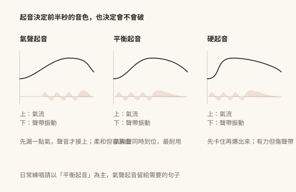
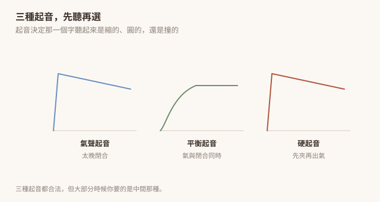
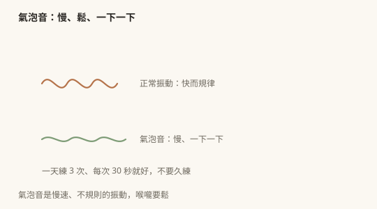

# [歌唱教學] 進階 第 17 章：氣息的微操技術：起音 (Onset) 與收尾 (Release) 的精準控制

## 先講結論

一句歌好不好聽，決定權常在頭尾那兩個瞬間，不是中間的最高音。

開頭太慢，聽起來拖；太快，聽起來硬。結尾太突然，情緒就斷在那裡。

這一章要你能分辨三種起音、三種收尾，然後照歌詞的需要挑一種。你不需要每次都做對，你只需要知道自己在做哪一種。

## 常見誤解

很多人以為唱歌就是嘴巴張開直接出聲。結果一種是先漏一堆氣才出聲，聽起來慢半拍；另一種是喉嚨先「喀」一下才擠出聲音，聽起來很硬。兩者都不是「直接」，都是時間沒對上。

另一個誤解是「一句唱完，嘴巴閉上就好」。收尾隨便，前面鋪的情緒會在最後半秒斷掉。收得好，聽的人情緒會停在半空中；收得差，像被人按了暫停。

還有人以為乾淨的起音就是用力。乾淨是時間對齊：氣到的時候，聲帶剛好靠攏。多一分力，就變成硬起音，那不是乾淨，是撞擊。

## 原理：為什麼會這樣

聲音的開始，取決於兩件事的時間差：氣流什麼時候到，聲帶什麼時候靠攏。

氣先到、聲帶晚一點靠攏，就是軟起音。前面會有一段純氣音，聽起來柔、帶嘆息。聲帶先閉緊、氣再把它衝開，就是硬起音。開頭會有一個小小的爆破點，聽起來俐落、有攻擊性。兩件事同時發生，就是同步起音：不漏氣、不爆破，最省力。

收尾是把順序反過來。氣先停、聲帶還閉著，聲音會被「切」斷。聲帶先鬆、氣還在流，聲音就慢慢化成氣音消失，這是漸弱收尾。收尾時氣流變少，支撐反而要更穩，不然音高會掉、聲音會抖。

為什麼硬的起音特別傷？因為撞擊能量集中在那一瞬間。聲帶靠攏得越緊、氣衝開得越猛，那一下的撞擊越大。這也是為什麼半閉口練習能讓起音變容易：口腔後方增加阻力，聲帶可以在較低的壓力下振動（Titze, 2006）。

還有兩個相關的機制值得知道。氣泡音是低張力、低氣壓下的振動，聲帶閉合很鬆（Elias et al., 2016）。所以它常被拿來「重設」一個太緊的起音：先用最鬆的狀態震起來，再往上加。另外，真音與假音之間是同一條聲帶的兩種閉合狀態（Titze et al., 2014），所以收尾如果收到換聲區，你會感覺閉合「跳」了一下，那就是狀態交接，不是失誤。

三種起音沒有哪一種正確。硬起音在重拍很好用，但連續用會讓聲帶一直受撞。軟起音適合柔的段落，但漏氣多，後面的句子容易沒氣。同步起音最中性，是平常的預設值。

## 打個比方

**推門。** 門是聲帶，推力是氣。先推再開門，門會被撞開，還可能反彈，那是硬起音。門沒關好就推，你的推力全散在門縫裡，那是軟起音。把手放上去、門同時開，那才是同步起音。三種都是開門，差在順序。

**接水。** 你要把杯子裝滿，會先把杯子放好再開水；不會先開水，再把杯子湊過去，那樣一定濺出來。軟起音就是先開水：氣先流了一段，杯子（聲帶）才到。

**停紅燈。** 好司機是慢慢踩煞車，車子滑到線前剛好停。爛司機是到線前才踩死，乘客往前衝一下。漸弱收尾是前者：氣慢慢減，聲音滑到沒有；突然閉嘴是後者，情緒被甩出去。

## 現在就做

### 練習一：聽三種起音

1. 吸氣後先憋住一下，再用力「啊！」，聽開頭那個爆破點。做五次。
2. 吸氣後先吐「哈——」，再把聲音融進去變成「哈—啊」。做五次。
3. 吸氣後直接「啊——」，不爆破也不漏氣。做十次。

感覺：第三種最省力，像「氣一出來就有聲音」，中間沒有空隙。
做錯會怎樣：如果三種聽起來都一樣，代表你沒有真的控制時間差。先放慢，把「先氣」「先閉」「同時」分開練，再加快。

### 練習二：只練同步起音

1. 手放下腹，吸氣。
2. 出聲的瞬間，感覺氣和聲帶是「一起」啟動的。
3. 檢查開頭：有「哈」聲是氣太早，有「喀」聲是聲帶關太早。
4. 一次只調一個方向，做十次。對了就停，不要練到累。

做錯會怎樣：如果調了十次還是抓不到，通常是你把注意力放在喉嚨。改成注意「氣從肚子出來」的那一刻，聲帶會自己跟上。如果越練喉嚨越緊，先休息，你的力氣用錯地方了。

### 練習三：先鬆再起

1. 嘆一口氣，讓聲帶發出低沉的氣泡音，像摩托車怠速。
2. 維持氣泡音兩秒，感覺喉嚨完全沒有用力。
3. 不要停，讓氣泡音直接融成一個「啊」，音高只往上跳一點。
4. 做五次，每次都從最鬆開始。

做錯會怎樣：如果氣泡音出不來，是氣太強或喉嚨太緊。把氣減到像嘆氣。如果融成「啊」的瞬間聲音變硬、變大，是舊習慣回來，退回只做氣泡音。

### 練習四：漸弱收尾

1. 用同步起音唱一個中音的「嗚」，維持三秒。
2. 準備結束時，讓聲帶慢慢鬆開，聲音開始混進氣。
3. 側腰的支撐留住，不要讓氣一次洩光。
4. 讓「嗚」變成氣音，最後完全消失。做五次。

做錯會怎樣：如果變弱時音高往下掉，是支撐跟音量一起放掉了。支撐不變，只減少氣。如果抖得很厲害，是氣放得太多太快，把出口收小一點。

### 練習五：套進一句歌詞

1. 挑一句抒情歌的副歌第一句。
2. 第一次：開頭帶一點嘆息（軟起音），結尾漸弱成氣音。
3. 第二次：開頭乾淨（同步起音），結尾果斷停住。
4. 第三次：開頭一個小小的重音（硬起音），結尾漸弱。

做錯會怎樣：如果三種聽起來情緒差不多，是差別太小。把特徵放大一點再練，熟了再收斂回去。

## 練完之後

做對的徵兆：你能聽出自己每一次的開頭是軟、硬還是同步；句尾想收就收、想飄就飄；同一句歌詞換一種起收，聽起來像換了一種心情。

常見卡點是「習慣只用一種」。有人每句都軟起音，整首聽起來含糊；有人每句都硬，聽起來像在吵架。平常練同步，需要表情時再換。

另一個卡點是「為了乾淨而用力」。乾淨是時間對齊，不是力氣大。用力只會讓起音變硬、聲帶更累。

下一章要處理強弱之間的瞬間切換：怎麼從大聲一瞬間收到很小，音還不掉。

## 延伸查證

- **Titze, I. R., et al. (2014).** Bi-stable vocal fold adduction: a mechanism of modal–falsetto register shifts and mixed registration. *Journal of the Acoustical Society of America.* 真音與假音是同一條聲帶的兩種閉合狀態，收尾經過換聲區時會出現狀態交接。PMID 25235006。
- **Elias, V. S., Cielo, C. A., & Jotz, G. P. (2016).** Effect of Vocal Fry on Voice and on Velopharyngeal Sphincter. *International Archives of Otorhinolaryngology.* 氣泡音是低張力、低氣壓下的振動，常用來重設過緊的起音。PMID 27096021。
- **Titze, I. R. (2006).** Voice training and therapy with a semi-occluded vocal tract: rationale and scientific underpinnings. *Journal of Speech, Language, and Hearing Research, 49*(2), 448–459. 口腔後方增加阻力後，聲帶可以在較低的壓力下起振，起音因此變容易。PMID 16671856。
