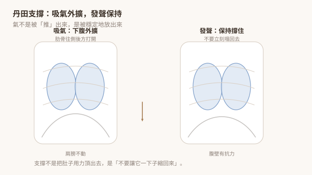

# [歌唱教學] 進階 第 18 章：進階丹田支撐：強弱對比下的核心抗力訓練

## 先講結論

小聲唱歌，比大聲更難。大聲時，氣大量往外流，你順著它就好；小聲時，你想把氣留住，但肺裡的氣一直想衝出來，你必須一直跟它對抗。

這一章要練的是「瞬間變小，音高不掉、聲音不抖」。做得到，歌裡那些大爆發之後的脆弱呢喃，你才唱得出來。

## 常見誤解

很多人以為「小聲就是放鬆」，所以副歌一結束，全身力氣跟著放掉。結果聲音變小的同時，音準也跟著掉，聲音開始抖。

另一個誤解是「用喉嚨把聲音關小」。把聲帶夾緊，聲音不會變小，反而會更緊、更刺，而且喉嚨會累。該做的是減少氣流，不是夾住喉嚨。

還有人以為「小聲就不用支撐」。剛好相反。聲音愈小，氣流總量愈少，但對流速的控制要愈精細，支撐一樣要穩，否則氣一下就跑光，句子撐不到尾。

## 原理：為什麼會這樣

音量由兩個東西決定：氣流的大小，和聲帶靠得多緊。要大聲，可以多給氣；要小聲，就要少給氣。

麻煩在於，肺像一個有彈性的氣球。吸得愈滿，它想回彈的力量愈大。你唱得很大聲時，氣本來就要出去，這股回彈幫了你；你唱得很小時，氣不該出去那麼多，你卻得一直拉住它。這就是為什麼小聲反而更費力。

所以弱音的控制點不在喉嚨，在腹部與側腰。橫膈膜放鬆上升，腹部肌肉要拉住它，讓它慢慢升。喉嚨仍然放鬆，只讓比較少的氣流通過。聲帶的閉合大致維持，音量靠減少氣流與聲門下壓來降；如果你想刻意做一點氣聲，再讓閉合稍微鬆開，那才是弱音聽起來「氣」的來源。

注意：對抗的是「氣流的速度」，不是「氣流的有無」。完全憋住就沒有聲音了。這條線要抓在中間。

## 現在就做

### 練習一：噝音的瞬間強弱

1. 吸一口氣，雙手插腰。
2. 發連續的「噝——」，先大聲兩拍。
3. 第三拍瞬間收小，但讓「噝」不要斷。
4. 一小節做「大、大、小、小」的組合，重複十次。

做錯會怎樣：如果變小的瞬間「噝」整個斷掉，是氣關死了。如果變小後側腰立刻軟掉，是支撐放掉了。你的側腰在變小的那幾拍應該更痠，不是更鬆。

### 練習二：跳水式弱音

1. 選一個唱得舒服的中高音。
2. 用結實的聲音唱「啊」，維持兩秒。
3. 第三秒瞬間收到很小，喉嚨放鬆，支撐加倍。
4. 讓弱的「啊」穩穩浮五秒，不抖、不走音。

做錯會怎樣：如果音高跟著往下掉，是想著「變小」而忘了「維持高度」。想像聲音是往上飄的，支撐往下沉。如果聲音抖，是氣漏太多，把出口再收小一點。

### 練習三：弱音起音

1. 不從大聲收小，改成直接從極小開始。
2. 用嘆氣的方式，讓聲音從幾乎聽不見的地方慢慢出現。
3. 維持三秒，再慢慢放掉。
4. 做五次，確認每一次的音高都一樣。

做錯會怎樣：如果每次音高都不同，是你在猜。先用琴或 App 給一個參考音，跟著唱。弱音最容易走音，因為氣太少，聲帶的振動不穩。

### 練習四：接回歌裡

1. 挑一段「前一句很用力、下一句突然變小」的歌詞。
2. 唱完大聲那句，在換氣點只吸一點點氣。
3. 把核心瞬間定住，不要讓氣一次洩掉。
4. 唱小聲那句，把注意力放在「托住」而不是「變小」。

做錯會怎樣：如果小聲那句聽起來像放棄，是情緒也跟著放掉了。弱音不是沒情緒，是情緒收在裡面。如果換氣點忍不住吸一大口，氣會太多，小聲更難控制。

### 練習五：錄音對照

1. 把練習四的兩句錄下來。
2. 聽大聲那句，再聽小聲那句。
3. 檢查小聲那句的音準是否和大聲那句在同一個高度。
4. 如果不準，先不要練整首歌，回到練習二。

做錯會怎樣：如果你只憑當下的感覺判斷，會低估走音的程度。弱音的走音，自己聽不太出來，錄音才聽得見。

## 練完之後

做對的徵兆：從大聲切到小聲，音高不掉；小聲能維持五秒以上不抖；唱完之後痠的是側腰，不是喉嚨。

常見卡點是「一變小就變虛」。聲音小和聲音虛不一樣。小是氣少、支撐穩；虛是支撐沒了、聲音散掉。如果聽起來虛，先檢查支撐，不是再用力。

另一個卡點是「弱音當成特效」。整首都用氣音唱，聽起來沒有重點，而且很耗氣。弱音要留給需要的地方，它靠對比才有力量。

下一個要處理的是聲帶本身：為什麼有人唱高音會破，有人卻很順。這要從兩組肌肉講起。
