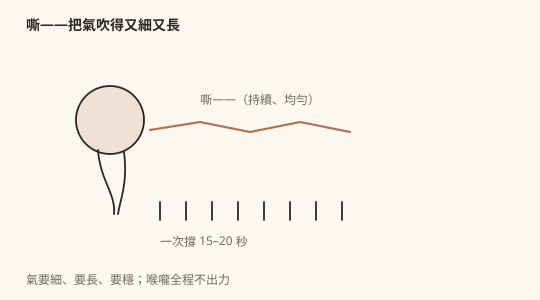
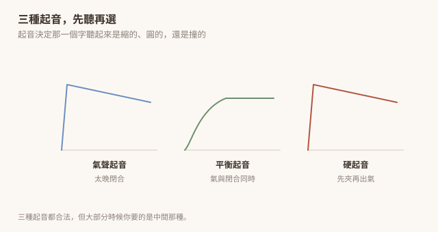

# [歌唱教學] 進階 第 18 章：進階丹田支撐：強弱對比下的核心抗力訓練

## 先講結論

小聲唱歌比大聲難。大聲時，氣本來就要出去，你順著它就好；小聲時，肺裡的氣一直想衝出來，你得一路拉住它。

這一章練的是「一瞬間變小，音高不掉、聲音不抖」。做得到，歌裡那些爆發之後的脆弱呢喃，你才唱得出來。

練完的判準很簡單：從大聲收到小聲，痠的地方從喉嚨換成側腰。

## 常見誤解

很多人以為小聲就是放鬆，所以副歌一結束，全身力氣跟著放掉。結果音準也跟著掉，聲音開始抖。小聲要用的力氣不是更少，是更細。

另一個誤解是用喉嚨把聲音關小。把聲帶夾緊，聲音不會變小，只會變緊、變刺。該做的是減少氣流，不是夾住出口。

還有人以為小聲就不需要支撐。剛好相反：氣流總量變少，誤差佔的比例就變大，控制要更精細。支撐一鬆，氣一下就跑光，句子撐不到尾。

## 原理：為什麼會這樣

音量由幾個東西一起決定：氣流量、聲門下壓力、聲帶閉合的程度，還有聲道共振的調整。要大聲，通常是多給氣、提高聲門下壓力；要小聲，是少給氣、降低壓力，但閉合不能一起鬆掉，否則聲音會散。

麻煩在於肺是一個有彈性的氣球。吸得越滿，它想回彈的力量越大。唱大聲時，這股回彈幫了你；唱小聲時，氣不該出去那麼多，你卻得一直拉住它。這就是為什麼小聲反而更費力，而且吸太滿會讓小聲更難做。

所以弱音的控制點不在喉嚨，在腹部與側腰。橫膈膜放鬆上升，腹部的肌肉拉住它，讓它慢慢升。喉嚨保持鬆，只讓比較少的氣流通過。閉合大致維持，音量靠減少氣流與降低壓力來降。如果你想刻意做一點氣聲，再讓閉合鬆一點，那才是弱音聽起來「有氣」的來源。

要注意的是：對抗的是氣流的速度，不是氣流的有無。完全憋住就沒有聲音了。這條線要抓在中間。

大聲的那一端也一樣有細節：音量增加時，聲道的共振調整會跟著改變，而且是量得出來的動作（Vurma, 2022）。也就是說，「更大聲」不是只有氣多，是整套設定一起動。而支撐的執行方式因人而異，不同歌手用不同的軀幹策略達到同樣的投射（Thorpe, 2001），骨盆底與深層腹肌也在其中參與（Emerich Gordon & Reed, 2020）。你不必模仿別人的肚子，只要抓到「氣流穩、出口鬆」這個結果。

## 打個比方

**下坡騎車。** 吸滿氣的肺就是一開始的下坡，車子自己會衝。你要做的是含著煞車，讓它慢慢滑，而不是讓它衝到底再撞牆。煞車不是停車：完全按死，車就不動了，聲音也沒了。

**倒醬油。** 大口倒，一下就是半碗，收不回來。師傅會用刀背擋住瓶口，讓它一滴一滴。你的側腰就是那片刀背：醬油（氣）還在流，但流量由你決定。手一放開，整瓶就出去了。

**端著滿水的水杯走路。** 水越滿越難端，因為它會晃。你的手不能抖，杯子也不能捏扁。捏扁杯子等於夾喉嚨：杯子變形，水反而灑出來。端水的人靠的是穩定，不是握力。

## 現在就做

### 練習一：噝音的瞬間強弱

1. 吸一口氣，雙手插腰。
2. 發連續的「噝——」，先大聲兩拍。
3. 第三拍瞬間收小，但讓「噝」不要斷。
4. 一小節做「大、大、小、小」，重複十次。

感覺：變小的那兩拍，側腰反而更痠。
做錯會怎樣：如果變小的瞬間「噝」整個斷掉，是氣關死了。如果變小後側腰立刻軟掉，是支撐放掉了。

### 練習二：跳水式弱音

1. 選一個唱得舒服的中高音。
2. 用結實的聲音唱「啊」，維持兩秒。
3. 第三秒瞬間收到很小，喉嚨放鬆，支撐加倍。
4. 讓弱的「啊」穩穩浮五秒，不抖、不走音。

感覺：收小的那一刻，像聲音往上飄、支撐往下沉。
做錯會怎樣：如果音高跟著往下掉，是你只想著「變小」而忘了「維持高度」。如果聲音抖，是氣漏太多，把出口再收小一點。

### 練習三：直接從極小開始

1. 不從大聲收小，改成直接從幾乎聽不見開始。
2. 用嘆氣的方式，讓聲音慢慢出現。
3. 維持三秒，再慢慢放掉。
4. 做五次，確認每一次的音高都一樣。

做錯會怎樣：如果每次音高都不同，是你在猜。先用琴或 App 給一個參考音再唱。弱音最容易走音，因為氣流小，振動的穩定度低，自己聽不太出來。

### 練習四：接回歌裡

1. 挑一段「前一句很用力、下一句突然變小」的歌詞。
2. 唱完大聲那句，在換氣點只吸一點點氣，不要吸滿。
3. 核心瞬間定住，不要讓氣一次洩掉。
4. 唱小聲那句，注意力放在「托住」，不是「變小」。

做錯會怎樣：如果小聲那句聽起來像放棄，是情緒也跟著放掉了。弱音不是沒情緒，是收在裡面。如果換氣時忍不住吸一大口，氣會太多，小聲更難控制。

### 練習五：錄音對照

1. 把練習四的兩句錄下來。
2. 先聽大聲那句，再聽小聲那句。
3. 檢查小聲那句的音準有沒有停在同一高度。
4. 不準的話先不要練整首，回到練習二。

做錯會怎樣：只憑當下的感覺判斷，你會低估走音的程度。弱音的走音，錄音才聽得見。

## 練完之後

做對的徵兆：從大聲切到小聲，音高不掉；小聲能維持五秒以上不抖；唱完痠的是側腰，不是喉嚨。

常見卡點是「一變小就變虛」。小和虛不一樣：小是氣少、支撐穩；虛是支撐沒了、聲音散掉。聽起來虛，先檢查支撐，不是再加力氣。

另一個卡點是「把弱音當特效」。整首用氣音唱，聽起來沒重點，而且很耗氣。弱音要靠對比才有力量。

下一章要處理聲帶本身：為什麼有人唱高音會破，有人卻很順。這要從兩組肌肉講起。

## 延伸查證

- **Emerich Gordon, K., & Reed, O. (2020).** The Role of the Pelvic Floor in Respiration: A Multidisciplinary Literature Review. *Journal of Voice.* 骨盆底與深層腹肌參與呼吸時的穩定，是「丹田」的解剖對應。PMID 30447797。
- **Thorpe, C. W., Cala, S. J., & Chapman, J. (2001).** Patterns of breath support in projection of the singing voice. *Journal of Voice.* 支撐不是單一動作，不同歌手用不同軀幹策略達到同樣結果。PMID 12269638。
- **Vurma, A. (2022).** Amplitude Effects of Vocal Tract Resonance Adjustments When Singing Louder. *Journal of Voice.* 音量變化時，聲道共鳴的調整是可量測的動作，不只是一個「感覺」。PMID 32624371。
