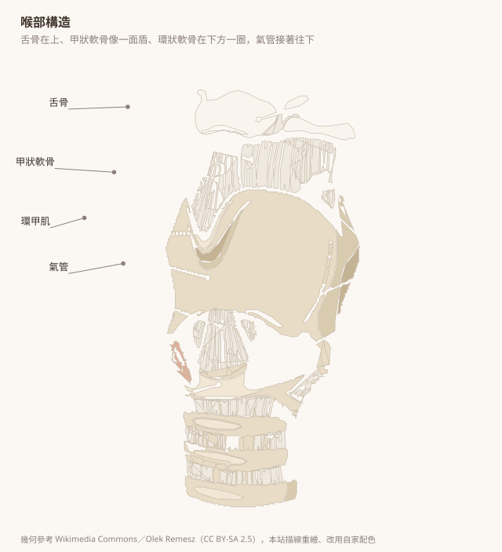
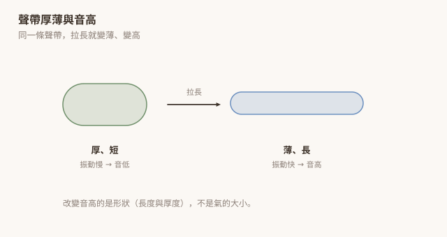
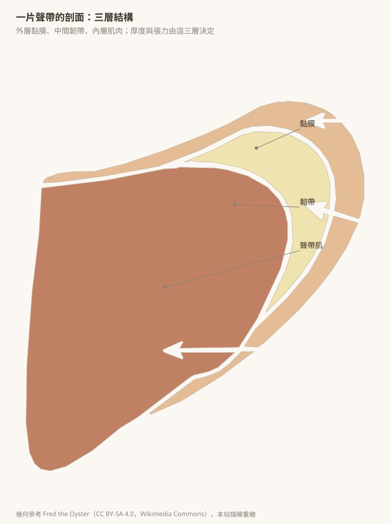

# [歌唱教學] 進階 第 19 章：聲帶解剖學：甲杓肌 (TA) 與環甲肌 (CT) 的連動機制

## 先講結論

音高不是靠用力決定的，是靠兩組肌肉把聲帶拉成什麼形狀。

甲杓肌（TA）讓聲帶變厚、變短，音往低走。環甲肌（CT）把聲帶拉長、拉薄，音往高走。

唱高音會破、會卡，通常是這兩組在互相拉扯。這一章要你認出這兩種感覺，然後練到它們能交接，而不是打架。

## 常見誤解

很多人以為唱高音就是把氣更用力推上去。氣推得再猛，聲帶如果還是厚厚一片，頻率就是上不去，只會變成嘶吼。音高看的是聲帶的長度、張力與質量，不是氣壓。

另一個誤解是低音要壓。低音不是壓出來的，是聲帶變厚變短、振動變慢的結果。壓喉嚨只會讓通道變窄，聲音變悶，而且隔天會痛。

還有人把兩組肌肉記反。記法很簡單：甲杓肌長在聲帶裡面，收縮時把聲帶變厚變短，往「厚、低」走；環甲肌在聲帶外側，收縮時把甲狀軟骨往前下方拉，讓聲帶變長變薄，往「薄、高」走。方向記反，整章的練習都會做錯。

## 原理：為什麼會這樣

先認位置。甲狀軟骨是你摸得到的那塊「喉結」，環狀軟骨在它下面一圈；環甲肌就長在兩者之間，收縮時把甲狀軟骨往下拉，聲帶因此被拉長。甲杓肌則在聲帶內部，往前接在甲狀軟骨上。

聲帶是兩片長在喉部中間的組織，裡面本身就有肌肉。甲杓肌（thyroarytenoid，簡稱 TA）是聲帶的主體。它收縮時，聲帶變厚、變短、張力下降，振動頻率變低，聲音往低、往厚走。你平常說話、喊人，主要是它在工作。

聲帶不是一條橡皮筋，是三層：外層黏膜會像波浪一樣抖動（你聽到的「聲音」其實主要是這一層在動）、中間的韌帶提供張力、內層的肌肉決定厚薄。這也是為什麼「放鬆」和「支撐」可以同時成立——放掉的是外面的力氣，留下的是裡面那一層的張力。

環甲肌（cricothyroid，簡稱 CT）位在聲帶外側的軟骨上。它收縮時把甲狀軟骨往前下方拉，聲帶被拉長、拉薄、張力上升，振動頻率變高，聲音往高、往薄走。

兩者不是開關，是比例。同一個音高可以由不同的厚薄組合做出來，所以同一個音，可以唱得厚，也可以唱得薄。研究比較胸聲、混聲、假聲三種登記，在聲學與氣動參數上確實可以區分，但界線是連續的（Lee et al., 2023）。這正好說明：你面對的不是三個格子，是一條光譜。

音高往上時，理想狀況是甲杓肌慢慢退場、環甲肌慢慢接手，兩邊平滑交換。沒訓練的人一遇到高音就緊張，甲杓肌反而抓得更緊，環甲肌又同時在拉，兩邊對抗，聲帶就卡住。

卡住的結果有兩種。甲杓肌贏，你帶著很厚的聲帶硬上高音，脖子爆青筋，聲音像在吼，聲帶承受很大的撞擊。環甲肌拉到極限、甲杓肌突然撐不住，振動狀態一瞬間改變，聲音就「喀」一聲破掉。破音不是聲帶壞了，是交接失敗。而這種交接之所以會「跳」，是因為聲帶的閉合狀態本來就有兩種穩定解（Titze et al., 2014）。

還有一件事要說清楚：這裡講的是肌肉的「相對參與」，不是百分比開關。聲帶振動遠比這複雜。你要抓的是「厚一點」「薄一點」的感覺，不是數字。

最後一個提醒：音高與音量是兩件事，但身體常把它們綁在一起。越大聲、越高音，頸部與肩部的肌肉活動越容易增加（Pettersen et al., 2005）。所以練高音時脖子變粗，不是「很努力」，是代償。

## 打個比方

**橡皮筋。** 同一條橡皮筋，放鬆時又粗又軟，撥一下聲音低；拉長之後變細變緊，撥一下聲音高。聲帶就是這樣：拉長拉薄（CT）頻率上升，放鬆變厚（TA）頻率下降。橡皮筋不會變成兩條，聲帶也不會。

**接力賽的交接棒。** 跑者在接力區必須速度相近，棒才交得順。前一棒（TA）跑太慢、後一棒（CT）已經起跑，棒就掉在地上，那就是破音。你練滑音，練的其實是那十公尺的交接區。

**手煞車沒放就踩油門。** 很多人的高音是這樣唱出來的：油門（氣）踩到底，手煞車（TA 的張力）卻還拉著。車子會動，但引擎聲很大、速度上不去，久了還會壞。你要做的是先放手煞車，再加油。

## 現在就做

### 練習一：先找到厚的那一端

1. 放鬆下巴，選一個很低的音。
2. 發出一個笨重的「葛」，像巨人在說話。
3. 手放胸口，感覺聲音厚、有重量、不飄。
4. 做五次，每次一秒，不要壓喉嚨。

感覺：厚，但喉嚨是開的；胸口有震動。
做錯會怎樣：如果「葛」變成喉嚨裡的摩擦聲，是壓得太低。往上退一個音，找到「厚但鬆」的位置。如果聲音還是很薄，是音高太高，再往下找。

### 練習二：再找到薄的那一端

1. 嘴唇嘟起來，用偏高的音發出很輕的「嗚」。
2. 音量小，帶一點氣，像貓頭鷹在叫。
3. 手放胸口，這次胸口幾乎不震動。
4. 做五次，每次兩秒。

做錯會怎樣：如果一出聲就變厚、變大，是甲杓肌跟上了。音量減半，先只求輕。如果聲音尖銳，是喉嚨夾住，回到只吐氣，再加一點點聲音。

### 練習三：讓它們交接

1. 用剛才「葛」的厚感覺，在低音唱「呢」，聲音扁扁亮亮的。
2. 不要斷氣，像警報器一樣慢慢往上滑。
3. 往上時告訴自己「變薄、放掉重量，但保持亮度」。
4. 到高處再滑回來，感受厚薄交換。

感覺：滑過某個音高時會有一點「換檔」的感覺，但不要停。
做錯會怎樣：如果中間「喀」一聲斷掉，是甲杓肌不肯放。不要加速衝過去，停在斷掉的那個音高，用很小的氣反覆滑，讓它習慣變薄。如果整段都厚厚的上不去，是滑得不夠高。

### 練習四：在同一個音上換厚薄

1. 選一個你平常最容易破的中高音。
2. 先用「嗚」唱，薄、輕。
3. 不斷氣、不改音高，慢慢變成「呢」，讓聲音變厚。
4. 再退回「嗚」。來回五次。

做錯會怎樣：如果一變厚音高就掉，是你用甲杓肌把音壓低，不是加厚度。先把音高定住，只改音色。如果一變薄就虛，是氣漏太多，把氣收小一點。

## 練完之後

做對的徵兆：你能在同一個中高音上做出明顯的厚薄變化而音高不變；滑音經過換聲區時斷層變小；唱高音時脖子沒有變粗。

常見卡點是「怕破音，所以滑到一半就停」。停在斷層下方，永遠練不到交接。正確做法是停在斷層上方，用很小的氣慢慢磨。

另一個卡點是「用喉嚨代替肌肉」。你沒辦法直接叫甲杓肌或環甲肌收縮，它們是反射性的。你能做的是改音高、改音色、放鬆喉嚨，讓它們自己協調。

下一章要處理閉合：聲帶靠得多緊，決定聲音是漏氣還是擠壓。

## 延伸查證

- **Titze, I. R., et al. (2014).** Bi-stable vocal fold adduction: a mechanism of modal–falsetto register shifts and mixed registration. *Journal of the Acoustical Society of America.* 聲帶的閉合有兩種穩定狀態，換聲區是兩種狀態交接的地方。PMID 25235006。
- **Lee, Y., Oya, M., & Kaburagi, T. (2023).** Differences Among Mixed, Chest, and Falsetto Registers: A Multiparametric Study. *Journal of Voice.* 胸聲、混聲、假聲在聲學與氣動參數上可以區分，但界線是連續的。PMID 33518476。
- **Pettersen, V., Bjørkøy, K., & Torp, H. (2005).** Neck and shoulder muscle activity and thorax movement in singing and speaking tasks with variation in vocal loudness and pitch. *Journal of Voice.* 越大聲、越高音，頸肩的肌肉活動越容易增加，那是代償。PMID 16301107。
