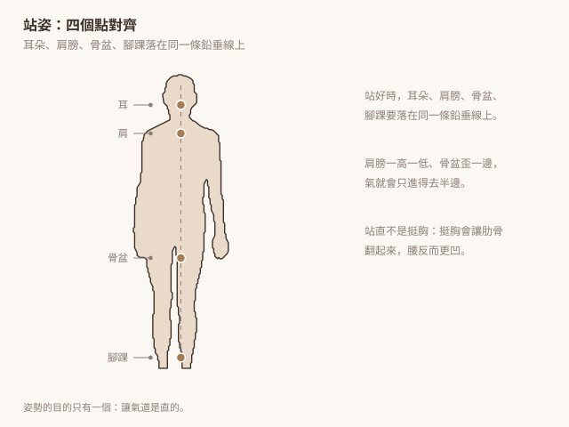
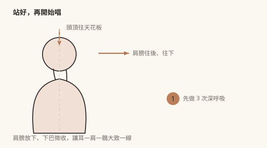
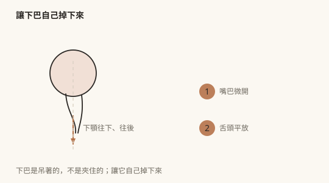
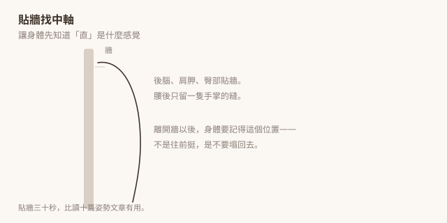

# [歌唱教學] 初階 第 2 章：身體的覺察：解開肩頸與下巴的緊繃鎖鏈

## 先講結論

唱高音時，你最常做錯的兩個動作是聳肩和伸下巴。這兩個動作會從外面壓縮喉嚨，讓聲帶被夾住，聲音變扁、變緊，久了還會痛。

這一章不談「放鬆的感覺」，談的是用骨骼排列取代肌肉硬撐：頭在肩膀正上方，肩膀下沉，下巴不往前頂。排好了，力氣自然省下來。

練完你會有一個隨時可以回去的姿勢，也會知道自己一緊張是哪裡先出賣你。

## 常見誤解

很多人以為唱高音要「伸長脖子去勾那顆音」。其實伸長的是下巴，縮短的是喉嚨後方的空間。喉位被往上拉，聲道被壓縮，喉部附近的肌肉也跟著緊；外面張力越大，聲帶越難平順地調整，音反而更難上去。

你可能也聽過「唱歌要站得很挺」。挺不等於僵。把腰挺死、肩膀往後鎖緊，肋骨卡住，橫膈膜就降不下來，氣吸不深。另一邊也要小心：每個人的平衡策略不一樣，研究量測抒情歌手的姿勢控制，發現大家維持穩定的方式並不相同（Peultier-Celli et al., 2022）。所以不要硬套一個「標準體態」，要找你自己站得住、又能呼吸的那個版本。

## 原理：為什麼會這樣

身體很會代償。某塊肌肉不夠力，它就叫旁邊的肌肉來幫忙。唱歌時最常見的三種：

第一種是聳肩。氣不夠、或急著唱大聲，肩膀上提，脖子兩側的肌肉縮短，直接把喉部周圍夾緊，聲音聽起來像困在喉嚨裡。這種代償不是想像，量測上看得出來：音量與音高上升時，頸肩肌肉的活動會跟著增加（Pettersen et al., 2005）。

第二種是下巴往前伸。很多人主觀覺得高音在「前面」，於是伸長脖子去夠。結果下巴離開中軸線，喉結被拉高，通道被折彎。

第三種是牙關咬死。很多人為了咬字清楚，把咀嚼肌繃住。下巴是通往口腔的門，門關著，聲音進不了口腔，只能擠在喉嚨裡，聽起來扁、變緊。順便澄清一個常見混淆：真正的鼻音是軟顎放下、氣流跑進鼻腔造成的，跟咬緊下巴無關。

這三件事有共同點：它們都是「從外面干預裡面」。喉頭本來就會自己調整，外面越用力，裡面越沒辦法做事。

## 打個比方

**用腳尖踩油門。** 座位太遠，你用腳尖去點油門，車會動，但腳踝很痠、力道也不穩。伸下巴唱高音就是這個動作：你以為在補足距離，其實是讓整條腿歪掉。

**四輪定位。** 方向盤一直偏，不是方向盤壞了，是四個輪子沒對齊。耳、肩、髖、踝疊在一起，就是你的定位；定位準了，唱高音時不用一直「修」。

**被折彎的水管。** 肩膀提起來，等於用手把水管折一個角。你沒有把水關掉，但水過不去。手放開，水自己會走。

比喻失真的地方是：身體會記住習慣。所以「手放開」不是一次就好，要用正確的排列反覆覆蓋舊習慣，通常要幾週。

## 現在就做

### 練習一：肩膀重置

1. 站直，雙腳與肩同寬。
2. 吸氣，兩肩聳到耳朵旁，停三秒，感覺脖子兩側被擠住的痠。
3. 吐氣，肩膀一次放掉，讓手臂自然垂下。
4. 閉眼重複五次。

感覺：每次放掉時，肩胛骨往下滑，胸口變寬。做錯會怎樣：如果放掉後肩膀還半提著，先甩手十下、轉轉脖子，再重來。吐氣要比吸氣長。

### 練習二：下巴融化

1. 食指和中指放在耳朵下方、下巴兩側，找到咬緊牙關時會鼓起來的那塊肌肉。
2. 用指腹輕輕畫圈按摩一分鐘，不要壓到痛。
3. 手放下，想像打瞌睡，下巴沒有力氣，嘴唇微開。
4. 在這個狀態發「哈——」，維持五秒，做三次。

感覺：聲音比平常寬，喉嚨沒有卡。做錯會怎樣：如果下巴掉下來之後聲音反而變悶，通常是舌根跟著往後縮了。舌尖輕碰上門牙後面，讓舌頭留在前面。

### 練習三：貼牆找中軸

1. 背對牆站，讓後腦勺、兩片肩胛骨、臀部、腳跟四個點輕碰牆面。
2. 膝蓋微彎，腰和牆之間留一個手掌的厚度。
3. 下巴微收，視線平視，不要抬頭。
4. 閉眼，用鼻子慢慢呼吸五次。

感覺：後腦勺一直貼著牆，肩膀不會往上滑。做錯會怎樣：如果呼吸時後腦勺離開牆，代表你吸氣時頭往後仰；如果肩膀摩擦牆面往上，代表你又在聳肩。停下來，重新排好四個點。

### 練習四：帶著新姿勢發聲

1. 離開牆，維持剛才頭在肩膀正上方的位置。
2. 下巴保持微鬆，吸氣時肩膀不動。
3. 發「哈——」八秒，做三次。
4. 過程中檢查：下巴有沒有往前？肩膀有沒有提？

感覺：氣流順，喉嚨不癢。做錯會怎樣：如果唱到一半姿勢跑掉，不要硬撐完，停下來重新排好再唱。短而正確，比長而變形有用。

## 練完之後

做對的徵兆：照鏡子時，你唱高音和唱低音的下巴高度差不多；唱完脖子不會痠；吸氣時肩膀不上提。

常見卡點是「一唱就忘」。練習時你會放鬆，一拿到歌又全部回來。解法是把練習縮短：每次唱歌前只做肩膀重置和貼牆三十秒，讓身體在正確位置啟動。

另一個卡點是把「站好」做成「站死」。膝蓋鎖死、肋骨撐開，氣一樣吸不深。支撐的軀幹策略本來就因人而異，寧可留彈性，不要把自己綁住（Thorpe et al., 2001）。

下一章要處理支撐。只放鬆不夠，聲音會虛；你要讓下腹接手出力，喉嚨才能繼續鬆。

## 延伸查證

- **Pettersen, V., Bjørkøy, K., & Torp, H. (2005).** Neck and shoulder muscle activity and thorax movement in singing and speaking tasks with variation in vocal loudness and pitch. *Journal of Voice.* 越大聲、越高音，頸肩的肌肉活動越容易跟著上來；這是「聳肩代償」最直接的量測證據。PMID 16301107。
- **Peultier-Celli, L., Audouin, M., & Beyaert, C. (2022).** Postural Control in Lyric Singers. *Journal of Voice.* 抒情歌手的姿勢控制策略，說明站得穩不是靠單一標準體態，而是各自找到平衡的方式。PMID 32456837。
- **Thorpe, C. W., Cala, S. J., & Chapman, J. (2001).** Patterns of breath support in projection of the singing voice. *Journal of Voice.* 不同歌手用不同的軀幹策略達到同樣的支撐效果，所以不必把自己鎖在一種姿勢裡。PMID 12269638。
