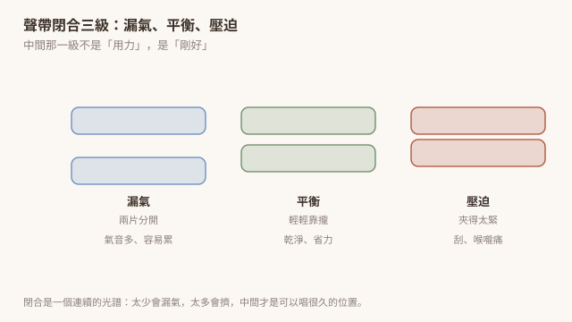

# [歌唱教學] 進階 第 20 章：聲帶閉合的黃金比例：解決漏氣與破音的針對性矯正

## 先講結論

聲音有兩種常見的毛病：一種是漏氣，唱一句氣就沒了，聲音虛；一種是擠壓，聲音尖、喉嚨乾。這兩個看起來相反，其實是同一件事的兩端：聲帶閉得太鬆或太緊。

這一章要你先聽出自己偏哪一邊，再用對的練習拉回來。

閉合沒有單一標準答案。它會跟著音高、音量、情緒一起調整，你要練的是「調得動」，不是「固定在某一格」。

## 常見誤解

很多人以為聲音要結實，就把聲帶用力捏緊。你捏不到聲帶，你捏到的是喉嚨外面的肌肉：下巴、舌根、脖子。結果聲音變緊、變扁，聲帶本身並沒有閉得更好。

另一個誤解是漏氣就是氣不夠，多吸一點就好。漏氣是閉合效率的問題，不是氣量的問題。吸得再多，如果每次振動都漏掉一大半，句子還是很快見底。

還有人把「放鬆」和「鬆掉」搞混。該放鬆的是喉嚨外圍；聲帶本身的閉合需要適度的張力。兩件事要分開處理，不然你會越放越虛，或越收越緊。

## 原理：為什麼會這樣

聲帶振動時，兩片邊緣靠在一起，氣流把它們推開，它們再彈回來，如此反覆。閉合說的就是這兩片靠攏的程度。

靠得太鬆，中間留著大縫，氣大量漏掉，聲音裡氣的比例高、核心少，這就是漏氣。代價是效率：氣流量大，能唱的句子短，而且長期下來黏膜容易乾。

靠得太緊，氣流被擋住，要用更高的聲門下壓力才推得開，聲音變硬、變刺，喉嚨也容易累。撞擊能量集中在邊緣，久了會疲勞。所以擠壓不是「比較用力所以比較厲害」，是「用更多成本換同樣的音量」。

中間有一段最好用的區間：夠緊到能有效振動，又沒有緊到阻礙氣流。這段不是固定點。音高越高、音量越大，通常需要越多閉合；唱柔的、帶氣的段落，閉合可以少一點。研究也顯示不同登記在氣動參數上可以區分，但界線連續（Lee et al., 2023），所以你要練的是「滑動」，不是「切換」。

正確的閉合不是用力關門，是順著氣流靠近。氣流穩定，聲帶自然會找到可以振動的距離；氣流忽大忽小，閉合就跟著亂。這也是為什麼先練氣息，再練閉合。

還有兩個工具值得知道。半閉口練習（吸管、彈唇、哼鳴）會在口腔後方增加阻力，聲帶可以在較低的壓力下振動（Titze, 2006），對偏擠壓的人特別有用。而以吸管發聲做練習，研究觀察到聲道與聲門功能都會跟著改變（Guzman et al., 2013），所以它不是「感覺有效」，是有量測依據的。

## 打個比方

**兩扇對開的門。** 門縫太大，風一直灌進來，你冷，而且門片不會互相拍打發聲。門關太緊，你要用全身的力氣才推得開，鉸鏈很快壞。適中的狀況是：門片貼著，但一推就開。聲帶的閉合就是那個「貼著」。

**水龍頭的墊圈。** 墊圈老化，水一直滴，那是漏氣：水（氣）用掉了，卻沒出力。你把龍頭轉到死緊，短期不漏了，但墊圈被壓壞，下次更難關，那是擠壓。修法是換一個剛好貼合的墊圈，不是把力氣加大。

**握手。** 太輕，對方覺得你沒誠意，握不住；太用力，對方手會痛。剛好的握法是「有接觸、不發白」。你唱歌時聲帶的接觸就是這個力道，而且它會隨著對方（音高、音量）調整。

## 現在就做

### 練習一：掃描你的現況

1. 用「衣」這個母音，唱一個舒服的音高。
2. 從很小聲開始，慢慢加大。
3. 聽兩個地方：聲音裡氣的比例，還有喉嚨有沒有刮的感覺。
4. 氣很多、聲音鬆散，你偏漏氣；聲音刺、喉嚨緊，你偏擠壓。

做錯會怎樣：如果掃描時就開始用力，你測到的是「用力之後」的狀態，不是平常的狀態。用中等的音量，像說話。

### 練習二：漏氣的人，練短促閉合

1. 發出短促的「呃」，像講話中途停頓的那一下。
2. 一次四下：「呃、呃、呃、呃」，每個都要乾淨、沒有氣音。
3. 確認喉嚨沒有夾緊，只是聲帶很快靠攏。
4. 熟了之後，把這個乾淨的起音套進「衣」。

感覺：四下之間，氣是停住的，不是一直漏。
做錯會怎樣：如果「呃」變成喉嚨的摩擦聲，是用力過頭。把它做小、做輕。如果每個「呃」都還是漏氣，是氣給太多，先讓氣穩定再談閉合。

### 練習三：擠壓的人，練氣泡音與吸管

1. 放鬆，吐一點氣，讓聲帶發出低沉的氣泡音，像摩托車怠速。氣泡音是低張力、低氣壓下的振動（Elias et al., 2016）。
2. 氣泡不用大聲，能連續就好。
3. 在這個鬆的狀態裡，加入一點「嗚」，感覺震動很輕。
4. 有吸管的話，用吸管吹氣發聲一分鐘，音高隨便，越小聲越好。

做錯會怎樣：如果氣泡音出不來，是氣太強或喉嚨太緊，把氣減到像嘆氣。如果加了「嗚」就變大變緊，是舊習慣回來，退回只做氣泡音。

### 練習四：動態調整

1. 選一句柔的歌詞，刻意帶一點氣，閉合鬆一點。
2. 再唱一句需要力量的歌詞，閉合收緊，但不夾喉嚨。
3. 兩句交替唱三次，感受同一首歌裡的兩種閉合。
4. 錄下來，聽兩句的差別是不是你想做的差別。

做錯會怎樣：如果柔的那句變成完全沒聲音，是鬆過頭，不是溫柔。如果強的那句變刺，是緊過頭，回到氣流穩定再收閉合。

## 練完之後

做對的徵兆：一句唱完還覺得氣有餘裕，不必急著再吸；聲音有核心，但不刺；柔的段落能帶氣，強的段落不破。

常見卡點是「一種閉合唱到底」。整首用同一種閉合，聽起來會很平；遇到不適合的段落，不是漏氣就是擠壓。閉合要跟著句子走。

另一個卡點是「把氣音當成閉合不足」。氣音是刻意做出來的效果，閉合不足是不小心的漏氣。前者你隨時收得掉，後者收不掉，這就是差別。如果兩者你都分不出來，先錄音，再聽一次。

下一章要處理聲帶的厚薄：同一個音，怎麼唱得厚、又怎麼唱得薄。

## 延伸查證

- **Titze, I. R. (2006).** Voice training and therapy with a semi-occluded vocal tract: rationale and scientific underpinnings. *Journal of Speech, Language, and Hearing Research, 49*(2), 448–459. 口腔後方增加阻力後，聲帶可以用較低的壓力振動，對閉合過緊的人特別有用。PMID 16671856。
- **Guzman, M., Laukkanen, A. M., & Krupa, P. (2013).** Vocal tract and glottal function during and after vocal exercising with resonance tube and straw. *Journal of Voice.* 吸管與共鳴管發聲會改變聲道與聲門功能，是量測得到的。PMID 23683806。
- **Elias, V. S., Cielo, C. A., & Jotz, G. P. (2016).** Effect of Vocal Fry on Voice and on Velopharyngeal Sphincter. *International Archives of Otorhinolaryngology.* 氣泡音是低張力、低氣壓下的振動，可以當作放鬆閉合的練習。PMID 27096021。
- **Lee, Y., Oya, M., & Kaburagi, T. (2023).** Differences Among Mixed, Chest, and Falsetto Registers: A Multiparametric Study. *Journal of Voice.* 不同登記在氣動與聲學參數上可以區分，但界線連續，閉合是滑動的。PMID 33518476。
