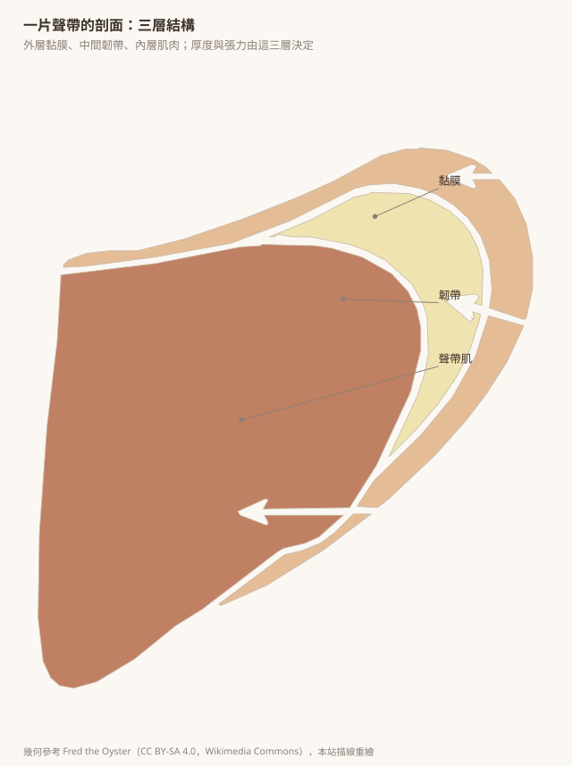

# [歌唱教學] 進階 第 21 章：聲帶厚薄調節：從低音的寬廣到高音的銳利邊緣

## 先講結論

高音上不去，很多時候不是氣不夠，是聲帶還帶著低音的厚度。音往上升，聲帶要跟著被拉長、拉薄。這一章練的就是這件事：音高上升的同時，主動把厚度放掉，而不是把厚厚的聲帶硬推上去。

練完的改變很具體。同一個高音，喉嚨會鬆一點，聲音卻更集中；從低音滑到高音，中間那個卡住的感覺會縮小。

先講清楚一件事：你能控制的是「讓它變」，不是「把它拉薄」。真正拉薄聲帶的是環甲肌，不是你的意志力。

## 常見誤解

很多人以為高音聽起來厚、有爆發力，就代表唱的時候聲帶也很厚。剛好相反。你聽到的那種厚，很大一部分是共鳴和氣流做出來的；真正在振動的是被拉薄之後的整片聲帶，只是振動的質量比低音時小得多。帶著整片厚聲帶去撞高音，換來的是卡頸、破音，或隔天喉嚨痛。

另一個誤解是「變薄就是把聲音變虛、變小」。變薄指的是振動的質量變小，聲音可以小，也可以很亮、很集中。虛不虛，主要看閉合乾不乾淨，不看厚度。

還有一種混淆：把「厚」和「大聲」當同一件事。你可以用很小的音量唱出很厚的低音，也可以用很大的音量唱出很薄的細音。練習時先固定音量、只改音高，你會比較聽得出厚度怎麼變。

## 原理：為什麼會這樣

聲帶有兩組肌肉在拉鋸。甲杓肌（TA）讓聲帶變厚變短，音往低走。環甲肌（CT）把聲帶拉長拉薄，音往高走。這不是開關，是連續變化的比例。

有一點要記住：低音時整片聲帶都在振動，高音時整片也還在振動。差別在振動的質量變小、振幅變窄，中間是連續的。所以「厚」和「薄」不是兩種聲帶，是同一條聲帶的兩端。

而音越高，需要的拉長越多，這是物理事實。你不讓它變薄，就只能用更大的氣壓去逼一個已經太厚的東西震得更快。那條路走不遠，而且代價是喉外的肌肉整個進來幫忙——音越高、越大聲，頸肩的代償活動就越明顯（Pettersen et al., 2005）。脖子一粗，聲音就悶。

反過來也要小心：放手放得太快，閉合鬆掉，聲音會變成漏氣的假音。真正要練的是「變薄」和「保持閉合」同時發生，不是單練其中一邊。

## 打個比方

**橡皮筋。** 你不拉它，它又寬又厚，彈一下是低沉的「咚」；往兩端拉長，它自己會變細、變薄，彈起來就清脆。音高上升本來就該伴隨變薄。失真在哪裡：橡皮筋是你用手拉的，聲帶不是。拉長它的是環甲肌，你能決定的只有「要不要讓它接手」。所以練習的重點不是「用力拉」，是「放手讓它變」。

**擰濕抹布。** 低音像一塊擰不乾的布，厚、重、水多；音往上，你慢慢把水擰掉，布變薄、變挺。量感少了，形狀卻清楚了。對回機制：被擰掉的是振動的質量，不是氣。很多人一聽到聲音變細就急著補氣，那等於又把水倒回去。

**同一條弦的高把位。** 吉他上你按到高把位，同一條弦發出更高的音，弦的粗細從頭到尾沒變。聲帶也是一樣：不是換了一條薄的，是同一條被拉長了，振動的質量跟著變小。

## 現在就做

### 練習一：先分辨厚與薄

1. 用舒適的低音發「波」，像嘆氣，讓聲音帶一點笨重感。三秒。
2. 記住喉嚨裡那種寬、鬆、邊緣模糊的感覺。
3. 換到中高音，發短促的「捏」，聲音扁平、集中在鼻樑後方。一次一秒，做三次。
4. 比較兩次。第二次胸口應該幾乎不震，喉嚨也不該有重量。

做錯會怎樣：如果發「捏」時脖子變粗、喉嚨癢，代表你是用擠的，不是用變薄的。停下來，音量砍一半再做。

### 練習二：警報器滑音

1. 從低音的「波」開始，氣流不要斷。
2. 音高慢慢往上滑，像警報器，五秒滑到你能到的最高音。
3. 滑到一半時，把母音從「波」換成「捏」，嘴型收小。
4. 到頂停住一秒，再原路滑回來。來回五次。

感覺：整段應該愈來愈輕，不是愈來愈用力；下腹持續把氣穩穩送出去。
做錯會怎樣：如果中途聲音突然變重、推不上去，代表你捨不得放掉厚度。音量減半重來，把母音轉換的點再提前一點。

### 練習三：同一個音高調厚度

1. 用 app 或鋼琴給一個中高音。
2. 先用「捏」唱兩秒，確認聲音細、集中、不漏氣。
3. 不改變音高，慢慢把嘴打開成「那」，聲音從一根針變一根柱子。
4. 再收回「捏」。來回五次。

做錯會怎樣：如果音高跟著掉，代表你加的是重量，不是厚度。把「那」唱小一點，先求音高不動。

### 練習四：錄一次，分開處理

1. 錄一次從低音到高音的滑音。
2. 回放，聽中間有沒有突然變小聲或變虛。
3. 變虛是閉合鬆掉了；變緊是厚度沒放。這兩種要分開處理。

做錯會怎樣：不要用「再用力一點」同時救這兩種問題。變虛要練閉合，變緊要練放手，方向剛好相反。

## 練完之後

做對的徵兆：從低到高滑音時，你不用越唱越大聲，聲音卻保持清楚；唱完高音，喉嚨是鬆的；同一個音高你能明確做出厚與薄兩種。

常見卡點是「越唱越興奮」。音量一加，厚度又回來了。練習時刻意小聲，是為了聽清楚聲音有沒有保持薄而集中，不是因為小聲好聽。

另一個卡點是急著攻高音。先把中音區的滑音練順，高音會自己變好。還有一個：只在練習時滑音，進到歌裡又用回舊習慣。挑一句你每次唱都卡的高音，在它前面兩三個字就先減重。

下一步是第 22 章：假聲帶。很多高音卡住的原因，不是聲帶不夠薄，是上面那兩片保護用的組織壓下來了。

## 延伸查證

- **Titze, I. R., et al. (2014).** Bi-stable vocal fold adduction: a mechanism of modal–falsetto register shifts and mixed registration. *Journal of the Acoustical Society of America.* 真音與假音是同一條聲帶的兩種閉合狀態，不是兩條不同的聲帶。PMID 25235006。
- **Lee, Y., Oya, M., & Kaburagi, T. (2023).** Differences Among Mixed, Chest, and Falsetto Registers: A Multiparametric Study. *Journal of Voice.* 三種登記在聲學與氣動參數上可以區分，但界線是連續的。PMID 33518476。
- **Pettersen, V., Bjørkøy, K., & Torp, H. (2005).** Neck and shoulder muscle activity and thorax movement in singing and speaking tasks with variation in vocal loudness and pitch. *Journal of Voice.* 音越高、越大聲，頸肩的代償活動越明顯。PMID 16301107。
- **Titze, I. R. (2006).** Voice training and therapy with a semi-occluded vocal tract: rationale and scientific underpinnings. *Journal of Speech, Language, and Hearing Research, 49*(2), 448–459. 彈唇、哼鳴這類半閉口練習為什麼能讓聲帶在較低的壓力下振動。PMID 16671856。
