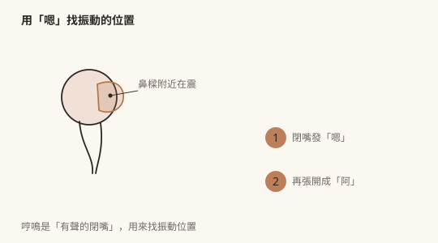

# [歌唱教學] 進階 第 22 章：假聲帶的運作：保護真聲帶與創造特殊音色的防禦機制

## 先講結論

唱到某個高度，喉嚨突然像被掐住、聲音悶住，問題常常不在聲帶不夠力，而在真聲帶上方那兩片「假聲帶」壓了下來。它平常的工作是保護，不是發聲。這一章要教你認出那個夾住的感覺，然後把它放掉。

練完的改變：唱同樣的高度，喉嚨裡面是開的，聲音不用變大就能出來；原本一到高音就啞掉的地方，會先鬆開，再談音準。

## 常見誤解

很多人把「假聲帶」和「假音」混在一起。這是兩個不同的東西。假音（falsetto）是真聲帶邊緣振動的一種狀態；假聲帶是喉嚨裡實體存在的兩片組織，位在真聲帶上方，平常不負責發出你唱歌的主要聲音。

另一個誤解是「高音要更用力才穩」。你越把它當成搬重物，身體越會叫假聲帶出來幫忙關門。結果是聲音被壓扁、喉嚨痛、破音。真正的高音，喉部反而要比低音更鬆。

## 原理：為什麼會這樣

真聲帶是氣流通道上那扇會振動的門。門的上方，還有一對肥厚的皺褶，就是假聲帶，醫學上叫室襞。吞東西、憋氣、用力搬東西的時候，它會往中間靠，把通道關緊，避免異物掉進氣管，也幫身體鎖住空氣、撐出腹壓。它是一個保護機制。

問題出在：身體會把「用力」的模式泛化到唱歌上，把「搬很重的東西」和「唱很高的音」都標記成「吃力」。一覺得吃力，假聲帶就下來夾。這種「假聲帶過度收縮」在肌肉緊張性嗓音障礙的個案身上是可以被量測的，不是憑感覺的說法（Han & Morrison, 2023）。它一夾，真聲帶上方就少了一塊空間，聲音變得又悶又緊，嚴重一點會刮。

上面那塊空間不是小事。聲樂研究裡說的會厭腔，就是真聲帶上方那一小段管子。用模型算過，這一小段管子的形狀會直接改變高頻能量集中的程度（Vampola et al., 2024）。換句話說，同樣一份氣，上面被壓掉，音色就散了。

所以方向不是「叫假聲帶用力」，也不是「練出假聲帶的聲音」，而是讓喉部相信現在不需要防禦。支撐交給下腹與側腰，喉嚨只負責當通道。有些嘶吼、破音風格會刻意讓假聲帶參與，做出粗糙的質感，但那是另一門技術，要有人看著練。它不是這一章要練的東西。

還有一件事：音越高、越大聲，頸肩的肌肉越容易進來代償（Pettersen et al., 2005）。你一聳肩，假聲帶就跟著關。所以「放下肩膀」不是姿勢建議，是發聲指令。

## 打個比方

**保險桿。** 保險桿不是拿來開車的，是撞到的時候用的。假聲帶也一樣：它的存在是為了「萬一」，不是為了平常前進。你如果每次踩油門都先撞一下保險桿，車還是會動，但油耗、異音、底盤全都不對。

**門口的警衛。** 警衛的工作是攔人，不是幫你開門。你越緊張、越東張西望，他越覺得有事要攔。你一進入「準備戰鬥」的狀態，喉嚨就派出警衛，把門關小一半。

**在麥克風前面拉窗簾。** 假聲帶一夾，等於在麥克風前掛上一層厚布。聲音還是出得去，只是高頻先被吃掉，聽起來悶、遠、沒有邊。對回機制：被吃掉的是高頻泛音，不是總音量。

## 現在就做

### 練習一：先認識那個夾住的感覺

1. 坐在椅子上，雙手抓住椅子兩側下緣。
2. 吸一口氣，假裝要把椅子連自己抬起來，憋住三秒。
3. 注意喉嚨深處那種「鎖住、塞住」的感覺。
4. 放掉，正常呼吸。這就是唱歌時不該出現的狀態。

做錯會怎樣：如果憋到頭暈，先停。這個練習只是讓你辨認感覺，不需要出力到極限。

### 練習二：把門打開

1. 想像突然看到很久不見的朋友，無聲地倒抽一口氣。
2. 注意喉嚨深處瞬間變寬、變涼的感覺。
3. 重複十次，每次吸氣都找回那個寬度。
4. 比較練習一與練習二。一個是關，一個是開。

做錯會怎樣：如果吸氣時肩膀聳起來，代表你是用上半身拉的，不是喉嚨放鬆。手放上胸口，讓肩膀留著不動。

### 練習三：無聲的笑

1. 閉上嘴，嘴角微微上揚。
2. 想像在圖書館聽到笑話不能出聲，用喉嚨做「呵呵呵」的悶笑，五秒。
3. 氣流要順，不要有摩擦或卡住的聲音。
4. 保持這個喉部狀態，張嘴發一個輕輕的「哈」。

做錯會怎樣：如果悶笑變成刮擦聲，代表你又夾了。把音量降到幾乎聽不見，只做動作。

### 練習四：滑音過關

1. 用很輕的「嗚」從低音開始。
2. 像警報器一樣慢慢往上滑，喉嚨維持練習二的寬度。
3. 音越高，下腹與側腰越要穩住，但喉嚨不要加力。
4. 到高音停住，再滑回來。做三次。

做錯會怎樣：如果滑到一半聲音變窄、變扁，就停在那個音高，重做一次無聲的驚訝，再從低一點的地方重新滑。

## 練完之後

做對的徵兆：唱同樣的高度，喉嚨不覺得被掐；聲音變悶的地方會先鬆開，才需要處理音準；唱完喉嚨不痛，只有腹部有一點運動後的感覺。

常見卡點是「越接近高音，越想準備戰鬥」。一準備，門就關了。另一個卡點是把放鬆做成「整個人軟掉」：放鬆的是喉嚨，支撐反而要更穩。這兩件事要分開。

如果你在台下唱得好好的，一上台就破音，那不是技巧忘了，是緊張被身體解讀成危險，門先關了。先處理那個反射，通常比多練二十次高音有用。

下一步是第 23 章的氣泡音。它會讓你在一種幾乎不出力的狀態下，重新感覺聲帶邊緣怎麼靠攏。

## 延伸查證

- **Han, J., & Morrison, R. (2023).** Quantification of False Vocal Fold Hyperfunction During Quiet Breathing in Muscle Tension Dysphonia. *The Laryngoscope.* 假聲帶在緊張、用力時向中線靠攏，是可觀察、可量測的現象，也與肌肉緊張性嗓音障礙相關。PMID 37314219。
- **Vampola, T., Horáček, J., & Laukkanen, A. M. (2024).** Three-Dimensional Finite Element Modeling of the Singer's Formant Cluster Optimization by Epilaryngeal Tube Shaping. *Journal of Voice.* 真聲帶上方那一小段會厭腔的形狀，會改變高頻能量能不能被集中。PMID 39218756。
- **Pettersen, V., Bjørkøy, K., & Torp, H. (2005).** Neck and shoulder muscle activity and thorax movement in singing and speaking tasks with variation in vocal loudness and pitch. *Journal of Voice.* 音越高、越大聲，頸肩的代償活動越明顯。PMID 16301107。
- **Titze, I. R., et al. (2014).** Bi-stable vocal fold adduction: a mechanism of modal–falsetto register shifts and mixed registration. *Journal of the Acoustical Society of America.* 聲帶閉合可以停在不同的穩定狀態，換聲區就是兩種狀態的交接。PMID 25235006。
- **Titze, I. R. (2006).** Voice training and therapy with a semi-occluded vocal tract: rationale and scientific underpinnings. *Journal of Speech, Language, and Hearing Research, 49*(2), 448–459. 半閉口練習讓聲帶在較低的壓力下振動，喉部不必防禦性收縮。PMID 16671856。
