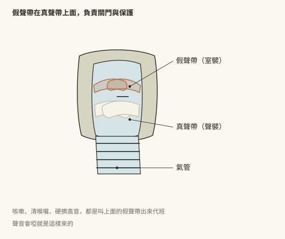

# [歌唱教學] 進階 第 22 章：假聲帶的運作：保護真聲帶與創造特殊音色的防禦機制

## 先講結論

唱到某個高音，喉嚨突然像被掐住、聲音悶住，問題常常不在聲帶不夠力，而在真聲帶上方那兩片「假聲帶」壓了下來。它平常的工作是保護，不是發聲。這一章要教你認出那個「夾住」的感覺，然後把它放掉。

練完的改變：唱高音時喉嚨裡面是開的，聲音不用變大就能出來；原本一到高音就啞掉的地方，會先鬆開再想辦法唱準。

## 常見誤解

很多人把「假聲帶」和「假音」混在一起。這是兩個不同的東西。假音（falsetto）是真聲帶邊緣振動的一種狀態；假聲帶是喉嚨裡實體存在的兩片組織，位在真聲帶上方，平常不負責發出你唱歌的主要聲音。

另一個誤解是「高音要更用力才穩」。你越把它當成搬重物，身體越會叫假聲帶出來幫忙關門。結果就是聲音被壓扁、喉嚨痛、破音。真正的高音，喉部反而要比低音更鬆。

## 原理：為什麼會這樣

真聲帶是氣流通道上那扇會振動的門。門的上方，還有一對肥厚的皺褶，就是假聲帶（醫學上叫心室襞）。吞東西、憋氣、用力搬東西的時候，它會往中間靠、把通道關緊，避免異物掉進氣管，也幫身體把空氣鎖住、撐出腹壓。它是一個保護機制。

問題出在：身體會把「用力」的運動模式泛化到唱歌上，把「搬很重的東西」和「唱很高的音」都標記成「吃力」。一覺得吃力，假聲帶就下來夾。它一夾，真聲帶上方就少了一塊空間，聲音變得又悶又緊，嚴重一點還會刮。

所以方向不是「叫假聲帶用力」，也不是「練出假聲帶的聲音」，而是讓喉部相信現在不需要防禦。支撐交給下腹與側腰，喉嚨只負責通道。有些嘶吼、破音風格會刻意讓假聲帶參與，做出粗糙的質感，但那是另一門技術，需要有人看著練；它不會讓你「用假聲帶唱歌」，也不是這一章要練的東西。

這也是為什麼有些人在台下唱得好好的，一上台就破音。不是技巧忘了，是緊張被身體解讀成危險，門先關了。先處理那個「準備戰鬥」的反射，通常比單純重複多練幾次高音更有幫助。

## 現在就做

### 練習一：先認識那個夾住的感覺

1. 坐在椅子上，雙手抓住椅子兩側下緣。
2. 吸一口氣，假裝要把椅子連自己抬起來，憋住三秒。
3. 注意喉嚨深處那種「鎖住、塞住」的感覺。
4. 放掉，正常呼吸。這就是唱歌時不該出現的狀態。

做錯會怎樣：如果你憋到頭暈，先停。這個練習只是讓你辨認感覺，不需要真的出力到極限。

### 練習二：把門打開

1. 想像突然看到很久不見的朋友，無聲地倒抽一口氣。
2. 注意喉嚨深處瞬間變寬、變涼的感覺。
3. 重複十次，每次吸氣都找回那個寬度。
4. 比較練習一與練習二。一個是關，一個是開。

做錯會怎樣：如果吸氣時肩膀聳起來，代表你用上半身拉，不是用喉嚨放鬆。手放上胸口，讓肩膀留著不動。

### 練習三：無聲的笑

1. 閉上嘴，嘴角微微上揚，做出微笑。
2. 想像在圖書館聽到笑話，不能出聲，用喉嚨做「呵呵呵」的悶笑。
3. 氣流要順，不要有摩擦或卡住的聲音。
4. 保持這個喉部狀態，張嘴發一個輕輕的「哈」。

做錯會怎樣：如果悶笑變成喉嚨刮擦，代表你又夾了。把音量降到幾乎聽不見，只做動作。

### 練習四：滑音過關

1. 用很輕的「嗚」從低音開始。
2. 像警報器一樣慢慢往上滑，喉嚨維持練習二的寬度。
3. 音越高，下腹與側腰越要穩住，但喉嚨不要加力。
4. 到高音停住，再滑回來。

做錯會怎樣：如果滑到一半聲音變窄、變扁，停在那個音高，重做一次無聲的驚訝，再從低一點的地方重新滑。

## 練完之後

做對的徵兆：唱同樣的高度，喉嚨不覺得被掐；聲音變悶的地方會先鬆開，才需要處理音準。唱完之後，喉嚨不痛，只有腹部有一點運動後的感覺。

常見卡點是「越接近高音，越想準備戰鬥」。一準備，門就關了。另一個卡點是把放鬆做成「整個人軟掉」：放鬆的是喉嚨，支撐反而要更穩。這兩件事要分開。

下一步是第 23 章的氣泡音。它會讓你在一種幾乎不出力的狀態下，重新感覺聲帶邊緣怎麼靠攏，這對控制「鬆而不虛」很有幫助。
