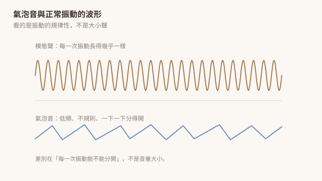

# [歌唱教學] 進階 第 23 章：邊緣化發聲 (Vocal Fry)：低音量的高階肌肉控制與氣泡音應用

## 先講結論

氣泡音（vocal fry）不是「壓著喉嚨發出的低音」，而是氣流很少、聲帶很鬆時，聲帶以極低的頻率（大約二十到六十赫茲）一顆一顆輕輕振動的一種狀態。它對音量要求很低，練習時能幫你感受聲帶閉合與放鬆的兩端，為後續的發聲控制建立本體感覺。

練完的改變：你能用很小的力氣唱出清楚的字；樂句的開頭和結尾可以做出顆粒感，而不是一開口就實、一收尾就斷。

## 常見誤解

很多人以為氣泡音很傷聲帶，是硬擠出來的沙啞。其實正確的氣泡音，氣流是所有發聲狀態裡最少的，聲帶也最鬆；它的基頻極低，波形一下一下像「爆開」，但整體仍是週期性振動，所以聽起來像一串「呃、呃、呃」。傷喉嚨的不是氣泡音本身，是用太大的氣、或夾著喉嚨去製造那個聲音。

另一個誤解是「氣泡音只能唱很低」。低音區最容易找到它，但在控制得好的情況下，高音區也能出現細碎的摩擦感。不過那是進階的變化，先把低音區做乾淨。

## 原理：為什麼會這樣

聲帶要振動，是氣流把它們推開，聲帶再靠內收肌與伯努利效應重新閉合，如此往復。氣流大、張力高，振動就快；氣流很小、聲帶又鬆，聲帶閉合的週期被拉得很長，一次一次分開，就形成氣泡音。它的關鍵是「低於一般歌唱所需的氣壓」，所以不需要用力，反而要減力。

把聲帶想成兩片柔軟的布簾，而不是兩條繃緊的弦。弦要有一定張力才會響；布簾只要輕輕靠著、有一點風，就會斷斷續續地抖。氣泡音就是布簾在抖，不是弦在震。

比喻失真的地方在這裡：布簾不會自己調整，聲帶會。你如果給太多氣，它不會變成氣泡音，只會變成漏氣的實音；你如果夾緊喉嚨，它會變成刮擦聲。所以「少氣」和「不夾」兩個條件要同時成立；只做到其中一個，都不會是氣泡音。

## 現在就做

### 練習一：從嘆氣找到氣泡音

1. 坐著，肩膀放下來，下巴微張。
2. 發一聲長長的「啊」，像很累時吐氣那樣。
3. 氣快吐完時，不要閉嘴，讓最後一點氣繼續溜過聲帶。
4. 聲音會自動碎成一顆一顆低頻的「呃」。這就是氣泡音。

做錯會怎樣：如果出現刮擦、想咳，代表你夾了喉嚨或氣給太猛。停下來，先正常呼吸三次，再從更輕的嘆氣開始。

### 練習二：測出「太少」與「太多」

1. 發出穩定的氣泡音。
2. 故意突然多吐一點氣。氣泡音會消失，變成漏氣或實音。記住這個「太多」。
3. 回到氣泡音，故意把脖子用力。聲音會變憋、變卡。記住這個「夾」。
4. 再放鬆，把氣縮到幾乎停止。顆粒會變得清楚、圓潤。

做錯會怎樣：如果不管怎麼調都只有刮擦聲，可能是聲帶還太緊。先做練習一的長嘆氣，不要直接攻氣泡音。

### 練習三：氣泡轉實音，再轉回來

1. 用低音唱一顆一顆的「呃、呃、呃」。
2. 下腹慢慢加一點點支撐，讓顆粒逐漸連起來。
3. 它們會過渡成一個乾淨的「啊」，音量不必大。
4. 維持兩秒，再把支撐慢慢放掉，讓聲音碎回氣泡音。

做錯會怎樣：如果中間出現「喀」的斷層，代表氣加得太快。把增加支撐的速度放慢，讓它幾乎聽不出轉換點。

### 練習四：放進一句歌裡

1. 挑一句抒情歌的主歌，第一個字是比較輕的子音。
2. 先正常唱一次，當作對照。
3. 第二次，在第一個字之前加零點幾秒的氣泡音，再順勢唱出那個字。
4. 錄下來比較兩次。第二次應該多了一點「話還沒說完」的口氣。

做錯會怎樣：如果每個字都加，聽起來會像故意裝飾。一句加一個地方就夠，放在樂句開頭或結尾。

## 練完之後

做對的徵兆：氣泡音不痛、不癢；從氣泡到實音的轉換，你自己聽得出差別，但別人不容易抓到切換點。唱完之後喉嚨是鬆的。

常見卡點是把氣泡音當成「低音量的實音」硬做出來，結果越練越緊。另一個卡點是只在錄音時用，平常不練，上台就做不出來。每天用兩分鐘，在還沒正式開嗓前做，最容易成功。

下一步是第 24 章的換聲區。氣泡音練的是「鬆」，換聲區練的是「交界」，兩件事接在一起，你會開始聽得出自己的聲音在哪裡換檔。
