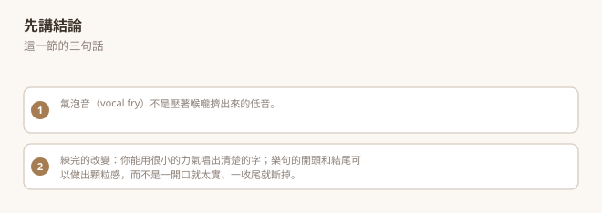
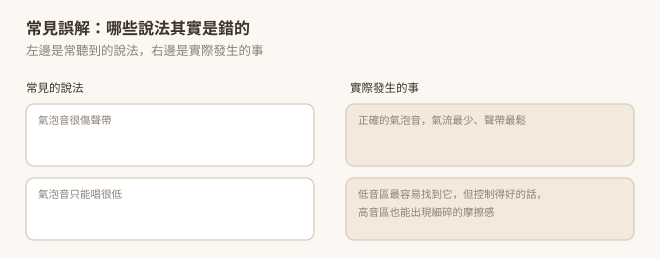
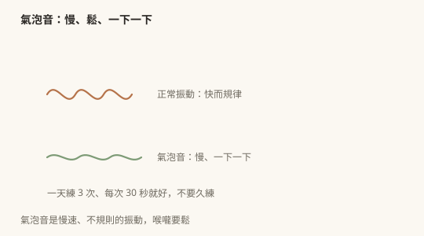
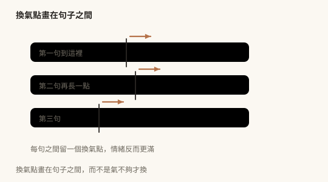
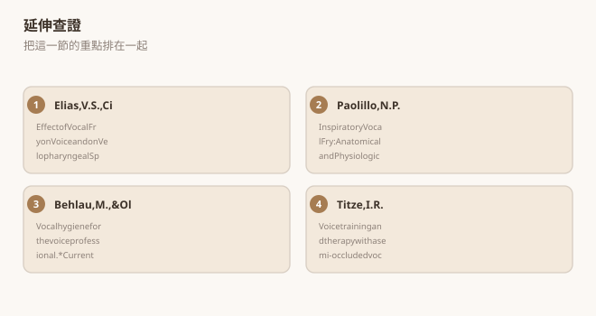

# [歌唱教學] 進階 第 23 章：邊緣化發聲 (Vocal Fry)：低音量的高階肌肉控制與氣泡音應用

## 先講結論

氣泡音（vocal fry）不是壓著喉嚨擠出來的低音。它是氣流很少、聲帶很鬆的時候，聲帶以很低的頻率一顆一顆輕輕振動的狀態，大約二十到六十赫茲。它幾乎是所有發聲狀態裡最省力的一種。

練完的改變：你能用很小的力氣唱出清楚的字；樂句的開頭和結尾可以做出顆粒感，而不是一開口就太實、一收尾就斷掉。

## 常見誤解

很多人以為氣泡音很傷聲帶，是硬擠出來的沙啞。其實正確的氣泡音，氣流最少、聲帶最鬆。傷喉嚨的不是氣泡音本身，是用太大的氣、或夾著喉嚨去製造那個聲音。

另一個誤解是「氣泡音只能唱很低」。低音區最容易找到它，但控制得好的話，高音區也能出現細碎的摩擦感。那是進階變化，先把低音區做乾淨。

## 原理：為什麼會這樣

聲帶振動的流程是：氣流把聲帶推開，聲帶靠肌肉內收與氣流效應重新靠攏，如此往復。氣流大、張力高，振動就快；氣流很小、聲帶又鬆，每一次閉合的週期被拉得很長，一次一次分開，就形成氣泡音。它的關鍵是「低於一般歌唱所需的氣壓」，所以不需要用力，反而要減力。

把聲帶想成兩片柔軟的布簾，而不是兩條繃緊的弦。弦要有一定張力才會響；布簾只要輕輕靠著、有一點風，就會斷斷續續地抖。氣泡音是布簾在抖，不是弦在震。

比喻失真的地方在這裡：布簾不會自己調整，聲帶會。你如果給太多氣，它不會變成氣泡音，只會變成漏氣的實音；你如果夾緊喉嚨，它會變成刮擦聲。所以「少氣」和「不夾」兩個條件要同時成立，只做到一個，都不是氣泡音。

還有一件事值得知道：氣泡音的顆粒感來自低頻的不規則振動，不是聲帶受傷後的沙啞。有研究專門量過它對嗓音與軟顎—咽部關閉功能的影響（Elias et al., 2016）。換句話說，它是一個狀態，不是一種病。

## 打個比方

**水龍頭轉到快關。** 你把水龍頭轉到快關，水不是停止，是變成一滴一滴。水滴的形狀跟全開時完全不同，但你沒有換水管，只是把水量轉到最小。氣泡音就是聲帶在「快關」的位置工作。

**公車起步。** 慢慢放離合器，車會一格一格頓著前進；猛地放，車就衝出去。頓著走不是車壞了，是動力給得剛剛好。氣泡音的顆粒就是那種「一格一格」；氣一給猛，車就衝出去，變成普通實音。

**砂紙與玻璃。** 同一張紙，在玻璃上滑是「咻」，在砂紙上滑是「沙沙沙」。位移一樣，差別在表面怎麼接觸。氣泡音不是多加了什麼，是聲帶靠攏的方式變了。

## 現在就做

### 練習一：從嘆氣找到氣泡音

1. 坐著，肩膀放下來，下巴微張。
2. 發一聲長長的「啊」，像很累時吐氣那樣，五秒。
3. 氣快吐完時不要閉嘴，讓最後一點氣繼續溜過聲帶。
4. 聲音會自動碎成一顆一顆低頻的「呃」。那就是氣泡音。

做錯會怎樣：如果出現刮擦、想咳，代表你夾了喉嚨或氣給太猛。停下來，正常呼吸三次，再從更輕的嘆氣開始。

### 練習二：摸出「太多」和「太夾」

1. 先發出穩定的氣泡音。
2. 故意突然多吐一點氣。顆粒會消失，變成漏氣或實音。記住這個「太多」。
3. 回到氣泡音，故意把脖子用力。聲音會變憋、變卡。記住這個「夾」。
4. 再放鬆，把氣縮到幾乎停止。顆粒會變清楚、變圓潤。

做錯會怎樣：如果怎麼調都只有刮擦聲，可能是聲帶還太緊。先回去做練習一的長嘆氣。

### 練習三：氣泡轉實音，再轉回來

1. 用低音唱一顆一顆的「呃、呃、呃」。
2. 下腹慢慢加一點點支撐，讓顆粒逐漸連起來。
3. 它們會過渡成一個乾淨的「啊」，音量不必大。
4. 維持兩秒，再把支撐慢慢放掉，讓聲音碎回氣泡音。做五次。

做錯會怎樣：如果中間出現「喀」的斷層，代表氣加得太快。把速度放慢，讓轉換點幾乎聽不出來。

### 練習四：換一個方向吸氣

1. 先做呼氣方向的氣泡音，兩秒。
2. 反過來，用「吸」的方式讓聲帶產生同樣的低頻顆粒。
3. 吸氣版的顆粒通常更細、更短，也更容易放鬆。
4. 兩種交替各做三次，感覺哪一種你的聲帶比較容易開。

做錯會怎樣：如果吸的時候喉嚨乾、想咳，代表吸得太用力。吸小一點，像聞到一點味道就好。

### 練習五：放進一句歌裡

1. 挑一句抒情歌的主歌。
2. 先正常唱一次當對照。
3. 第二次，在第一個字之前加零點幾秒的氣泡音，再順勢唱出那個字。
4. 錄下來比較。第二次應該多了一點「話還沒說完」的口氣。

做錯會怎樣：如果每個字都加，聽起來像刻意裝飾。一句加一個地方就夠，放在樂句開頭或結尾。

## 練完之後

做對的徵兆：氣泡音不痛、不癢；從氣泡到實音的轉換，你自己聽得出差別，別人不容易抓到切換點；唱完喉嚨是鬆的。

常見卡點是把氣泡音當成「低音量的實音」硬做出來，結果越練越緊。另一個卡點是只在錄音時用，平常不練，上台就做不出來。每天兩分鐘、在正式開嗓前做，最容易成功。

補充一個嗓音衛生的小事：練完如果喉嚨乾或想清喉嚨，先喝水，不要用清喉嚨解決（Behlau & Oliveira, 2009）。清喉嚨會讓聲帶撞得更用力，剛練完的放鬆就白費了。

下一步是第 24 章的換聲區。氣泡音練的是「鬆」，換聲區練的是「交界」，兩件事接在一起，你會開始聽得出自己是在哪裡換檔。

## 延伸查證

- **Elias, V. S., Cielo, C. A., & Jotz, G. P. (2016).** Effect of Vocal Fry on Voice and on Velopharyngeal Sphincter. *International Archives of Otorhinolaryngology.* 量測氣泡音對嗓音與軟顎—咽部關閉的影響。PMID 27096021。
- **Paolillo, N. P., Carrozza, L., & Osio, M. (2021).** Inspiratory Vocal Fry: Anatomical and Physiological Aspects, Application in Speech Therapy, Voice Therapy and Singing Pedagogy. *Journal of Voice.* 氣泡音有呼氣與吸氣兩個方向，兩者都被用在治療與歌唱教學上。PMID 31708370。
- **Behlau, M., & Oliveira, G. (2009).** Vocal hygiene for the voice professional. *Current Opinion in Otolaryngology & Head and Neck Surgery.* 補水、避免清喉嚨、聲音休息的實證建議。PMID 19342952。
- **Titze, I. R. (2006).** Voice training and therapy with a semi-occluded vocal tract: rationale and scientific underpinnings. *Journal of Speech, Language, and Hearing Research, 49*(2), 448–459. 氣流與口腔阻力怎麼改變聲帶的工作條件。PMID 16671856。

