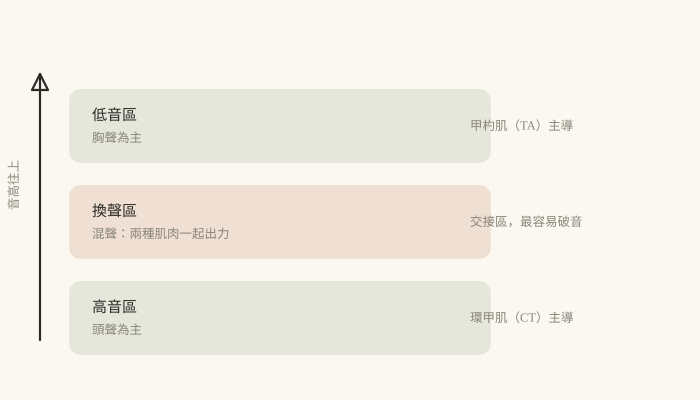
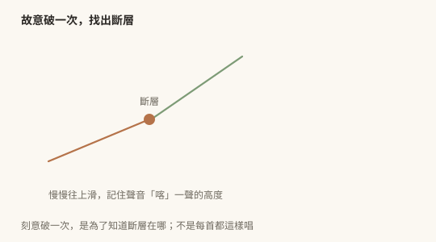
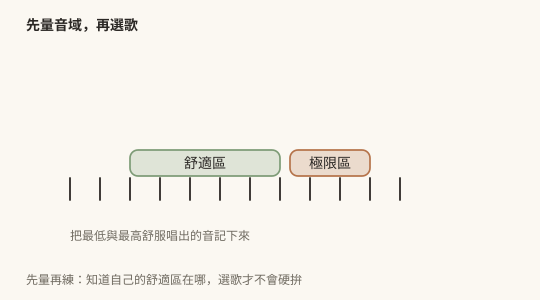

# [歌唱教學] 進階 第 24 章：聲區過渡 (Passaggio) 深度解析：破解換聲區的斷層

## 先講結論

換聲區不是一個固定的音，是一段換檔的區域。往上唱到那裡，主導權要從讓聲帶變厚的肌肉，交接給把聲帶拉長的肌肉。交接沒做好，聲音就「喀」一聲斷掉，或整段卡住。

這一章要教你三件事：找到自己的換聲區在哪、在交界之前就先減重、用母音和一點集中感把兩端接起來。

## 常見誤解

很多人以為換聲區是一道要撞破的牆，只要氣夠猛、丹田夠用力，就能把真音頂上去。撞破的結果通常是喉嚨卡死或聲音啞掉。它不是牆，是斜坡上的一個轉彎。

另一個誤解是「別人的換聲區在哪，我的就在哪」。它跟聲帶長短、喉部構造、訓練背景都有關。教學上常說男生大約在 E4 到 F4 附近、女生在 A4 到 C5 附近，但那只是粗略的參考，不是每個人都一樣。你要用耳朵找自己的。

## 原理：為什麼會這樣

低音時，甲杓肌（TA）讓聲帶變厚，整片振動。高音時，環甲肌（CT）把聲帶拉長拉薄。中間那段，兩邊都在出力，比例正在改變。這就是換聲區。它是一段範圍，不是一個音。

它會移動，這件事本身就值得知道。睡不好、沒開嗓、唱了一整晚、感冒剛好，換聲區都可能掉下一兩個半音。所以不要背一個固定的音高，要用耳朵找當天的位置。

沒訓練過的人，TA 通常比較強勢，到了換聲區還不肯放手。聲帶不變薄，音高上不去，大腦最後只好硬切，聲音就斷了。反過來，太快放手、閉合鬆掉，聲音變成漏氣的假音。兩邊都不行。

所以要練的不是「更多力氣」，是「減重」和「保持閉合」同時發生。母音窄化是減重：把大開口的「阿」收圓成「呃」或「喔」，喉頭比較穩，聲帶也比較容易變薄。集中感是保持閉合：聲音往鼻樑後方集中，這個聽覺加上身體的回饋會幫你維持明亮的共振、減少喉外肌代償；真正的閉合還是由喉內肌控制。

有一點可以幫你確認方向：換聲區的問題是比例，不是力量。你如果越練越累、脖子越練越粗，通常是練錯方向了。

## 打個比方

**上坡換檔。** 手排車上坡不換檔，引擎會拉轉、聲音變尖，最後熄火。換檔那一瞬間車會頓一下，那就是你的「喀」。頓一下不代表車壞了，代表你正在換。真正要練的是「提早換」，不是「頓得小一點」。

**樓梯的最後一階。** 你以為還有一階，結果已經到頂，腳就踩空。換聲區的「喀」就是踩空。解法不是跳更高，是看清楚階梯在哪。所以第一步永遠是「找到它」，不是「蓋掉它」。

**接力賽的交棒區。** 那不是一個點，是一段二十公尺的區域。跑者在進區之前就要開始加速，棒子在區內交出去。你如果在棒子快掉了才想追，一定掉棒。對回機制：TA 和 CT 的交接也是在一段音域內完成的，所以切換要提前兩三個音。

## 現在就做

### 練習一：找到自己的斷層

1. 站直，吸氣。
2. 用完全不修飾的「阿」，從舒適的低音慢慢往上滑，五秒。
3. 不要用力撐。讓聲音在某個地方「喀」一聲翻掉，翻就翻。
4. 來回三到五次，記住那個音高大約在哪。

做錯會怎樣：如果你從頭到尾都在用力，聲音不會斷，只會越來越緊。把音量降到一半，允許它斷，才找得到真正的位置。

### 練習二：用母音過橋

1. 從低音的「阿」開始。
2. 接近換聲區前兩三個音，把嘴收圓，母音改成「呃」。
3. 帶著「呃」穿過交界，不要臨時才改。
4. 過了交界，再決定要不要回到比較開的母音。

做錯會怎樣：如果還是斷，通常是改得太晚。把轉換點再提前，寧可早一點變窄。

### 練習三：用集中感接住

1. 發出扁扁的「捏」，像小孩撒嬌。
2. 確認聲音集中在鼻樑、牙齒後方，喉嚨不費力。
3. 用「捏」從低音滑到高音，全程保持這份集中。
4. 過關之後，慢慢把「捏」打開成「那」，但保留集中的感覺。

做錯會怎樣：如果「捏」聽起來像感冒鼻音，先捏住鼻子測試。聲音如果被堵住，代表你是塞住鼻子，不是集中。

### 練習四：放進一句歌

1. 挑一句你每次唱都破的高音。
2. 找到那個高音前的兩三個字。
3. 在那兩三個字就先減輕厚度，把亮點往臉前面移。
4. 到高音時嘴型收圓，支撐放在下腹，不要放在喉嚨。

做錯會怎樣：如果到高音才想切換，一定來不及。切換要提前。

### 練習五：量一次，不要只靠感覺

1. 用手機的調音器 app 或鋼琴，找出你斷掉的那個音。
2. 寫下來。隔一週再測一次。
3. 你會發現它會浮動，不會永遠固定在同一個半音。
4. 浮動本身就是正常現象，不用追一個標準答案。

做錯會怎樣：不要拿別人的換聲區當目標。音域是量出來的，不是憑感覺說「我唱得到」（Berger et al., 2022）。

## 練完之後

做對的徵兆：從低到高滑音，中間還聽得出換檔，但不再有「喀」的斷層；同一個高音，唱完喉嚨比以前鬆。

常見卡點是「過橋時忘記支撐」。喉嚨越放鬆，下腹和側腰反而要更穩，不然聲音會虛掉。另一個卡點是只練滑音、不練歌，練習時很順，進歌又破。每天挑一句真的會破的句子練，比滑一百次有用。

還有一個：只在安靜的房間裡練。伴奏一進來，你會自動加大音量，厚度就回來了。練的時候開著伴奏，人聲音量只到七成。

下一步是第 25 章：混聲。換聲區是交界，混聲是讓交界兩邊用比例混在一起，聽起來沒有接縫。

## 延伸查證

- **Titze, I. R., et al. (2014).** Bi-stable vocal fold adduction: a mechanism of modal–falsetto register shifts and mixed registration. *Journal of the Acoustical Society of America.* 換聲區是兩種閉合狀態交接的地方，不是一條聲帶換成另一條。PMID 25235006。
- **Lee, Y., Oya, M., & Kaburagi, T. (2023).** Differences Among Mixed, Chest, and Falsetto Registers: A Multiparametric Study. *Journal of Voice.* 胸聲、混聲、假聲在參數上可以區分，但界線是連續的。PMID 33518476。
- **Berger, T., Fuchs, M., & Dippold, S. (2022).** Standardization and Feasibility of Voice Range Profile Measurements in Epidemiological Studies. *Journal of Voice.* 音域圖是客觀量測，不是憑感覺說「我唱得到」。PMID 32402662。
- **Mürbe, D., Pabst, F., & Hofmann, G. (2002).** Significance of auditory and kinesthetic feedback to singers' pitch control. *Journal of Voice.* 音準同時依賴聽覺與身體感覺，兩者要一起用。PMID 12002886。
