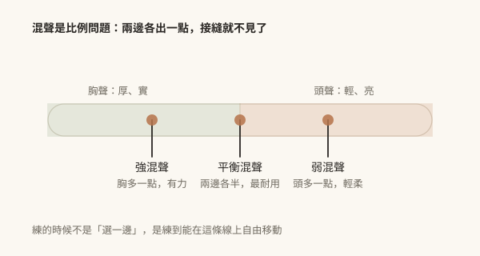
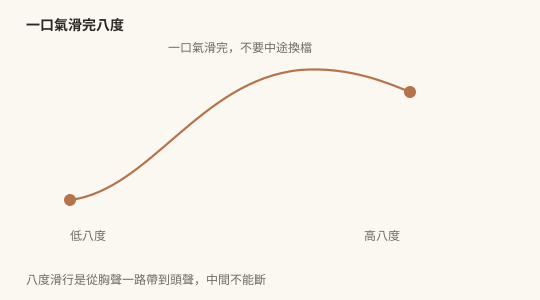

# [歌唱教學] 進階 第 25 章：混聲技術 (Mixed Voice) 核心：打造無縫接軌的全音域

## 先講結論

混聲不是喉嚨裡藏著的第三種聲音。它只是讓「變厚的肌肉」和「拉長的肌肉」同時工作、比例不同，聽起來像一條沒有接縫的音域。偏胸聲的混聲結實，偏頭聲的混聲輕盈，中間可以連續滑動。

練完的改變：換聲區附近不再是兩個世界，高音可以同時有力量和不緊；你能在同一個音高上把聲音從輕做到重，再收回來。

## 常見誤解

很多人以為混聲是一個特定開關，找到就一勞永逸。其實它是一段比例，不是一個點。你今天在哪個音高最容易混，跟疲勞、有沒有開嗓都有關。

另一個誤解是「混聲就是假音加一點真音」。不完全對。假音是閉合較鬆的狀態，混聲要求閉合要夠，只是厚度可以少。只把假音的音量加大，聽起來還是鬆的；把真音硬推上去，就是卡頸。混聲介於兩者之間，但閉合要清楚。

## 原理：為什麼會這樣

你的喉嚨只有一副聲帶。甲杓肌讓聲帶變厚變短，環甲肌把聲帶拉長拉薄。所謂「混」，就是這兩組同時還有作用，只是誰佔得多。偏胸聲的一邊，甲杓肌多一些，聲音厚、低頻多；偏頭聲的一邊，環甲肌多一些，聲音輕、高頻多。兩邊不是二選一。

聲學量測上，胸聲、混聲、假聲的確可以被區分，但界線是連續的（Lee et al., 2023）。這句話很重要：它代表「我現在到底算不算混聲」沒有標準答案，你該問的是「我往哪一邊偏」。

一個實用線索：委屈、快哭出來的那種「嗯」，喉頭會微微下降、聲道變長，環甲肌同時溫和地把聲帶拉長，閉合又不會鬆掉。那就是混聲最好找的起點。

還有一件事要分清楚：混聲不是把音量加大。它是同一個音高上，振動質量與閉合的組合。把混聲當成「大聲版假音」，聲音會鬆；當成「小聲版真音」，聲音會緊。

## 打個比方

**拉鍊。** 低音時拉鍊幾乎全開，整片在振動；音高往上，拉鍊慢慢拉起來，振動的部分越來越薄。重點是「慢慢」，而不是拉到一半突然換另一條拉鍊。失真在哪裡：拉鍊只能上下，聲帶的厚度卻可以同時受兩組肌肉影響，所以會出現「聽起來很厚、其實已經變薄」的狀態。

**兩隻手抬一張桌子。** 一開始兩手平均出力；要往左走，左手多一點、右手少一點，但右手沒有放掉。一放掉，桌子就歪。混聲就是「兩手都沒放，只是比例在變」。

**調灰階。** 白加黑，中間有一整段灰。你要的不是「白」或「黑」，是能停在任何一階的灰。混聲也一樣：不是選邊，是能停在你想要的位置。

## 現在就做

### 練習一：先找到那個委屈感

1. 想像一個小孩要不到東西，不敢大哭，只能哽咽。
2. 眉頭微皺，發出「嗯」的長音，音高比說話再高一點。
3. 感覺聲音掛在鼻樑後方，喉嚨深處有一點被拉長的感覺。
4. 重複五次，每次確認喉嚨不痛。

做錯會怎樣：如果「嗯」變成喉嚨壓出來的低吼，代表你往下降了。把音高往上提半個音，讓它輕一點。

### 練習二：換成「曼」

1. 帶著剛才的委屈感。
2. 在中高音唱「曼、曼、曼」，每個音短一點。
3. 聲音應該比講話細，但比假音結實。
4. 手放胸口，確認震動沒有大到整片在響。

做錯會怎樣：如果完全沒有胸口感覺、聲音又漏氣，代表閉合太鬆。把「曼」唱小聲一點、集中一點，先求不虛。

### 練習三：八度滑行

1. 在舒適低音唱「曼」，保留委屈感。
2. 氣不斷，像警報器往上滑。
3. 進換聲區時，讓聲音往鼻樑集中，下腹穩住，喉嚨不要加力。
4. 到高音後停住，再滑回來。做三次。

做錯會怎樣：如果滑到一半破音，通常是低音給得太重。把起點音量減半，用更明顯的委屈感重新出發。

### 練習四：同一個音高調比例

1. 選一個你平常最容易破的音高。
2. 先用很輕的「嗚」唱，這是偏頭聲的一端。
3. 保持音高，慢慢轉成「曼」，聲音會變得集中、有芯。
4. 再把嘴打開一點，加入一點「阿」的感覺，支撐往下放，聲音會變厚。
5. 然後原路收回「嗚」。來回三次。

做錯會怎樣：如果加厚的過程音高掉了，是加了重量而不是比例。把「阿」唱小一點，先確定音高不動。

## 練完之後

做對的徵兆：同一句高音，你可以選擇唱得輕或唱得厚，喉嚨都不痛；滑音時，換聲區只是顏色變了，不是斷了。

常見卡點是「一開始就想唱厚」。厚是最後加上去的，不是起點。另一個卡點是只練音階、不練句子：進歌時情緒一來，比例就亂。挑一句真的會唱的歌，用同樣的音高練三種比例。

還有一個：把混聲當成萬用解。有些歌的高音就是要有一點假音的鬆，有些段落就是要老老實實用胸聲。混聲是讓你多一個選擇，不是取代其他選擇。

下一步是第 26、27 章，分別把偏頭聲和偏胸聲這兩端練細。先確認你能在兩端之間移動，再去追求任何一端。

## 延伸查證

- **Lee, Y., Oya, M., & Kaburagi, T. (2023).** Differences Among Mixed, Chest, and Falsetto Registers: A Multiparametric Study. *Journal of Voice.* 三種登記在聲學與氣動參數上可以區分，但界線是連續的。PMID 33518476。
- **Titze, I. R., et al. (2014).** Bi-stable vocal fold adduction: a mechanism of modal–falsetto register shifts and mixed registration. *Journal of the Acoustical Society of America.* 混聲不是第三種發聲器官，是兩種閉合狀態之間的比例。PMID 25235006。
- **McGlashan, J., Aaen, M., & White, A. (2023).** A mixed-method feasibility study of the use of the Complete Vocal Technique (CVT), a pedagogic method to improve the singing voice. *Pilot and Feasibility Studies.* CVT 把歌唱音色分成四種模式，每種模式的差別在於金屬感與重量的比例。PMID 37226281。
- **Sundberg, J., & Thalén, M. (2015).** Respiratory and Acoustical Differences Between Belt and Neutral Style of Singing. *Journal of Voice.* 同一句話用不同風格唱，氣壓與共振峰策略會跟著改變。PMID 25819162。
