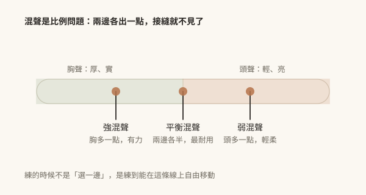

# [歌唱教學] 進階 第 26 章：弱混聲 (Light Mix) 實戰：輕柔高音的處理與色彩編織

## 先講結論

弱混聲的「弱」，指的是重量輕，不是支撐虛。它把厚重的低頻收掉，只留下很細、但閉合夠緊的邊緣。聽起來像一條細線，柔，卻能穿過伴奏。

這一章要教你從高音往下找這條線，而不是從低音把重量整個拖上去。練完的改變：安靜的段落你能唱得清楚又不壓迫，高音不必靠音量才有存在感。

## 常見誤解

很多人一遇到「輕柔高音」，就直接切成假音，或把真音的音量壓小。前者聽起來鬆散、一碰到伴奏就被吃掉；後者只是變小聲，聲音還是悶在喉嚨，沒有高音該有的亮。

弱混聲不是這兩種。它要閉合，但不加厚；要有高頻的亮，但不需要大音量。差別就在「閉合乾不乾淨」，而不是「大小聲」。

## 原理：為什麼會這樣

聲音能不能被聽見，跟音量有關，但更跟頻率有關。低頻在混音裡很容易被貝斯、大鼓、吉他吃掉；高頻的泛音反而能穿出來。弱混聲做的事，就是把聲帶的振動質量收得很小，讓高頻成分變多，同時靠良好的閉合，讓氣流不要漏掉。

用光源比喻：大力唱像手電筒，光亮但散；弱混聲像雷射筆，只有一個點，可是很遠也看得見。比喻會有失真的地方在這裡：雷射筆的亮度是固定的，人聲不是。你如果氣一多，聲音就不會「更亮」，只會變回鬆散的實音或假音。所以弱混聲反而要更穩的支撐，只是這份支撐不會變成大音量。

支撐在這裡的意思是「氣不要一下子衝出去」。下腹像在慢慢把氣擠出來，而不是放掉。你如果一放掉，聲帶就沒有足夠的氣壓維持閉合，聲音立刻變鬆。

從高音往下找，比從低音往上容易。因為從低音出發，大腦會習慣把厚度一起帶上去。

## 現在就做

### 練習一：先去掉重量

1. 選一個很高的音，用「嗚」輕輕唱。
2. 喉嚨完全不要有沉重的感覺。
3. 讓聲音帶一點氣，像貓頭鷹叫。
4. 記住這個「沒有重量」的感覺。

做錯會怎樣：如果高音一出來喉嚨就緊，音高先降半個音。硬撐上去的假音，對後面的練習沒有幫助。

### 練習二：換成「嘰」

1. 在同一個高音，把「嗚」改成很短的「嘰」。
2. 想像一隻很小、很生氣的吉娃娃。
3. 聲音應該有一點金屬般的細銳感，不是漏氣的。
4. 如果聽起來鬆散，把嘴型收窄一點，氣少一點。

做錯會怎樣：如果「嘰」變成喉嚨刮擦，代表你夾了。回到「嗚」，用更少的氣重來。

### 練習三：從高往下滑

1. 保持細銳的「嘰」。
2. 從高音慢慢往低滑，走五聲音階。
3. 全程不要讓胸口的震動跑出來幫忙。
4. 滑到低音後，再滑上去。

做錯會怎樣：下滑時聲音如果突然變粗、變重，代表你讓厚度接手了。停在那個音，用更輕的音量重滑。

### 練習四：霧與線的切換

1. 選一個中高音，先用「嗚」多給一點氣，讓它鬆散。
2. 下腹瞬間穩住，嘴型收成「衣」。
3. 聲音會從一團霧收成一條線。
4. 再放掉，回到鬆散的「嗚」。

做錯會怎樣：如果「衣」變得刺耳、喉嚨癢，是收得太用力。把支撐放在下腹，嘴型收小但不要咬緊。

### 練習五：放進安靜的段落

1. 挑一首慢歌的導歌或橋段。
2. 用弱混聲唱，每一個字都輕，但核心要清楚。
3. 想像聲音浮在鋼琴或吉他上面，不是埋進去。
4. 錄下來聽，確認小聲但聽得懂。

做錯會怎樣：如果整段聽起來沒有存在感，不是音量不夠，是閉合太鬆。把「嘰」的感覺加一點回去。

## 練完之後

做對的徵兆：小聲唱高音，喉嚨不緊；同樣的音量，字比以前清楚；唱完之後聲音沒有變沙。

常見卡點是「越安靜越想省力」，結果連支撐都放掉，聲音就虛了。另一個卡點是把弱混聲當成整首歌的默認音色：它適合安靜、細膩的段落，副歌該厚的地方還是要厚。

還有一個很容易忽略的地方：麥克風。弱混聲的細節來自氣音的寬頻噪聲、輔音的高頻成分，以及泛音的亮度，離麥克風太遠就全散掉。錄音時先試三個距離，找到字清楚、又不會噴麥的位置，這個音色才聽得出效果。

下一步是第 27 章，把另一端練起來：有力但不卡頸的高音。先確定你能在輕與重之間移動，兩端才有意義。
