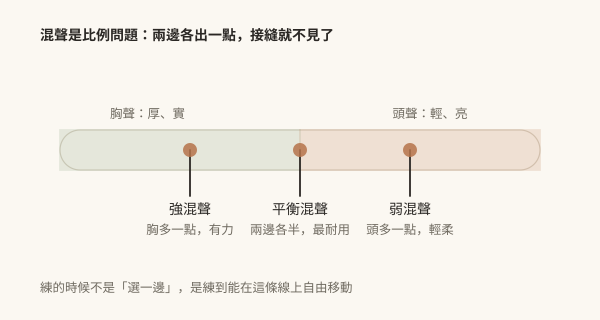
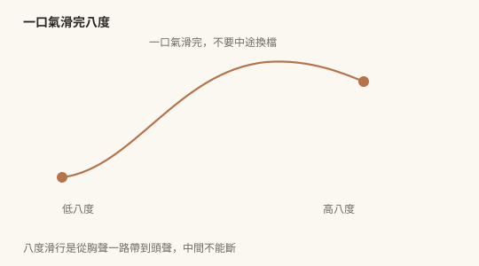
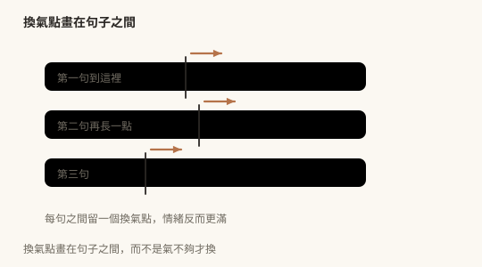

# [歌唱教學] 進階 第 27 章：強混聲 (Strong Mix) 實戰：具備爆發力與厚度的高音技巧

## 先講結論

高音要有爆發力，不是把講話的厚聲帶整片拖上去。強混聲靠兩件事：聲帶變薄但閉合很緊，加上咽腔的集中與高頻，讓它聽起來厚。喉嚨本身反而是輕的。

練完的改變：副歌的高音可以唱得大聲、扎實，但不會卡頸；「阿」這種大開口的字，在高音不再一唱就破。

## 常見誤解

很多人以為強混聲就是真音硬扯。如果高音還維持講話時的厚度，喉嚨一定會卡死，英文教學裡叫 pulling chest。你越用力，它越上不去。

另一個誤解是「大聲就要把嘴巴張到最大」。在高音區，嘴張太大反而讓喉頭往上跑，聲音變扁、變乾。音越高，母音通常要收得越攏，讓共振峰跟得上泛音。

## 原理：為什麼會這樣

強混聲仍然是混聲。環甲肌有在工作，聲帶其實已經變薄了。那「厚」從哪裡來？一部分是咽腔的集中，讓聲音多出一段明亮、有穿透力的高頻；另一部分是下腹與側腰給出很穩的氣壓，讓已經變薄的聲帶振動得很結實。

用音響比喻：同一把小喇叭，沒有號角時聽起來單薄；接上向外張開的號角，聲波比較容易輻射出去，就變得很響、很有攻擊性。真正讓聲音變大的不是喉嚨，是形狀。

這裡要小心一個詞：咽音（twang）。它是靠咽縮肌與杓會厭肌把喉部上方的咽腔收窄，讓聲音變亮、變集中，不是什麼獨門技術。它聽起來扁、刺，練習時不好聽是正常的，但喉嚨不應該痛。

要分清楚「亮」和「緊」。亮來自形狀與高頻，緊來自用力。同一個音高，你可以唱得很亮但不緊，也可以唱得很緊卻不亮。判斷方法是看唱完之後：亮而放鬆，喉嚨只會有一點用過；緊，則會痛、會沙、隔天開口聲音變低。這個回饋比當下的感覺可靠。

還有一件研究上很清楚的事：把高音唱得很厚很有力，不是單一參數，而是聲壓、氣壓與共振峰策略一起改變的結果（Sundberg & Thalén, 2015；Lebowitz & Baken, 2011）。所以「唱大聲」不是只有一個音量旋鈕可以轉。

## 打個比方

**號角。** 同一個小喇叭單體，裝在沒有號角的箱子裡，聲音又悶又散；接上號角，聲音往一個方向集中，聽起來大很多。失真在哪裡：號角是被動的形狀，咽腔是肌肉收縮出來的；你不能「把聲音推進號角」，只能把號角收起來，讓聲音自己變。

**壓水管。** 你把水管口壓扁一半，水柱會噴得更遠。水量沒變，變的是出口的形狀。咽腔收窄就是這個動作：出口變小，速度變快。

**油門與方向盤。** 爆發力不是握緊方向盤，是油門踩得穩。方向盤握死，車只會偏；喉嚨握死，聲音只會緊。

## 現在就做

### 練習一：先找到那層亮

1. 捏住鼻子，確認等一下的聲音不是從鼻孔漏掉。
2. 發出刺耳的「捏」，像鴨子叫或小孩嘲笑人。
3. 感覺震動貼在硬顎與牙齒後方，喉嚨不費力。
4. 放掉手，聲音應該一樣亮。

做錯會怎樣：如果捏住鼻子聲音就消失，代表你剛才發的是鼻音，不是集中。嘴張開一點，讓聲音從口腔出來。

### 練習二：把亮套回母音

1. 在中高音發「捏」。
2. 保持貼在牙齒後方的感覺，慢慢把嘴打開成「貝」。
3. 再打開一點，變成「耶」。
4. 全程不要讓那個亮點掉回喉嚨。

做錯會怎樣：如果「耶」一開口就變悶，是嘴開太快、太大。回到「捏」，一次只打開一點。

### 練習三：深蹲滑音

1. 雙腿微彎，雙手插腰，感覺側腰。
2. 吸氣，讓側腰撐開。
3. 用「貝」從低音往上滑。
4. 音越高，下腹與側腰往外撐、往下踩的力量越大，喉嚨不要跟著用力。

做錯會怎樣：如果高音突然變細或破掉，通常是支撐在最後一刻鬆了，不是「不夠大聲」。重新吸氣，把支撐留到最後。

### 練習四：高音的「阿」怎麼唱

1. 先故意張大嘴巴喊「阿」，聽那個乾、緊的聲音，當作對照。
2. 重新來，把嘴唇兩側收攏，想像嘴型在「喔」和「呃」之間。
3. 用這個收攏的嘴型唱「阿」，支撐照給。
4. 錄下來聽。主觀上你覺得唱的是「喔」，聽起來卻還是「阿」。

做錯會怎樣：如果收攏之後聲音變成另一個字、聽不懂，是收太多。先把嘴型調回一半。

### 練習五：練耐力，不是練那一顆音

1. 挑一段連續八小節的副歌。
2. 在譜上先標好每個換氣點，包括休止符。
3. 用七成音量唱完整段，不要中途停。
4. 唱完如果腹部有感覺、喉嚨沒有，就對了。

做錯會怎樣：如果唱到第三句開始變沙，是支撐分配的問題，不是力氣不夠。把換氣點往前挪。

## 練完之後

做對的徵兆：高音變大聲，但喉嚨不痛；唱完一整段副歌，聲音沒有變沙。你花的力氣在腹部，不在脖子。

常見卡點是「一緊張就回到扯嗓」。練習時把音量控制在七成，注意力放在支撐與嘴型，而不是「夠不夠大聲」。另一個卡點是只練一分鐘的高音：耐力是另一件事，要讓身體習慣在副歌長度裡維持支撐。

還有一個很現實的：這種唱法吃體力。不要在喉嚨已經累的時候練爆發力，那只會讓你用錯肌肉。排練習順序時，把強混聲放在聲音還新鮮的前半段。

下一步是第 28 章，把咽腔的集中單獨拉出來練。強混聲之所以能厚，很大一部分是它做的。

## 延伸查證

- **Sundberg, J., & Thalén, M. (2015).** Respiratory and Acoustical Differences Between Belt and Neutral Style of Singing. *Journal of Voice.* 厚而有力的高音，氣壓與共振峰策略都和中性唱法不同。PMID 25819162。
- **Lebowitz, A., & Baken, R. J. (2011).** Correlates of the belt voice: a broader examination. *Journal of Voice.* Belt 不是單一參數，是多項特徵的組合。PMID 20236798。
- **McGlashan, J., Aaen, M., & White, A. (2023).** A mixed-method feasibility study of the use of the Complete Vocal Technique (CVT), a pedagogic method to improve the singing voice. *Pilot and Feasibility Studies.* CVT 把有力的高音分成 overdrive 與 belting 兩種模式，差別在金屬感與音域。PMID 37226281。
- **Pettersen, V., Bjørkøy, K., & Torp, H. (2005).** Neck and shoulder muscle activity and thorax movement in singing and speaking tasks with variation in vocal loudness and pitch. *Journal of Voice.* 越大聲、越高音，頸肩的代償活動越明顯；爆發力不該長在脖子上。PMID 16301107。
