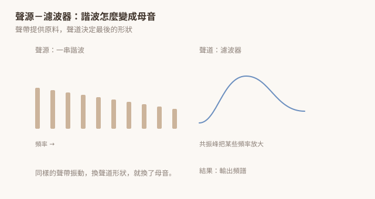

# [歌唱教學] 進階 第 28 章：咽喉腔共鳴的秘密：創造聲音的穿透力與銳利度

## 先講結論

在樂團裡被蓋掉，通常不是音量不夠，是頻率重疊。貝斯與大鼓佔據低頻，吉他、鍵盤在中頻也有很多能量，你再用厚厚的聲音去擠，只會被吃掉。要穿出去，得讓聲音帶著一段明亮、集中的高頻。做這件事的地方在咽喉腔，方法是把它收窄。

練完的改變：同樣的音量，你的聲音在伴奏裡聽得見；高音快破的時候，不必再給更多氣，只要把集中感加回來。

## 常見誤解

很多人以為穿透力等於大聲。所以一被蓋掉就扯嗓，結果兩首歌之後聲音就啞了。真正讓聲音穿出去的是頻率，不是音量。

另一個誤解是「咽音是很玄的祕技」。它其實只是一個動作：用咽縮肌與杓會厭肌把喉部上方的咽腔收窄，讓聲道形成一個小漏斗。收窄之後，共振峰往上移，中低頻被壓抑，高頻泛音被放大，聲音就變亮、變集中。這個動作我們平常在學鴨子叫、學小孩嘲笑人時就用過。

## 原理：為什麼會這樣

咽喉腔在真聲帶上方、舌根後方。它放鬆時是一個寬的管子，聲音溫暖、圓，但邊緣模糊。它收窄時，會厭往後傾，上方變成一個小漏斗，聲道阻抗改變、共振峰上移，高次泛音與共振峰對齊而被強化。這就是咽音，也叫 twang。

聲音變亮為什麼有用？人耳對兩、三千赫茲附近的頻率特別敏感。這個頻段在混音裡常常留著相對窄的縫隙，你的聲音如果能在那裡有一塊能量，就算音量不大，也容易被辨識。聲樂研究把這種高頻聚集稱為歌手共振峰，它是一群泛音被聲道形狀強化出來的結果，不是喉嚨裡另外長了一個器官。

比喻的極限在這裡：漏斗是被動的形狀，咽腔是肌肉收縮出來的。所以你不能「把聲音推進漏斗」，只能把漏斗收起來，讓聲音自己變。收太多會刺耳，收太少沒效果，中間有一段可以用的範圍。

還有一件事值得知道：收窄咽腔會讓聲音變亮，但它不會讓你因此唱得更高。音高由聲帶的長度與張力決定，咽腔只改變音色。很多人把這兩件事混在一起，於是一唱不上去就開始收咽腔，結果聲音變刺，音高還是沒上去。

## 現在就做

### 練習一：先找到那個亮

1. 學小女巫笑：「嘿、嘿、嘿」，短而尖。
2. 學鴨子叫：「嘓」，或小孩嘲笑的「捏」。
3. 感覺震動貼在硬顎、牙齒後方，喉嚨不痛。
4. 這幾個聲音都很難聽，這是正常的。

做錯會怎樣：如果做的時候喉嚨會癢、會想咳，代表你夾的是喉嚨，不是上方的咽腔。把音量減半，聲音做小一點。

### 練習二：捏鼻子檢查

1. 發出女巫的「嘿嘿嘿」。
2. 捏住鼻子。
3. 如果聲音幾乎沒變，代表聲音從口腔出來，位置對了。
4. 如果聲音被堵住或明顯變悶，代表你剛才發的是鼻音。

做錯會怎樣：捏鼻測試只是檢查，不是練習。不要捏著鼻子唱，會養成錯誤的用力方式。

### 練習三：把亮稀釋

1. 在中高音發刺耳的「捏」。
2. 保持喉嚨上方那個收窄的感覺，慢慢把嘴打開成「拿」。
3. 聲音會從卡通人物變成搖滾味的結實音色。
4. 再打開成「阿」，讓它變圓，但留一點集中的芯。

做錯會怎樣：如果每打開一次，亮點就整個消失，代表你是靠嘴型在撐，不是靠咽腔。回到「捏」，一次只打開一點。

### 練習四：小聲也要清楚

1. 用很小的音量，像在耳邊說話。
2. 先發充滿氣息的「哈」，聽它有多鬆散。
3. 加入一點咽腔的集中，改發「嘻」或「嘿」。
4. 比較兩次。第二次音量一樣小，字卻清楚很多。

做錯會怎樣：如果小聲加入集中之後變大聲，代表你把集中做成了用力。集中是形狀，不是音量。

## 練完之後

做對的徵兆：在伴奏裡，你的聲音不用推就聽得見；唱高音快破時，加一點集中就能救回來，不必加氣。唱完之後喉嚨不痛，只有一點點「用過」的感覺。

常見卡點是把咽音當成為整首歌預設的音色，從頭到尾都很刺。它是一個旋鈕，主歌可以少一點，副歌再多一點。另一個卡點是只練「難聽的聲音」，沒有練稀釋，結果上台不敢用。

判斷有沒有過頭，可以錄一段歌，戴耳機聽。如果高頻刺到耳朵痛，或咬字變得模糊，就是收太多。理想的位置是：在伴奏裡聽得清楚，但拿下耳機、面對面講話時，對方不會覺得你在尖叫。

下一步是第 29 章：軟顎。它決定聲音從口腔還是鼻腔出去，和這一章的集中感合起來，你就能調出大部分的流行音色。
