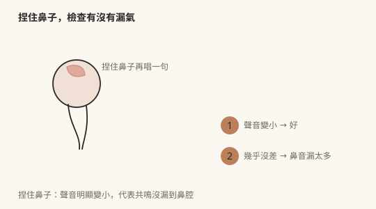
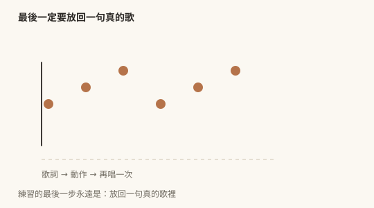
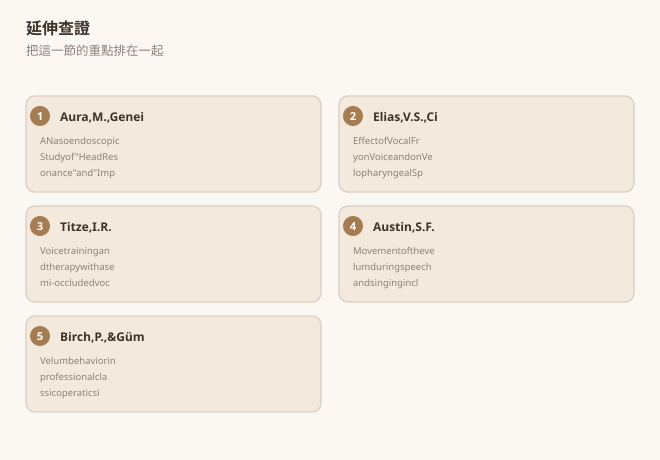

# [歌唱教學] 進階 第 29 章：軟顎的升降控制：精準調配鼻腔與口腔的共鳴比例

## 先講結論

聲音要離開身體前，最後會遇到一個分岔口：往口腔，或分一點往鼻腔。控制這個分岔的是軟顎。它抬起來，聲音幾乎全從嘴巴出去，乾淨、宏亮；它放下來一點，聲音會多一層鼻音的黏與暖。

練完的改變：你能自己決定要不要鼻音、要多少；唱大歌時聲音乾淨，唱 R&B 時又能加一點慵懶的磁性。

## 常見誤解

很多人以為「有磁性的鼻音」就是把氣往鼻孔塞。塞進去只會變成感冒般的悶聲，字也糊掉。好聽的鼻音其實大部分聲音還是從嘴巴出來，只是分了一小部分到鼻腔，讓兩邊一起共振。

另一個誤解是「軟顎只有開和關兩種」。它其實可以停在半開的位置，那個位置才是流行歌裡最常用的音色。

## 原理：為什麼會這樣

用舌頭舔口腔上方：前面硬硬的是硬顎，往後變軟、沒有骨頭的就是軟顎，末端掛著小舌。吞東西時它會自動抬起來把鼻腔關住，免得食物跑進鼻子。唱歌時我們要把它從「自動」變成「可控制」。受過訓練的歌手，軟顎在說話與歌唱時的動作確實不一樣，這是可以被觀察到的差異（Austin, 1997）。

軟顎抬高，鼻腔通道關閉，聲音走口腔。這種聲音清楚、有力，適合高音和需要爆發力的段落。軟顎放下，聲音進鼻腔，聽起來悶、扁。完全放下其實不好聽，但它是個有用的定位點，讓你確認鼻腔在哪裡。

真正實用的是中間：軟顎只放一點點，大部分聲音還是從嘴出去，鼻腔分到一小部分。捏住鼻子測試時，聲音不會消失，但音色會變悶，這就證明兩邊都有。比例不需要背數字，用耳朵和捏鼻測試判斷就好。

這個機制不只在音色上有用。有研究用內視鏡看古典唱法裡的「頭聲共鳴」與 imposto，發現變化主要發生在聲道形狀與咽部、軟顎的調整，而不是聲音真的跑到頭骨裡（Aura et al., 2022）。氣泡音這類低張力的振動，也被量測過對軟顎—咽部關閉的影響（Elias et al., 2016）。同一塊組織，不同的用法。

要提醒的是，捏鼻測試只是檢查工具。唱的時候不要捏著鼻子，也不要把「聲音通過鼻子」和「鼻音」畫上等號。鼻音重不重，聽的是聽眾那一端，不是你自己在頭骨裡聽到的感覺。自己聽自己，本來就會偏低頻。

## 打個比方

**平交道。** 柵欄放下來，車只能走路面；柵欄抬起來，另一條路也開通。軟顎就是那個柵欄，不是引擎。它不產生聲音，只決定聲音走哪條路。

**紗窗的縫。** 開一點縫，風進得來一點，房間不會整個通風，但氣味會變。軟顎半開就是這樣：不是全開，也不是全關，是一條縫。

**混音器的推桿。** 主唱一支推桿，房間殘響一支推桿。軟顎管的是殘響那一支：推上去多一點空間感，推到底就糊。你要的不是極端，是剛好。

## 現在就做

### 練習一：感覺它在動

1. 閉嘴，用鼻子深吸氣。軟顎是放下的。
2. 張開嘴，改用嘴巴大口吸氣。呼吸時軟顎幾乎不動，只是停在放鬆的中性位置。
3. 保持張嘴，發一個長長的「啊」。發聲時軟顎才會抬起來，把鼻腔通道關住。
4. 交替「鼻吸、口吐、口吸、鼻吐」，再偶爾加一個「啊」，注意口腔深處有一塊肌肉在上上下下。

做錯會怎樣：如果完全感覺不到，先別急。把注意力放在「發聲時鼻子通不通」：通就是軟顎放下，不通就是抬起。

### 練習二：用子音找兩端

1. 發誇張的「喀」，舌根頂住軟顎。這是抬起的一端。
2. 發「嗯」，像英文 sing 的結尾。這是放下的一端。
3. 交替做十次，感覺兩者的差別。
4. 記住這兩個位置，中間就是可調的範圍。

做錯會怎樣：如果「嗯」的時候喉嚨緊，是你用喉嚨壓，不是軟顎放下。嘴巴微微張開，讓下巴鬆。

### 練習三：捏鼻測試

1. 唱一個圓潤的「阿」，像打哈欠開頭那樣。
2. 在長音中反覆捏住、放開鼻子。
3. 目標是聲音幾乎不變。這代表軟顎關好了。
4. 再發「嗯」的長音，捏住鼻子，聲音應該被堵住。

做錯會怎樣：如果唱「阿」時捏鼻子聲音變悶，代表你漏了鼻音。把軟顎再抬高一點，或檢查舌根有沒有後縮壓住軟顎。

### 練習四：從鼻音滑到口腔

1. 先發完全鼻音的「嗯」。
2. 氣不斷，慢慢把舌根放下，變成「阿」。
3. 到「阿」時，刻意不要讓軟顎全抬，停在半開的位置。
4. 聽那個「阿」是不是有一點扁、一點懶。那就是流行歌的鼻音磁性。

做錯會怎樣：如果一變「阿」就變成聲樂式的宏亮，代表你抬太多；如果糊到聽不懂字，是放太多。兩邊來回調，找到中間。

### 練習五：同一句歌換兩種顏色

1. 挑一句簡單的歌詞。
2. 第一次軟顎抬高唱，聲音乾淨、字清楚。
3. 第二次軟顎半放，聲音多一點鼻音的黏。
4. 錄下來比較。兩次都沒有對錯，只有適不適合。

做錯會怎樣：如果第二次聽起來像感冒，先從「少放一點」開始。半開和全開只差一點點。

## 練完之後

做對的徵兆：你能用捏鼻測試判斷自己現在是哪種共鳴；同一句歌，你能唱出兩種明顯不同的顏色，而且字都還聽得懂。

常見卡點是「把鼻音當成壞事」，結果該加的地方不敢加，聲音變得太乾淨、太遠。另一個卡點是軟顎一直放著，所有歌都糊。它是一個調色盤，不是預設值。

還有一個實務上的細節：感冒、鼻塞的時候，軟顎的控制會變差，你會不自覺用喉嚨去補。這種時候不要硬練音色，先把聲音休息排進行程裡。

下一步是第 30 章：頭腔。它和軟顎、咽腔一起，構成高音那一段的明亮度。

## 延伸查證

- **Aura, M., Geneid, A., & Bjørkøy, K. (2022).** A Nasoendoscopic Study of "Head Resonance" and "Imposto" in Classical Singing. *Journal of Voice.* 「頭腔共鳴」實際上是聲道形狀改變，不是聲音真的跑到頭骨裡。PMID 32513553。
- **Elias, V. S., Cielo, C. A., & Jotz, G. P. (2016).** Effect of Vocal Fry on Voice and on Velopharyngeal Sphincter. *International Archives of Otorhinolaryngology.* 量測氣泡音對軟顎—咽部關閉的影響。PMID 27096021。
- **Titze, I. R. (2006).** Voice training and therapy with a semi-occluded vocal tract: rationale and scientific underpinnings. *Journal of Speech, Language, and Hearing Research, 49*(2), 448–459. 哼鳴這類半閉口練習為什麼能讓你更容易感覺到臉上的振動。PMID 16671856。
- **Austin, S. F. (1997).** Movement of the velum during speech and singing in classically trained singers. *Journal of Voice.* 受訓歌手在說話與歌唱時，軟顎動作的模式不同；「把它變成可控制」有觀察依據。PMID 9181545。
- **Birch, P., & Gümoes, B. (2002).** Velum behavior in professional classic operatic singing. *Journal of Voice.* 專業歌劇歌手的軟顎位置與鼻音比例，會隨音高與母音調整。PMID 12002888。

