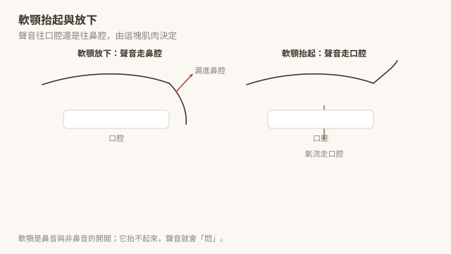

# [歌唱教學] 進階 第 29 章：軟顎的升降控制：精準調配鼻腔與口腔的共鳴比例

## 先講結論

聲音要離開身體前，最後會遇到一個分岔口：往口腔，或分一點往鼻腔。控制這個分岔的是軟顎。它抬起來，聲音幾乎全從嘴巴出去，乾淨、宏亮；它放下來一點，聲音會多一層鼻音的黏與暖。

練完的改變：你能自己決定要不要鼻音、要多少；唱大歌時聲音乾淨，唱 R&B 時又能加一點慵懶的磁性。

## 常見誤解

很多人以為「有磁性的鼻音」就是把氣往鼻孔塞。塞進去只會變成感冒般的悶聲，字也糊掉。好聽的鼻音其實大部分聲音還是從嘴巴出來，只是分了一小部分到鼻腔，讓兩邊一起共振。

另一個誤解是「軟顎只有開和關兩種」。它其實可以停在半開的位置，那個位置就是流行歌裡最常用的音色。

## 原理：為什麼會這樣

用舌頭舔口腔上方：前面硬硬的是硬顎，往後變軟、沒有骨頭的就是軟顎，末端掛著小舌頭。吞東西時它會自動抬起來，把鼻腔關住，免得食物跑進鼻子。唱歌時我們要把它從自動變成可控制。

軟顎抬高，鼻腔通道關閉，聲音走口腔。這種聲音清楚、有力，適合高音和需要爆發力的段落。軟顎放下，聲音進鼻腔，聽起來悶、扁。完全放下其實不好聽，但它是個有用的「定位點」，讓你確認鼻腔在哪裡。

真正實用的是中間：軟顎只放一點點，大部分聲音還是從嘴出去，鼻腔分到一小部分。捏住鼻子測試時，聲音不會消失，但音色會變悶，這就證明兩邊都有。比例不需要背數字，用耳朵和捏鼻測試判斷就好。

要提醒的是，捏鼻測試只是檢查工具。唱的時候不要捏著鼻子，也不要把「聲音通過鼻子」和「鼻音」畫上等號。鼻音重不重，聽的是聽眾那一端，不是你自己在頭骨裡聽到的感覺。自己聽自己，本來就會偏低頻。

## 現在就做

### 練習一：感覺它在動

1. 閉嘴，用鼻子深吸氣。軟顎是放下的。
2. 張開嘴，改用嘴巴大口吸氣。注意：呼吸時軟顎幾乎不動，只是停在放鬆的中性位置。
3. 保持張嘴，發一個長長的「啊」。發聲時軟顎才會抬起來，把鼻腔通道關住。
4. 交替「鼻吸、口吐、口吸、鼻吐」，再偶爾加一個「啊」，注意口腔深處有一塊肌肉在上上下下。

做錯會怎樣：如果完全感覺不到，先別急。把注意力放在「發聲時鼻子通不通」，通就是軟顎放下，不通就是抬起。

### 練習二：用子音找兩端

1. 發誇張的「喀」，舌根頂住軟顎。這是抬起的一端。
2. 發「嗯」，像英文 sing 的結尾。這是放下的一端。
3. 交替做十次，感覺兩者的差別。
4. 記住這兩個位置，中間就是可調的範圍。

做錯會怎樣：如果「嗯」的時候喉嚨緊，是你在用喉嚨壓，不是軟顎放下。嘴巴微微張開，讓下巴鬆。

### 練習三：捏鼻測試

1. 唱一個圓潤的「阿」，像打哈欠開頭那樣。
2. 在長音中反覆捏住、放開鼻子。
3. 目標是聲音幾乎不變。這代表軟顎關好了。
4. 再發「嗯」的長音，捏住鼻子，聲音應該被堵住。

做錯會怎樣：如果唱「阿」時捏鼻子聲音變悶，代表你漏了鼻音。把軟顎再抬高一點，或檢查舌根有沒有後縮壓住軟顎、妨礙它抬高。

### 練習四：從鼻音滑到口腔

1. 先發完全鼻音的「嗯」。
2. 氣不斷，慢慢把舌根放下，變成「阿」。
3. 到「阿」時，刻意不要讓軟顎全抬，停在半開的位置。
4. 聽那個「阿」是不是有一點扁、一點懶。那就是流行歌的鼻音磁性。

做錯會怎樣：如果一變「阿」就變成聲樂式的宏亮，代表你抬太多。反過來，如果糊到聽不懂字，是放太多。兩邊來回調，找到中間。

### 練習五：同一句歌換兩種顏色

1. 挑一句簡單的歌詞。
2. 第一次軟顎抬高唱，聲音乾淨、字清楚。
3. 第二次軟顎半放，聲音多一點鼻音的黏。
4. 錄下來比較。兩次都沒有對錯，只有適不適合。

做錯會怎樣：如果第二次聽起來像感冒，先從「少放一點」開始。半開和全開只差一點點。

## 練完之後

做對的徵兆：你能用捏鼻測試判斷自己現在是哪種共鳴；同一句歌，你能唱出兩種明顯不同的顏色，而且字都還聽得懂。

常見卡點是「把鼻音當成壞事」，結果該加的地方不敢加，聲音變得太乾淨、太遠。另一個卡點是軟顎一直放著，所有歌都糊。它是一個調色盤，不是一個預設值。

下一步是第 30 章：頭腔。它和軟顎、咽腔一起，構成高音那一段的明亮度。
