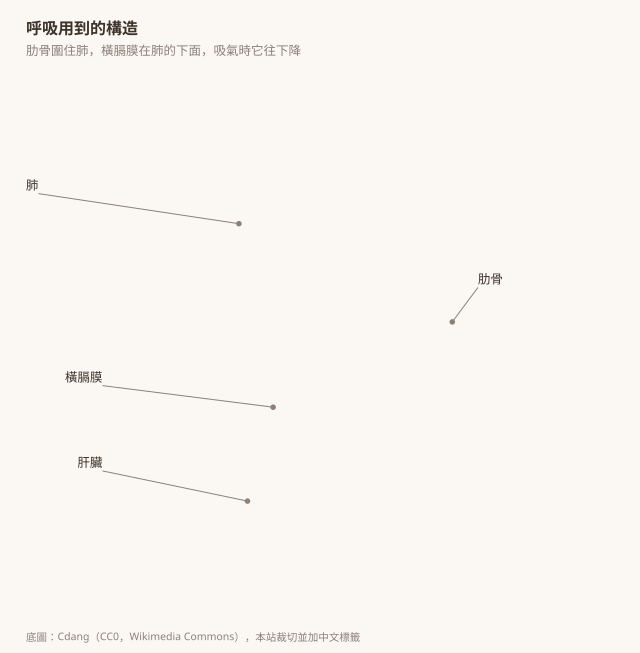
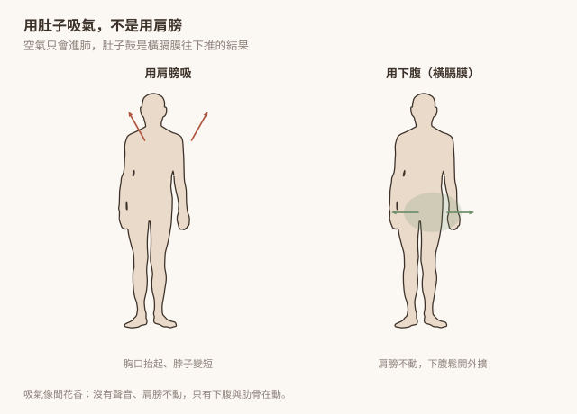
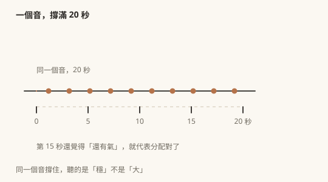
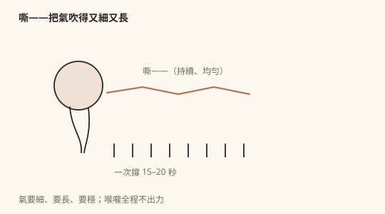

# [歌唱教學] 初階 第 3 章：核心支撐：找尋你的丹田（肌肉記憶、發力位置與日常訓練）

## 先講結論

丹田不是玄學，就是肚臍下方一帶的核心肌群，連著下腹與骨盆底。它的工作只有一件：控制氣流出來的速度。它穩，喉嚨就不用代償。

只有放鬆沒有支撐，聲音會虛。這一章要把「放鬆」和「支撐」接起來：上半身鬆，下腹微微出力。

練完你會知道力氣該出在哪裡，也能分辨「有彈性的支撐」和「憋氣」的差別。

## 常見誤解

很多人以為丹田是一個神祕的點，找到之後唱歌就會自動變好。其實它是一組肌肉，位置大概在肚臍下方兩到三指寬，一路連到骨盆底。它不會自己醒，要靠練習叫它起床。

另一個誤解是「要出力的時候肚子越硬越好」。肚子硬成鐵板，橫膈膜降不下來，氣反而吸不進、送不出。支撐是持續、可調的壓力，不是把它鎖死。

## 原理：為什麼會這樣

吸氣時，橫膈膜收縮下降，空氣進肺，下腹被往外推。吐氣時，橫膈膜放鬆回升。唱歌要的是「慢一點的吐氣」，所以下腹與腹部的肌肉會輕輕往內收，抵抗橫膈膜太快彈回去，讓氣流平均地出來。骨盆底在吸氣時放鬆，吐氣與支撐時才參與，它和深層腹部肌肉是同一組動作系統（Emerich Gordon & Reed, 2020）。

這就是丹田的工作：控制氣流的速度，不是製造音量。音量與音高由聲帶振動決定，下腹只是把需要的氣穩定送上去。所以「唱得大聲」不是把肚子推得更用力，是讓閉合與氣流一起配合。

還有一個順序要記住：氣流先穩，聲音才穩。你如果在氣流上再加喉嚨的力，等於同時踩油門又拉手煞車。

最後一件事：支撐不是一種標準動作。研究量測歌手投射聲音時的軀幹變化，發現大家用的策略不太一樣，有人靠下腹，有人靠側腰與肋間（Thorpe et al., 2001）。你要練的是「氣送得穩」，不是模仿某個人的肚子。

## 打個比方

**擠水球。** 從底部平穩施壓，水流就順；你從出水口捏，水會噴、會斷。喉嚨就是出水口。比喻失真的地方是：水球會流光，但你可以中途補氣，所以不必一次擠完。

**幫腳踏車打氣。** 打氣筒是一次一次、短而穩的行程，不是一直死壓。短促的「嘶」練的就是這個：一下一下，下腹往內彈。

**輪胎。** 按下去有阻力，但沒有變成石頭。這就是支撐的手感：有彈性、能微調，不是硬撐。

## 現在就做

### 練習一：咳嗽找位置

1. 站直，雙手反手叉腰，四指貼在肚臍下方。
2. 上半身放鬆，輕輕悶咳兩聲。
3. 注意咳嗽瞬間，四指下方那塊肌肉往外彈一下、變硬。
4. 再咳三次，記住那個位置。

感覺：下腹瞬間往外頂。做錯會怎樣：如果你只感覺肩膀在動，把咳的力道縮小，像清喉嚨一樣，讓身體自己去找那塊肌肉。

### 練習二：吹遠方的蠟燭

1. 手放在下腹，想像前方兩公尺有一根蠟燭。
2. 吸氣，嘟嘴發「呼——」，把氣送遠。
3. 下腹往內收，持續給氣，不要一口氣衝完。
4. 做三次，每次五秒。

感覺：下腹持續、緩慢地收。做錯會怎樣：如果一吹氣肩膀就抬、肚子瞬間縮到底，代表你用胸口在推。放慢，讓收縮是慢慢往內，不是一次縮光。

### 練習三：短促的「嘶」

1. 鼻子吸氣，讓下腹微微鼓。
2. 牙齒輕閉，發出短促的「嘶、嘶、嘶、嘶」，一次四下。
3. 每發一聲，下腹往內彈一次。
4. 做三輪。

感覺：下腹像打氣筒，一下一下彈；肩膀不動。做錯會怎樣：如果肚子完全沒動、只有喉嚨在嘶，先把音量減小，手壓著下腹感覺它的彈動，再重新開始。

### 練習四：長音的「嘶」

1. 吸氣，發平穩的「嘶——」。
2. 維持十到十五秒，音量與氣流粗細不變。
3. 下腹慢慢往內收，不要一次縮完。
4. 做三次。

感覺：整條氣流像一條直線，最後不會突然變細。做錯會怎樣：如果後半段發抖，是給氣不均。把吐氣放慢，或先把秒數降到八秒，穩定比長度重要。

### 練習五：接到聲音

1. 用下腹的支撐，發短促的「哈、哈、哈」，像笑聲。
2. 再發一個長的「哈——」，用下腹托住。
3. 注意喉嚨是鬆的。
4. 各做三次。

感覺：肚子在出力，喉嚨沒事。做錯會怎樣：如果「哈」變成從喉嚨刮出來，先回到練習三的「嘶」，確認位置對了，再加聲音。

## 練完之後

做對的徵兆：同樣的音量，你覺得是肚子在做事，不是脖子；長音可以走完，不必中途補氣；唱完下腹有點痠，喉嚨不痠。

常見卡點是「一用力就憋氣」。一憋氣，聲音變緊、臉會紅。檢查方法很簡單：練習時能不能一邊給氣一邊講話？不能，就是憋住了。

另一個卡點是急著加大力量。支撐要練的是穩定，不是強度。每天五分鐘的短嘶與長嘶，比偶爾一次猛練有效；練完如果喉嚨乾、想清喉嚨，先補水、讓聲音休息，不要用清喉嚨把不舒服壓下去（Behlau & Oliveira, 2009）。

下一章要把這股穩定的氣流變成可控制的線條：不暴衝、不中斷，還能隨樂句收放。

## 延伸查證

- **Emerich Gordon, K., & Reed, O. (2020).** The Role of the Pelvic Floor in Respiration: A Multidisciplinary Literature Review. *Journal of Voice.* 骨盆底與深層腹部肌肉在呼吸中的角色，也是「丹田」在解剖上大致對應的位置。PMID 30447797。
- **Thorpe, C. W., Cala, S. J., & Chapman, J. (2001).** Patterns of breath support in projection of the singing voice. *Journal of Voice.* 支撐不是單一動作；不同歌手用不同的軀幹策略達到同一結果，所以不必死背某種肚子用法。PMID 12269638。
- **Behlau, M., & Oliveira, G. (2009).** Vocal hygiene for the voice professional. *Current Opinion in Otolaryngology & Head and Neck Surgery.* 補水、避免清喉嚨、安排聲音休息的實證建議，練支撐之外的日常保養。PMID 19342952。
