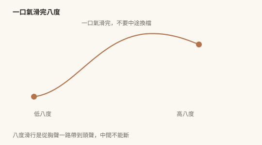
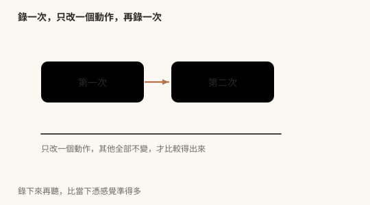

# [歌唱教學] 進階 第 30 章：頭腔共鳴的高頻區：唱出空靈、明亮與集中的泛音

## 先講結論

「頭腔共鳴」不是把氣吹進腦袋，氣也進不去。你感覺到眉心、鼻梁在震，是富含高頻泛音的聲音讓面部骨骼與軟組織跟著振動，連帶讓你覺得聲音在上面。這一章要教你先找到那個震動，再把它疊到結實的高音上。

練完的改變：高音除了有力，還多一層亮與光澤；唱長音時，聲音不會一大就變乾。

## 常見誤解

很多人把「頭聲」和「頭腔共鳴」當成同一件事。頭聲指的是聲帶的狀態，環甲肌主導、聲帶拉長變薄；頭腔共鳴指的是聲音在高處的振動感。兩者常一起出現，但不是同一件事。

另一個誤解是「要用力把聲音往上送」。送不上去。頭骨不是像琴身那樣的空箱，不會放大聲音。你如果往上推，只會把喉嚨拉緊，聲音反而更出不來。

## 原理：為什麼會這樣

聲帶發出的是很弱的聲音，經過聲道裡的空間與形狀，某些頻率被放大。頭部這一帶有鼻腔與鼻竇幾個小空腔，但鼻竇的共振落在低頻，不是放大高頻的主要結構；你感覺到的亮，主要是高頻泛音帶著面部組織一起振動。這是一種被動的共振：你不需要往那裡唱，只要泛音夠、閉合好、下巴與脖子不擋路，振動自然會出現。

內視鏡研究看過古典唱法裡的「頭聲共鳴」，結論是變化主要發生在聲道形狀的調整，不是聲音真的跑進某個腔室（Aura et al., 2022）。這和量測到的另一個現象對得起來：受過訓練的歌手在高頻會有一群集中的能量，通常被稱為歌手共振峰，位置大約在 2.8 到 3.2 kHz（Lee et al., 2008）。

用音叉比喻：敲一下音叉，再把它底部貼在桌上，整張桌子都會響。桌子沒有被吹氣，它是被帶著振。人聲也一樣：真正在振的是空氣柱與組織，頭骨只是把振動傳開的一部分。

這個比喻失真在最關鍵的地方：桌子只會被動接收，人的聲道卻會因為母音、軟顎、喉位而改變形狀，主動決定哪些頻率被放大。所以練習不是想辦法震頭骨，是調整聲道形狀，讓高頻泛音被放大。

順帶釐清：你感覺到的「在頭上」，有一部分來自身體的感覺神經，不全然是聲學。所以不要用「震得越麻越好」當標準，那只會讓你抬高下巴、拉緊脖子去製造感覺。標準應該是聲音聽起來有沒有變亮、字有沒有更清楚。

## 打個比方

**音叉與桌子。** 音叉本身很小聲，貼上桌面，整張桌子都在響。桌面不是喇叭，它只是把振動傳開。你的臉部組織就是那張桌子。

**小提琴的琴身。** 弦本身發出的聲音細得可憐，是靠琴身跟著振才變成我們聽到的音量。但琴身是木頭做的、有特定的形狀；聲道的形狀也會決定哪一段被放大，只是它會被你調整。

**音響的擺位。** 同一對喇叭，擺在牆角跟擺在房間中央，聲音完全不同。喇叭沒換，換的是空間。你調整母音與軟顎，就是在搬那對喇叭。

## 現在就做

### 練習一：用哼鳴找位置

1. 閉上嘴唇，上下牙齒微微分開，不要咬緊。
2. 在中高音發「嗯」的長音，三秒。
3. 口腔裡留一點空間，像含著半口水。
4. 把注意力放在鼻梁與眉心，找那個麻麻的震動。

做錯會怎樣：如果完全找不到，音高先往上移一點。太低的時候，震動會集中在胸口。

### 練習二：讓震動往上爬

1. 保持「嗯」，像警報器一樣慢慢往上滑。
2. 想像那個震動從嘴唇、鼻尖，往眉心移動。
3. 下腹給支撐，但喉嚨不要往上推。
4. 到最高的地方停住，再滑回來。做三次。

做錯會怎樣：如果越往上喉嚨越緊，是你在推而不是在放。把音量減半，用更少的氣滑。

### 練習三：張嘴也不掉下來

1. 在中高音找到眉心的震動。
2. 維持兩秒，嘴唇慢慢往前嘟，變成「嗚」。
3. 張嘴的瞬間，注意震動有沒有掉回喉嚨或胸口。
4. 再收一點，變成「衣」，聲音會更亮、更集中。

做錯會怎樣：如果「衣」一唱喉嚨就卡，是舌頭太用力。把舌頭放平，嘴型小一點。

### 練習四：疊到高音上

1. 挑一句抒情歌的副歌高音。
2. 先用強混聲唱，聲音結實，但可能偏乾。
3. 唱之前做一個無聲的驚訝，讓軟顎抬起、喉嚨打開。
4. 用同樣的支撐再唱一次，調整聲道形狀讓高頻泛音多一點，注意力放在眉心那種亮的感覺。

做錯會怎樣：如果加了上面之後聲音變虛，代表你把支撐放掉了。支撐留在下腹，上面只是多開一個空間。

### 練習五：錄音對照

1. 同一句，錄兩次：一次不加，一次加。
2. 戴耳機聽，只問一個問題：哪一次的字比較清楚。
3. 不要問哪一次比較「有共鳴」，那個感覺不可靠。
4. 選清楚的那次，記住它的嘴型。

做錯會怎樣：如果兩次幾乎一樣，那可能這一句本來就不需要加。不是每句都需要。

## 練完之後

做對的徵兆：高音有一種上面亮、下面穩的雙層感；小聲唱時，字仍然清楚；唱完後額頭或鼻梁有一點點用過的感覺，但喉嚨不痛。

常見卡點是「追求震動感，忘了支撐」，結果聲音空空的。另一個卡點是每首歌都想加，加了太多會變得太飄、咬字不清。它是一層光澤，不是主體。

如果你加了之後開始頭暈，先停下來正常呼吸。頭暈不是共鳴開通，通常是憋氣或過度換氣。練這種東西不需要把自己搞到缺氧。

下一步是第 31 章，把胸腔、咽腔、鼻腔、頭腔這四個比例放在一起，依曲風調配。你會發現，同一句歌詞可以唱出完全不同的顏色。

## 延伸查證

- **Aura, M., Geneid, A., & Bjørkøy, K. (2022).** A Nasoendoscopic Study of "Head Resonance" and "Imposto" in Classical Singing. *Journal of Voice.* 「頭腔共鳴」實際上是聲道形狀改變，不是聲音真的跑到頭骨裡。PMID 32513553。
- **Lee, S. H., Kwon, H. J., & Choi, H. J. (2008).** The singer's formant and speaker's ring resonance: a long-term average spectrum analysis. *Clinical and Experimental Otorhinolaryngology.* 歌手共振峰（約 2.8–3.2 kHz 附近的能量群）可以被量測。PMID 19434279。
- **Vampola, T., Horáček, J., & Laukkanen, A. M. (2024).** Three-Dimensional Finite Element Modeling of the Singer's Formant Cluster Optimization by Epilaryngeal Tube Shaping. *Journal of Voice.* 咽部與會厭腔的形狀，會改變高頻能量集中的程度。PMID 39218756。
- **Titze, I. R. (2006).** Voice training and therapy with a semi-occluded vocal tract: rationale and scientific underpinnings. *Journal of Speech, Language, and Hearing Research, 49*(2), 448–459. 哼鳴與吸管發聲為什麼能讓振動感更容易被感覺到。PMID 16671856。
