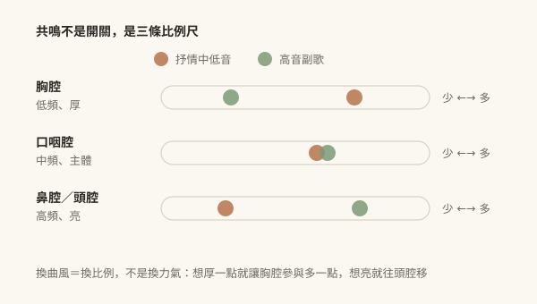

# [歌唱教學] 進階 第 31 章：音色調配器：針對大調色彩與不同曲風轉換共鳴比例

## 先講結論

同一句歌詞，換一種共鳴比例，聽起來會像別人的歌。音色不是你的真面目，是你可以調的參數。這一章把胸腔、咽腔、鼻腔、頭腔當成四個旋鈕，依編曲決定要轉到哪裡。

練完的改變：拿到新歌，你會先聽低頻多不多、伴奏的空間大不大，再決定聲音要厚還是薄，而不是用同一種聲音唱所有歌。

如果你常被說「唱得不錯，但不太像這首歌」，問題多半不在音準，在這裡。

## 常見誤解

很多人練出一種自己滿意的音色之後，就什麼歌都用它。結果唱安靜的慢歌，聽起來有壓迫；唱編曲很滿的快歌，聲音糊在伴奏裡。這不是技巧不夠，是沒有「適配」的概念。

另一個誤解是「共鳴比例有標準答案」。沒有。同一首搖滾，有人唱得乾淨透亮，有人唱得厚實，兩種都成立，取決於樂器數量、混音空間，還有你站在哪裡唱。數字只是記法，不是處方。

還有一件事要澄清：這裡講的「大調色彩」是氛圍，不是樂理上的調式。大調聽起來常常明亮、開放，但小調的歌也可以唱得很暖、很亮。決定聲音的不是調號，是編曲。

## 原理：為什麼會這樣

聲音的「顏色」不是抽象的感覺，是頻譜：哪些頻率被放大、哪些被削弱。決定這件事的是聲道形狀——喉頭高低、軟顎抬或降、咽腔收窄或放開、嘴唇圓或扁。同一個音高，換一個形狀，頻譜就換一張臉（Vurma, 2022）。

四個旋鈕對應不同的頻率傾向：

- **胸腔**：低頻與厚度。聲音變暖、變近，像貼著麥克風講話。
- **咽腔**：中高頻的集中與銳利。收窄之後，兩千多到三千赫茲附近的能量會集中起來，這是歌聲能穿過伴奏的那一帶（Lee et al., 2008）。
- **鼻腔**：軟顎微降，多一個兩、三百赫茲附近的鼻音共振，聽起來黏、帶一點嗆的亮。
- **頭腔**：高頻的光澤。注意，這不是聲音跑進頭骨，是聲道形狀讓高頻泛音變明顯（Aura et al., 2022）。

調配的方向只有一句：補它沒有的，避開它已經太多的。伴奏低頻很滿，你再加胸腔只會更擠；伴奏很乾淨、空間很大，你的聲音太乾又會顯得孤單。

順序也重要：先決定咬字要多清楚，再決定亮度，最後才決定厚度。咬字一糊，後面再怎麼調都救不回來；亮度與厚度可以在同一個咬字上疊加。每次只轉一個旋鈕，你才聽得出是誰造成的差別。

## 打個比方

**調味。** 湯已經很鹹，你不會再加鹽，會加一點酸或香氣。伴奏的低頻就是那鍋湯的鹹。它已經很滿，你卻還加胸腔，最後只會糊成一團；它很清淡，你補一點厚度就立刻有存在感。對回機制：你調的是頻譜，而頻譜是共用的，你跟伴奏在搶同一段頻率。

**拾音位置。** 同一把吉他，麥克風靠近琴橋收，聲音亮而利；靠近琴頸收，聲音厚而暖。琴沒換、弦沒換，換的是「哪一段振動被收到」。你的喉頭高低、軟顎、咽腔寬窄就是那個拾音位置——聲音還是你的，被強調的頻率換了。失真在：麥克風不會被聲音改變，你的聲道會，它同時是樂器也是喇叭。

**磨豆子的粗細。** 同一顆咖啡豆，磨粗一點、泡久一點，喝到的是厚與甜；磨細一點、快沖，喝到的是亮與香氣。豆子沒換，換的是「哪一些成分被萃取出來」。你的聲道形狀就是磨豆粗細：同一個音高，被放大的頻率不同，味道就不同。失真在：咖啡只能選一次粗細，你的聲道在句子中間就能換。

## 現在就做

### 練習一：先聽，再決定

1. 挑三首歌，風格差距大一點：一首安靜抒情、一首編曲很滿的搖滾、一首 R&B。
2. 每首只聽主歌，耳機專門聽貝斯和鼓。問兩件事：低頻多不多？空間大不大？
3. 在紙上寫兩個答案：這首適合厚還是薄？亮還是暗？
4. 先不要唱。

做錯會怎樣：三首都寫一樣的答案，代表你聽的是旋律，不是編曲。把總音量調小，只注意貝斯。

### 練習二：三種配方，同一句歌詞

用同一句歌詞、同一個音高，做三次：

1. **近的版本**：胸腔多一些，軟顎抬高讓聲音乾淨，起音用很軟的氣音。目標是像在講話，不是像在唱。
2. **穿的版本**：胸腔收掉一半，咽腔收窄，聲音往鼻梁與硬顎集中，字要乾淨。起音短，下腹給氣快。
3. **黏的版本**：下巴放鬆，軟顎降一點，母音不要太字正腔圓，把亮的母音往後吞一點，句尾加一點氣泡音。

每一種唱兩次，第二次錄音。

感覺：近的版本胸口有振動、喉嚨鬆；穿的版本鼻梁後面有一點緊繃，但喉嚨不痛；黏的版本聲音像離麥克風更近。

做錯會怎樣：穿的版本聲音刺、喉嚨癢，是咽腔收太過，把集中的量減一半。黏的版本糊到聽不懂字，是軟顎放太多，先把字咬清楚再加鼻音。

### 練習三：一次只改一個變數

1. 同一句、同一個音高，錄三個版本。
2. 聽的時候不要看順序，隨機播。問：哪一個最適合這首歌？為什麼？
3. 把理由寫下來，例如「伴奏很滿，所以需要前面一點」。

做錯會怎樣：三次聽起來差不多，是旋鈕沒有真的轉動。先用最誇張的版本各唱一次，確定你抓得到差別，再縮回合理的量。

## 練完之後

做對的徵兆：同一句話，你能唱出至少三種明顯不同的顏色；聽別人的歌時，你開始聽得出他哪一段加了咽腔、哪一段退回胸腔。

常見卡點是「只練技巧，不練判斷」。技巧是材料，判斷才是製作。另一個卡點是太快模仿某個歌手：先模仿可以，但要聽出他為什麼這樣唱——是為了穿過哪一層伴奏，還是為了讓字聽起來更近。把音色當貼紙貼上去，換一首歌就不合身。

還有一個實用差別：錄音和 Live 是兩個環境。錄音可以一軌一軌修，Live 只有一次機會，而且監聽會騙你。先把三種配方在家裡練到不用想就能切換，台上才有餘裕。

下一步是第 32 章：咽音。它就是這一章「穿的版本」那顆旋鈕，單獨拉出來練會更穩、更省力。

## 延伸查證

- **Aura, M., Geneid, A., & Bjørkøy, K. (2022).** A Nasoendoscopic Study of "Head Resonance" and "Imposto" in Classical Singing. *Journal of Voice.* PMID: 32513553。古典唱法裡的「頭腔共鳴」與 imposto，內視鏡看到的是聲道形狀改變，不是聲音跑進頭骨。
- **Lee, S. H., Kwon, H. J., & Choi, H. J. (2008).** The singer's formant and speaker's ring resonance: a long-term average spectrum analysis. *Clinical and Experimental Otorhinolaryngology.* PMID: 19434279。歌手共振峰（約 2.8–3.2 kHz 的能量群）可以用長期平均頻譜量到。
- **Vurma, A. (2022).** Amplitude Effects of Vocal Tract Resonance Adjustments When Singing Louder. *Journal of Voice.* PMID: 32624371。音量改變時，聲道共鳴的調整是可量測的動作，不只是「感覺比較亮」。
- **Sundberg, J., & Thalén, M. (2015).** Respiratory and Acoustical Differences Between Belt and Neutral Style of Singing. *Journal of Voice.* PMID: 25819162。同一段旋律，belt 與中性唱法的氣壓、聲壓與共振峰策略不同，音色是整套參數，不是單一開關。

