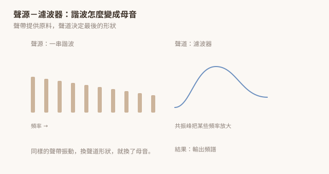
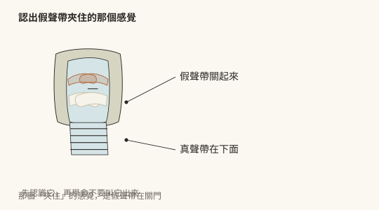
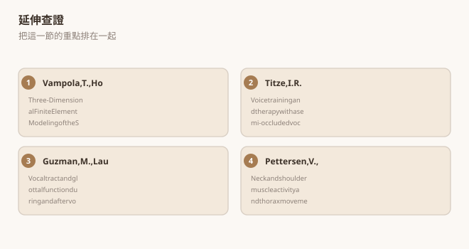

# [歌唱教學] 進階 第 32 章：咽音技術初探：強化聲帶發聲能力的高階訓練法

## 先講結論

咽音不是另一套發聲器官。它的核心只有一個動作：把喉嚨上方的咽腔收窄，讓聲音變扁、變集中。這是一種練習工具，不是上台要用的聲音。

練完的改變：原本要高音只能靠「用力撐」的地方，可以換成比較省力的方式；你也分得出「集中」和「夾緊」的差別。

如果你的高音是漏氣、發虛的，這一章比再唱十次大聲長音有用。

## 常見誤解

很多人第一次做咽音，會覺得「這聲音這麼難聽，怎麼可能拿來唱歌」。練習時難聽是正常的。它像蹲馬步，不會搬上台，但會讓你在台上穩。真正要唱的時候，是把那份集中稀釋到母音裡，不是整首用鴨子叫。

另一個誤解是「咽音可以修好受傷的聲帶」。講保守一點：收窄咽腔、讓聲音集中，是一種負荷較低的發聲練習，對健康的聲帶有幫助；但如果你已經沙啞超過兩週、唱完會痛、音域突然變窄，那不是練法的問題，是先去看耳鼻喉科或找語言治療師。練習不能代替診斷。

還有一個混淆要拆開：把「集中」當成「夾」。集中是形狀變窄，夾是力氣變大。前者做完喉嚨鬆，後者做完喉嚨癢。

## 原理：為什麼會這樣

核心動作只有一個：咽縮肌與杓會厭肌把喉部上方的咽腔收窄，聲道形成一個小漏斗。聲音通過時，中低頻被削弱，兩、三千赫茲附近的高頻被強調，聽起來扁、亮、集中（Vampola et al., 2024）。這也解釋了為什麼專業歌手的聲音能穿過管弦樂團——不是比較大聲，是那一段頻率的能量比較集中。

為什麼它對閉合有幫助？當聲音被要求「集中、不能漏氣」，聲帶邊緣會靠得比較緊，而這份閉合不必靠增加厚度換來。你得到的是細、亮，但不重。這正是高音需要的那一半。

還有一層：窄聲道本身就是阻力。口腔後方有阻力時，聲帶可以用比較低的壓力振動（Titze, 2006）。用共鳴管和吸管發聲量測過，窄管確實會改變聲門的工作方式（Guzman et al., 2013）。所以咽音練習後常覺得「聲音突然變好做」，不是錯覺，是負荷真的降了。

邊界也要講清楚：這個練習不會讓你「用假聲帶唱歌」。假聲帶平常的工作是保護，不是發聲。你要的是它退開、不壓下來，然後用聲帶邊緣把閉合做好。聲音變扁是聲道形狀造成的，不是假聲帶在響。

最後一個風險：收窄咽腔很容易連脖子一起用力。越大聲、越高音，頸肩的代償越明顯（Pettersen et al., 2005）。所以練習音量要小，小到你不需要借脖子的力。

## 打個比方

**捏水管。** 花園水管的口徑是固定的，你用手指把出水口壓扁，水會噴得更遠、更集中——但你沒有加壓馬達，馬達還是原本那顆。咽腔收窄就是壓扁管口：聲帶沒有變強，被集中的是能量。失真在：水管可以一直壓著，你的咽腔壓久了會痠，所以要練短、練完就放掉。

**手電筒換聚光。** 同一顆燈泡，散光模式照亮一整面牆，聚光模式只能照一小塊，但那塊很亮。你沒有換燈泡，唱歌時你要的是那一塊，不是整面牆。

**蹲馬步。** 沒有人用蹲馬步的姿勢上台，但每個練武的人都要蹲。它練的是「在奇怪的位置上仍然穩」。咽音就是聲音的蹲馬步：姿勢不拿出來用，但要求你在窄的形狀裡不漏氣、不夾緊。

## 現在就做

### 練習一：先確認「集中」不是「夾」

1. 吸氣，然後像要憋住一樣，把喉嚨那扇門關上。
2. 不要放掉，直接從那個點擠出短促的「捏」。
3. 聲音應該扁、亮、貼在鼻梁後方。
4. 捏住鼻子再試一次，聲音不該突然變悶。

感覺：鼻梁後面有一點緊繃，喉嚨本身不痛。做錯會怎樣：喉嚨癢、想咳、聲音沙沙的，那是夾，不是集中。停下來，做兩分鐘彈唇（第 11 章），先讓喉嚨鬆回去。

### 練習二：短促的「捏」

1. 連續發短促、彈跳的「捏、捏、捏」，像在趕貓。
2. 一次比一次短。
3. 每一下都確認沒有漏氣聲。
4. 做十下，休息三十秒，再做十下。總共不要超過三組。

感覺：聲音像一顆一顆小石子丟在硬地上。做錯會怎樣：越做越緊是疲勞，不是進步。五下就停，比硬撐十下好。

### 練習三：滑過換聲區

1. 從中低音的「捏」開始。
2. 像警報器往上滑，一路保持扁、集中。
3. 到換聲區附近，下腹穩住，喉嚨不加力。
4. 到高音停住，再滑回來。做三次。

做錯會怎樣：滑到一半聲音突然變厚、變重，是「捏」掉回母音了，嘴型收小一點。如果滑到高處就斷氣，是支撐掉了，先縮小音程，只滑五度。

### 練習四：把集中稀釋回母音

1. 選一個你容易唱虛的中高音。
2. 先用「捏」唱兩秒，記住那個集中的芯。
3. 音高不變，慢慢把嘴打開成「拿」或「啊」。
4. 打開的過程留住喉嚨那一點集中的感覺，像在一層軟的外面留著一根細針。

感覺：聲音從細變寬，但中間那條線沒有斷。做錯會怎樣：一打開就散，是集中整個掉了。嘴型收小一半重來，或先只練到「拿」，不要一次跳到「啊」。

每次練習至少留一半時間做這一項，不然你會練出一堆唱歌時用不上的技能。

## 練完之後

做對的徵兆：高音比較不漏氣；同樣的音高，你用比較小的力氣就唱得住；練完喉嚨不痛，只有一點使用感。

常見卡點是把「集中」練成「夾」，越練越緊。判斷方法很簡單：練完會不會一直想清喉嚨，想清就是做錯了。第二個卡點是只練難聽的版本、沒有練稀釋，結果練習很有感，唱歌用不上。

如果你的聲音已經沙啞、疼痛或音域突然變窄，先暫停這類訓練，找醫師或語言治療師確認。練習是給健康聲帶的。

下一步回去看第 25 到 27 章。咽音練的閉合，正好是混聲裡「輕但不虛」的那一半。

## 延伸查證

- **Vampola, T., Horáček, J., & Laukkanen, A. M. (2024).** Three-Dimensional Finite Element Modeling of the Singer's Formant Cluster Optimization by Epilaryngeal Tube Shaping. *Journal of Voice.* PMID: 39218756。小體積的會厭腔能集中歌手共振峰的能量群；咽腔形狀會直接改變高頻輸出。
- **Titze, I. R. (2006).** Voice training and therapy with a semi-occluded vocal tract: rationale and scientific underpinnings. *Journal of Speech, Language, and Hearing Research, 49*(2), 448–459. PMID: 16671856。聲道的窄化與阻力，會直接影響聲帶振動所需的壓力。
- **Guzman, M., Laukkanen, A. M., & Krupa, P. (2013).** Vocal tract and glottal function during and after vocal exercising with resonance tube and straw. *Journal of Voice.* PMID: 23683806。用共鳴管與吸管發聲時，聲道與聲門功能會改變；練完之後的變化也被量到。
- **Pettersen, V., Bjørkøy, K., & Torp, H. (2005).** Neck and shoulder muscle activity and thorax movement in singing and speaking tasks with variation in vocal loudness and pitch. *Journal of Voice.* PMID: 16301107。唱得越大聲、越高，頸肩肌肉越容易代償；這也是「集中練成夾」時第一個出現的訊號。

