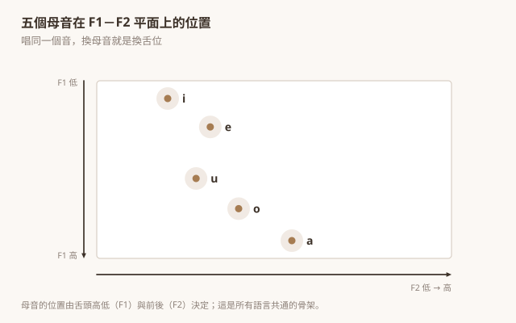

# [歌唱教學] 進階 第 33 章：母音與子音的聲學策略：讓咬字成為律動的一部分

## 先講結論

發聲練習唱得很順，一加歌詞就變笨重，通常不是你退步，是你把每個字都咬得太用力。子音負責節奏，母音負責聲音。子音短、母音長，句子就會開始有律動。

練完你會發現：同一首歌，你沒有唱得更大聲，但字跟字之間不再卡，聽起來像在講話，不像在唸課文。

## 常見誤解

很多人以為咬字清楚，就是每個字都要用力咬到底。其實子音只要「碰到」就夠了。咬得越久，氣流被切得越碎，喉嚨越累，句子也一塊一塊。

另一個誤解是「有律動就等於不準」。不是。律動是你在很清楚拍子在哪的前提下，讓子音早一點、母音踩在拍上。拍子沒有消失，只是被你先一步抵達。

還有人以為唱不清楚是舌頭不夠靈活。多數時候是下巴太忙、子音太長，舌頭只是背了黑鍋。

## 原理：為什麼會這樣

子音大部分是無聲的。發 P、T、K 時，氣流被嘴唇、舌尖或舌根短暫擋住，這是塞音；發 S 時，氣流沒有被擋住，而是通過狹窄的齒縫產生摩擦噪音，這是擦音。這幾種音聲帶都會短暫停振。如果每個子音都又重又長，聲帶就得一直重新啟動，喉嚨當然累。

母音相反。發「啊」「衣」「嗚」時聲帶持續振動，氣流順順通過，這才是聽眾真正聽到的那條線。母音之間真正的差別是共振峰的位置：口腔與咽腔的形狀改變，被放大的頻率就跟著改變（Vurma, 2022）。所以換母音其實是換聲道形狀，不是換一個「共鳴腔」（Aura et al., 2022）。

子音還有一個功能：它決定拍子落在哪裡。你先讓嘴唇或舌尖碰到定位，真正出聲的瞬間留給母音，字就會有彈性。這不是偷跑，是把「接觸」和「發出聲音」拆開。

中文還有一個容易忽略的地方：很多字的結尾是鼻音，例如「天」「想」「聽」。鼻音收太早，聲音短而扁；收太晚，又會拖到下一個字。把鼻音當母音的一部分，唱滿它的長度，再進下一個字。

咬字的位置也會影響音高。同樣的音，嘴形越開，喉嚨越容易鬆；嘴形越扁，聲音越集中。所以你不需要為每個字換一套唱法，只要維持同一個共鳴位置，讓嘴唇和舌頭在上面做小動作。哼鳴、彈唇這類半閉口練習之所以好用，就是它用阻力幫你守住那條連續的氣流（Titze, 2006）。

## 打個比方

**鼓與長音。** 鼓點決定拍子落在哪裡，長音決定音樂是什麼顏色。鼓敲完就沒了，弦可以一直拉。你的嘴巴只有一組器官，所以不是分工，是比例：子音像鼓皮被敲到的那一瞬間，母音是餘響。失真在：鼓和長音是兩件樂器，你的嘴只有一套。

**蓋印章。** 子音是印章碰到紙的那一下，母音是印出來的墨。你不需要把印章壓進桌裡，碰一下、離開，圖案最清楚。壓太久紙會破，那就是喉嚨痛。

**運球。** 手拍地面只有一下子，球在空中待的時間長得多。你聽到的節奏是拍的那一下，你聽到的音樂是球在飛。歌裡的律動就是這樣：子音給你拍點，母音給你弧線。

## 現在就做

### 練習一：只做子音，不出聲

1. 關掉聲音，只用氣做「P、T、K、S」。
2. 嘴唇、舌尖、舌根像鼓棒，碰一下立刻彈開，不要拖成「Puh」「Tuh」。
3. 做十次。

感覺：嘴唇中央、舌尖前緣、舌根分別在動，下巴幾乎不動。做錯會怎樣：下巴跟著開合，喉嚨很快就會緊。停下來，手按住下巴，只動嘴唇。

### 練習二：母音裡點子音

1. 發一個集中的長音「衣」，維持三秒。
2. 同一個音高，用舌尖快速點進「T」：衣—提—衣—提—衣。
3. 做四個呼吸循環。

感覺：亮的「衣」一直在，T 只是劃過去。做錯會怎樣：T 之後聲音掉回喉嚨、共鳴不見，是子音咬太長，減短一半再試。

### 練習三：整句只唱母音

1. 挑一句慢歌，例如「我想你」，把子音全拿掉，只唱母音：「喔—昂—衣」。
2. 整句不要斷氣。
3. 唱三次。

感覺：像一條線，字和字之間只有口型的改變。做錯會怎樣：每個母音之間都停一下，先放慢，確定氣沒斷，再回到原速。

### 練習四：把子音預先放好

1. 練「天空」這兩個字。
2. 在拍子來之前，舌尖先輕輕放到「T」的位置。
3. 重拍落下時才張開唱「ian」。

感覺：字是被拍子接住的，不是一起撞上去。做錯會怎樣：子音和母音同時砸在拍上，聽起來像兒歌。把子音再提前一點點。

### 練習五：鼻音收尾要唱滿

1. 挑一句有鼻音結尾的歌詞：「想」「聽」「天」。
2. 每個鼻音唱滿它的長度，再接下一個字。
3. 錄音聽一次。

感覺：句子變圓，但不會糊。做錯會怎樣：鼻音太重、像感冒，是嘴巴沒開；嘴形張大一點，讓鼻腔和口腔一起工作。

## 練完之後

做對的徵兆：唱完一串快字，喉嚨是鬆的；錄音裡字與字之間有空間，但沒有斷層。

常見卡點是「一到高音就又咬緊」。高音更需要把子音放輕，因為那時候喉嚨已經在忙了。先唱母音，再把子音點回去。

另一個卡點是速度。歌詞一密，你會覺得每個字都來不及。那時候不是加快舌頭，是減少舌頭的移動距離：子音碰一下就走，母音用同一個嘴形撐著，不要每個字都重新開一次嘴。

下一章把嘴巴的動作拆得更細：快到來不及咬字時，哪一個部位該動，哪一個部位該完全不動。

## 延伸查證

- **Vurma, A. (2022).** Amplitude Effects of Vocal Tract Resonance Adjustments When Singing Louder. *Journal of Voice.* PMID: 32624371。聲道共鳴的調整是真實的動作，會反映在頻譜與音量上；換母音就是換這一組調整。
- **Aura, M., Geneid, A., & Bjørkøy, K. (2022).** A Nasoendoscopic Study of "Head Resonance" and "Imposto" in Classical Singing. *Journal of Voice.* PMID: 32513553。內視鏡看到的「共鳴位置」其實是聲道形狀的變化，不是聲音跑到某個空腔裡。
- **Titze, I. R. (2006).** Voice training and therapy with a semi-occluded vocal tract: rationale and scientific underpinnings. *Journal of Speech, Language, and Hearing Research, 49*(2), 448–459. PMID: 16671856。半閉口（哼鳴、彈唇）為什麼能幫你維持連續氣流：口腔後方的阻力讓聲帶用較低的壓力工作。
