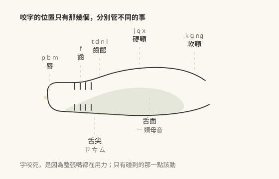

# [歌唱教學] 進階 第 34 章：唇齒舌的精細協調：高速樂句與複雜咬字的處理

## 先講結論

快歌唱不清楚，通常不是舌頭不夠快，是下巴動太多。下巴是塊很重的骨頭，它一快，喉頭就跟著晃，聲音會破、拍子會拖。高速咬字的工作要交給舌尖和嘴唇，下巴只要穩穩把空間撐開。

練完你會發現：同一段快詞，嘴巴看起來幾乎沒動，字卻變清楚了。

## 常見誤解

很多人以為字唱得越快，下巴就要開合得越快。其實下巴越忙，聲音越不穩。你可以在鏡子前唱同一段快詞，一次下巴放鬆、一次下巴用力開合，差別會很明顯。

還有人以為「含糊」是舌頭不夠快。更多時候是舌根跟著舌尖一起抬，把喉嚨塞住了。舌頭前段在動，後段卻跟著往後縮，聲音就悶。

## 原理：為什麼會這樣

下巴（下顎骨）體積大、質量重，它跟喉頭之間有肌肉連結。你快速開合下巴時，喉頭會跟著上下晃，聲帶的閉合就變得不穩定。速度一快，這個晃動來不及修正，結果就是拖拍、破音、喉嚨緊。頸肩的代償也是同一條路：越用力，脖子和肩膀越會自動接手（Pettersen et al., 2005）。

舌尖則是全身最靈活的部位之一。它輕、路徑短，一秒內可以做好幾次精準的接觸。嘴唇也一樣，真正的唇音只需要嘴唇最內側那條濕潤的邊緣去碰，不需要整張嘴用力。

所以高速咬字的原則是：下巴提供穩定的空間，舌尖和嘴唇負責切割。下巴像桌腳，舌唇像在桌面上快速敲打的筆尖。失真在：桌腳完全不動，你的下巴還是會微幅開合，重點是它不主導速度。

舌頭的移動距離也很關鍵。同一個音，舌尖從門牙後面移到硬顎前緣，可能只有幾毫米。距離越短，速度越快，也越不容易帶動舌根。很多人咬字慢，不是舌頭不夠快，而是每一次都做了多餘的移動：舌尖縮回太深，或下巴跟著一起開。

還有一點：越快的樂句，越需要預先決定。你不能等那個字到了才想嘴巴要怎麼動，要在前一個字還在唱的時候，舌頭已經移到下一個位置。慢歌可以臨時反應，快歌只能事先排好。這件事一部分靠練習，一部分靠身體感覺——咬字的位置感是練出來的動覺記憶，不是靠耳朵猜的（Mürbe et al., 2002）。

## 打個比方

**桌腳與筆尖。** 桌子不穩，你在上面寫字一定歪。下巴就是桌腳，它只要穩，不必跟著筆畫動。寫字快不快，看的是筆尖，不是桌腳。

**縫紉機。** 針上下動得極快，機器本身卻穩穩放在桌上。你踩踏板提供動力，不參與針的節奏。下巴是機身，舌尖是針：機身一晃，線就歪；機身穩，針再快都漂亮。

**打字。** 手指動得飛快，手腕卻幾乎不動。真正打錯字的人，常常是整隻手跟著抬。唱快歌也一樣，舌頭前面的三分之一在動，舌根應該是平的。

## 現在就做

### 練習一：先讓下巴閉嘴

1. 把大拇指和食指彎成一個指節寬，輕輕橫放在上下門牙之間。下巴被固定住，只能微張。
2. 保持這個姿勢，唸一段快歌歌詞，速度先放到平常的七成。
3. 舌尖做較大的移動，嘴唇把 B、P、M 做完。

感覺：嘴巴像被撐開，舌頭突然變得很忙。做錯會怎樣：用力咬手指、臉頰痠，代表你在用下巴硬撐。放鬆，只要固定就好。

### 練習二：拿掉手指，保留那個「懸著」的感覺

1. 拿掉手指，保持下巴微張、像被懸著的感覺，再唸一次。
2. 對著鏡子確認下巴的開合幅度有沒有變小。

感覺：口腔空間變大，字反而更清楚。做錯會怎樣：下巴立刻回復用力開合，回到練習一，重新建立「下巴不動也能說話」的感覺。

### 練習三：舌尖四兄弟

1. 用節拍器，慢速開始，練「Da-Ta-Na-La」，四拍一組，每拍四個音。
2. 只讓舌尖最前面三分之一動。

感覺：舌根平貼，像一片平原。做錯會怎樣：脖子前面鼓起來、喉嚨癢，是舌根在幫忙。把速度再放慢，或先只練「Na-La」兩個音。

### 練習四：嘴唇只動中間一小塊

1. 在一個長音「嗚」裡，用嘴唇邊緣快速唱「Bu-Bu-Bu-Bu」。
2. 對著鏡子看：只有嘴唇中央一小塊在動，臉頰和下巴靜止。

感覺：像魚嘴快速開合。做錯會怎樣：整張嘴噘起來、臉頰凹陷，力量用錯地方了。放鬆嘴角再試，只要中間動。

### 練習五：慢動作放大，再回原速

1. 挑最卡的那一句，用一半速度唱三遍。
2. 把每個子音的接觸點放大，像慢動作。
3. 再回到原速。

感覺：原速突然變簡單。做錯會怎樣：慢速時就含糊，先不要提速，把歌詞拆成兩、三個字一組練。

## 練完之後

做對的徵兆：唱完快歌，痠的是舌頭和嘴唇，不是下巴和脖子；錄音裡字與字之間有清楚的起點。

常見卡點是一緊張就回復「用下巴咬字」。練習時在鏡子前確認下巴的幅度，比聽聲音更快抓到問題。

另一個卡點是舌根。舌尖練快之後，舌根會跟著抬，喉嚨就緊了。判斷很簡單：唱完一段快詞，如果脖子前面痠、不是舌頭痠，那是舌根在幫忙。回到「Da-Ta-Na-La」，用一半速度，確認舌根是平的。

練到舌頭痠是正常的，休息一下就好。練到喉嚨痛是方法錯了，停下來，重新檢查下巴和舌根。這種痛的差別，比任何錄音都誠實。

下一章要處理時間感：字都唱對了，為什麼整句聽起來還是像節拍器，沒有律動。

## 延伸查證

- **Pettersen, V., Bjørkøy, K., & Torp, H. (2005).** Neck and shoulder muscle activity and thorax movement in singing and speaking tasks with variation in vocal loudness and pitch. *Journal of Voice.* PMID: 16301107。音量和音高增加時，頸肩與軀幹的動作會跟著改變；用力咬字時，代償會從脖子先出現。
- **Mürbe, D., Pabst, F., & Hofmann, G. (2002).** Significance of auditory and kinesthetic feedback to singers' pitch control. *Journal of Voice.* PMID: 12002886。歌唱控制同時依賴聽覺與身體感覺；咬字的位置感也是同一種動覺記憶。
- **Peultier-Celli, L., Audouin, M., & Beyaert, C. (2022).** Postural Control in Lyric Singers. *Journal of Voice.* PMID: 32456837。歌唱時的姿勢控制與平衡策略會影響上半身的穩定度；下巴與頸部的穩定不是獨立於全身的。
