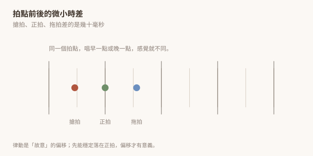

# [歌唱教學] 進階 第 36 章：節奏的微操：搶拍、拖拍與靈魂樂的彈性速度

## 先講結論

搶拍和拖拍不是節奏不好，是你在很清楚拍子的情況下，選擇把某幾個字放在拍子前面或後面。用得對，句子有情緒；用得亂，聽眾會不安。分野只有一個：你有沒有在後面把時間還回去。

練完你會發現：同一句歌詞你能唱三種表情，而且每一種都還在拍子上。

## 常見誤解

很多人以為「不在拍點上」就是節奏差。要分兩種：一種是不知道拍子在哪，聲音亂飄；一種是知道拍子在哪，刻意偏離，並在下一個重拍回到軌道。前者聽起來混亂，後者聽起來有張力。

另一種誤解是拖拍越拖越有味道。拖到聽眾開始替你緊張，就不是風格，是失控。差距通常只有幾十毫秒的量級，聽得出來，但不會讓人慌。

## 原理：為什麼會這樣

音樂的拍子是一個持續的網格，人的注意力會預期下一個重拍出現。你在重拍前先唱，等於提前滿足這個預期，聽起來急、有衝勁；你在重拍後才唱，等於讓預期落空一下，聽起來鬆、有分量。整首歌的時間感，就是這些小落差的總和。

所謂彈性速度，是把一整句當成一個區塊：句子的起點和終點仍然清楚，內部則拉長某些字、壓縮某些字。你可以先借一點時間，後面一定要還。只要借還平衡，聽眾只感覺到拉扯，不會覺得你迷路。

這個比喻要停一下：橡皮筋不會斷，人聲會。如果拖到氣不夠、下一句來不及準備，張力就變成失誤。支撐的分配在這裡很關鍵，而支撐本來就不是單一動作——不同歌手會用不同的軀幹策略達到同一個結果（Thorpe et al., 2001）。你的方法不必跟別人一樣，但要能重複。下腹與骨盆底在呼吸裡的角色也是這樣：不是繃緊，是穩定（Emerich Gordon & Reed, 2020）。

還有一個實用判準：偏離通常落在句子內部，不要落在第一個字或最後一個字。句首偏離，聽眾會覺得你沒抓到進點；句尾偏離，最後一個字會拖泥帶水。句中的字偏離，聽起來才像語氣。

最後：偏出去之前，心裡要有一條線。你在心裡先聽見那個拍，才敢離開它（Reed et al., 2024）。沒有內在拍子的偏離，就是跑掉。

## 打個比方

**借錢。** 你可以先跟朋友借兩百，但下次要還。借得順，關係裡有一種彈性；只借不還，就是欠債。句首借、句尾還，是同一件事。

**彈簧。** 你把彈簧壓進去，放手它會彈回來。壓得越深，回彈越有力——但你得先放手。很多人搶拍搶得很爽，卻忘了放手，句子就一路往前衝到結束。

**方向盤回正。** 車偏出去不是問題，問題是你有沒有回正。開長途的人一直在微調，乘客不會暈；只有偏出去不回正的人，才會讓人抓緊扶手。

## 現在就做

### 練習一：先量基準

1. 找一句副歌開頭，照拍子唱，每個字都踩在正拍。錄一次。
2. 閉眼聽一次，確認自己真的在線上。

感覺：安全、平。做錯會怎樣：連這樣都跟不上，先不要練微操，回去對著節拍器唸歌詞。

### 練習二：前三後一

1. 同一句，把前兩、三個字提前一點點唱，像連珠炮。
2. 最後一個重音字準準落在下一個重拍，並拉長。

感覺：前面衝出去，後面被釘住。做錯會怎樣：最後一個字也提前，整句會變趕。慢下來，只想一件事：最後一個字要準。

### 練習三：晚進來，但要收回來

1. 找一句慢歌的主歌，第一拍完全不張嘴，讓伴奏先走。
2. 等到「再不唱就來不及」的那一刻，用比較鬆的聲音滑進去。
3. 句尾確認下一個字落在拍上。

感覺：像被拍子拉著走。做錯會怎樣：進來之後每個字都拖，下一句會整句遲到。把中間的連接字唱快一點，把時間補回來。

### 練習四：頭尾固定，中間液體

1. 選一句四拍的樂句，故意把第一拍拉長，中間兩個字擠短。
2. 最後一個字回到正拍。用節拍器，不放伴奏。
3. 做三次。

感覺：句子內部像液體，頭尾是固體的。做錯會怎樣：最後一個字也跑掉，代表你只顧前面。先只練「最後一拍要準」，再處理中間。

### 練習五：三種體溫

1. 把練習二、三、四各錄一次。
2. 閉眼聽，問自己：哪一個像「講話講到激動」，哪一個像「懶懶地回答」？

做錯會怎樣：聽不出差別，就把差距再放大，直到你自己都覺得明顯，再縮小回來。

## 練完之後

做對的徵兆：偏離之後，你心裡知道下一個拍子在哪，身體會自己回去；聽的人覺得有情緒，不覺得你掉拍。

常見卡點是一搶拍就一路趕到句尾。解法是先把「落地點」找出來，只練那一個字，前後都先照拍唱。

另一個卡點是拖拍之後接不上。拖完的那一句通常會比較短，因為你晚了開始。解決方式不是硬唱快，是先想好中間哪幾個字可以輕輕帶過，把時間留給重音字。重音字要準，其他字可以趕。

還有一個紀律：一句話裡只用一次。用了兩次以上，聽眾會開始注意你的時間，而不是你的話。

下一章要練裝飾音：轉音、滑音、顫音。先有穩定的拍子，裝飾音才不會變成模糊帶過。

## 延伸查證

- **Thorpe, C. W., Cala, S. J., & Chapman, J. (2001).** Patterns of breath support in projection of the singing voice. *Journal of Voice.* PMID: 12269638。支撐不是單一動作，不同歌手用不同的軀幹策略達到同一個結果；「借還」時間時，支撐也要跟著分配。
- **Emerich Gordon, K., & Reed, O. (2020).** The Role of the Pelvic Floor in Respiration: A Multidisciplinary Literature Review. *Journal of Voice.* PMID: 30447797。下腹與骨盆底在呼吸時的角色，常被誤解成「繃緊」；實際上穩定比用力重要。
- **Reed, C. N., Pearce, M., & McPherson, A. (2024).** Auditory imagery ability influences accuracy when singing with altered auditory feedback. *Music & Science.* PMID: 39219861。心裡先聽見，唱出來才穩；偏離拍點之前，內在的拍子要先存在。
