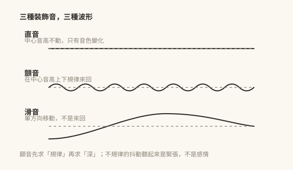

# [歌唱教學] 進階 第 37 章：裝飾音的藝術：轉音、滑音與顫音 (Vibrato) 的技術拆解

## 先講結論

裝飾音不是情緒來了就抖一下、滑一下。它是在穩定的氣流上，做很小、可控制的變化。轉音是階梯，滑音是連續的線，顫音是規律的音高來回。三種動作的肌肉方式不同，練法也不一樣。

練完你會發現：你的轉音聽得出音，滑音不會掉進喉嚨，顫音不用下巴抖。

## 常見誤解

很多人以為顫音是把喉嚨或下巴快速抖動。那樣做出來的是音量忽大忽小、位置亂跑的聲音，聽起來像綿羊叫，音準還會偏。

另一種誤解是「轉音就是快速滑過去」。滑過去會變成一團，聽不出音階。轉音的每個音要有落點，像走樓梯，不是坐溜滑梯。

還有一種：以為顫音是天生的，沒有就沒有。速率和幅度都可以透過訓練改變，只是慢（Mitchell & Kenny, 2010）。

## 原理：為什麼會這樣

先把三者分清楚。

**轉音**是一串短音快速交替。聲帶持續閉合，只是在每個音上快速調整張力來切換音高，聽起來一階一階。**滑音**是一個音高連續移動到另一個音高，中間沒有中斷，聲帶張力平順改變。**顫音**是音高規律地上下小幅變動，一般歌唱者大約落在每秒 5–7 次（Nix et al., 2016），由氣流與聲帶張力的平衡帶出來。

顫音特別容易搞錯：它是音高的週期變化，不是音量。音量週期變化叫震音（tremolo），是另一回事。判斷方法很簡單：手指輕放喉結，做對的顫音喉結幾乎不動，但音高在微微來回；如果喉結跟著上下明顯起落，你是在用手或喉嚨推。

還有一個關鍵：裝飾音要從穩定的直音長出來。直音站不穩，裝飾音就會變成遮掩——你以為在加感情，其實是在蓋掉不穩。所以下面的練習都先練直音，再放裝飾。

轉音的另一個要點是音階。同樣五個音，只是上上下下滑，聽起來很含糊；清楚每個音落在哪，聽起來像一串珠子。流行歌的轉音常用五聲音階或大小調音階，不是隨便亂跑。所以練轉音，其實也在練音感。

## 打個比方

**樓梯與溜滑梯。** 轉音是走樓梯，每一階都要踩到；滑音是溜滑梯，中間不停。你不可能用溜滑梯的方式走樓梯——腳不落地，就沒有階。反過來，該滑的地方你硬要一階一階，聽起來會很硬。

**吉他揉弦。** 吉他手讓音微微上下，不是抖手腕，是用手指把弦的張力來回改變。同一條弦、同一個音，只是張力在動。顫音就是聲帶的揉弦：動的是張力，不是喉嚨的位置。

**鐘擺。** 你推一下，它自己擺；你一直扶著它，它反而擺不勻。顫音也一樣，你放手它才均勻。這也是為什麼「越用力抖」聽起來越假。

## 現在就做

### 練習一：先把階梯踩清楚

1. 選一個五個音下行的小句子，例如 La-Sol-Mi-Re-Do，用「啊」。
2. 速度放慢到平常的三分之一，每個音分開唱，音和音之間停一下。
3. 做三次。

感覺：像用木琴敲五下，每一下都是獨立的。做錯會怎樣：音和音黏在一起、聽不出階梯，速度再放慢，或先只唱三個音。

### 練習二：同一個氣流串起來

1. 同一個氣流上唱出這五個音，音與音之間不要停。
2. 換音時讓肚子輕輕送一下，像極小聲的「哈」。

感覺：每個音有一個小小的起點。做錯會怎樣：「哈」太大聲變成氣音，把它縮小，小到自己聽不見，只剩肚子的動作。

### 練習三：滑音不要斷

1. 從低音到高音，用「嗚」滑上去，再滑下來。
2. 肚子保持支撐，不要在半路放掉。
3. 做三次。

感覺：聲音像一條有彈性的線被拉長又放回。做錯會怎樣：滑到一半變虛、掉回喉嚨，代表你在高處放棄支撐；先縮小音程，只滑三度。

### 練習四：讓顫音自己發生

1. 用鋼琴 App 找兩個相鄰的半音，用「嗚」來回唱，先慢，像鐘擺。
2. 對著鏡子確認下巴不動。慢慢加快，快到你有點跟不上。
3. 在那個「快跟不上」的瞬間，放掉喉嚨的力氣，但肚子繼續穩定送氣。

感覺：聲音自己開始均勻來回，你不用刻意做。做錯會怎樣：變成忽大忽小、忽快忽慢，那是音量在抖，不是音高。回到直音，先把長音唱平；長音不穩，顫音不會穩。

### 練習五：句尾才放

1. 找一句抒情歌的句尾，先保持直音一小段。
2. 接近尾聲再讓顫音自然出來。
3. 錄音聽。

感覺：先定、後鬆。做錯會怎樣：一開始就抖，整句會顯得不穩；把直音拉長一點再放。半閉口練習（彈唇、吸管）可以幫你在放鬆的狀態下維持氣流，是練直音時好用的暖身（Titze, 2006）。

## 練完之後

做對的徵兆：轉音聽得出每個音，滑音中間不斷，顫音均勻而且音高中心沒有跑掉。

常見卡點是想讓裝飾音更明顯，就越抖越大。好的裝飾音幅度很小，清楚是因為穩定，不是因為大聲。

另一個卡點是每句都加。裝飾音像標點符號，用得少才有作用。一句裡通常只有句尾需要，主歌甚至不需要。練習時只挑三個句尾加，其餘全部唱直音，落差會讓那三個更明顯。

還有一個現實問題：速率不會固定。同一個人唱慢歌和快歌，顫音的速率會不一樣；錄音時也不要為了整齊而把它修到每一句都相同，那會聽起來像機器。你只要確認它穩定、中心音高沒有飄就好。

下一章要退一步看整首歌：這些裝飾音、音量和語氣，怎麼排成一條有起有落的情緒線。

## 延伸查證

- **Nix, J., Perna, N., & James, K. (2016).** Vibrato Rate and Extent in College Music Majors: A Multicenter Study. *Journal of Voice.* PMID: 26564579。一般歌唱者的顫音速率大約落在每秒 5–7 次；速率與幅度是兩個獨立的參數。
- **Mitchell, H. F., & Kenny, D. T. (2010).** Change in vibrato rate and extent during tertiary training in classical singing students. *Journal of Voice.* PMID: 19850446。經過訓練，顫音的速率與幅度都會改變——它不是固定的天賦。
- **Titze, I. R. (2006).** Voice training and therapy with a semi-occluded vocal tract: rationale and scientific underpinnings. *Journal of Speech, Language, and Hearing Research, 49*(2), 448–459. PMID: 16671856。彈唇、哼鳴、吸管發聲為什麼能讓聲帶在較低壓力下工作；這是練直音與穩定氣流的基礎。
