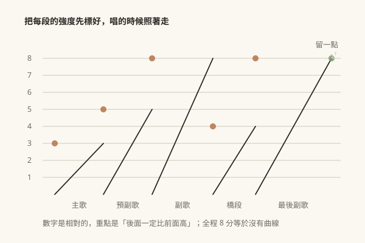

# [歌唱教學] 進階 第 38 章：深度情緒線規劃：主歌與副歌的情感張力分配

## 先講結論

唱得技術很好、卻感動不了人，通常是因為整首都在同一個強度。情緒不是靠大聲堆出來的，是靠對比。主歌壓得夠小，副歌才顯得大。你要在開口之前，先決定每一段要給幾分。

練完你會發現：你不需要一直用力，聽眾反而更專心。

## 常見誤解

很多人以為「有感情」就是從第一個字開始掏心掏肺。結果整首都在滿檔，聽眾聽不了多久就疲勞了。人在持續不變的刺激裡，會很快把它當背景。

另一種誤解是「副歌一定要飆高音」。副歌的重點是相對的大，不是絕對的高。主歌很小，副歌中等音量也能很有力量。

還有一種：把「大」當成單一開關。其實大聲是多項參數一起變——音量、氣音的比例、咬字的密度、支撐的量。專業的 belt 之所以聽起來厚，是這些特徵的組合，不是把音量轉大而已（Lebowitz & Baken, 2011）。

## 原理：為什麼會這樣

人對持續不變的刺激會很快適應。同樣的音量聽久了，耳朵就把它當背景。所以真正讓人起雞皮疙瘩的，是變化：從很小突然變大，或從很滿突然收掉。

音量的增加也不是只有「比較用力」。唱得更大聲時，聲道共鳴的調整是具體可量測的動作，不只是感覺（Vurma, 2022）；支撐的分配也會跟著改變，而且不同歌手用不同策略達到同樣的結果（Thorpe et al., 2001）。這代表你可以選擇：用更多氣、用更集中的共鳴、還是用更密的咬字去推一段副歌。三種聽起來不一樣。

把一首歌想成拉弓：主歌慢慢把弦往後拉，導歌瞄準，副歌放箭。如果你在主歌就把箭射出去，後面就沒有東西了。這個比喻失真在：拉弓只有一次，一首歌可以有好幾次起落，第二次主歌通常要比第一次多一點。

音量的分配不需要精確到數字，但需要你先寫下來。憑感覺唱，人在緊張時會全部唱成同一個大小。

還有一個容易忽略的對比：不是只有大小，還有乾濕。主歌可以多一點氣音，像在耳邊；副歌少一點氣音，聲音變實。從霧到實的變化，比單純變大聲更細，也更適合貼著麥克風唱的流行歌。

## 打個比方

**燈光。** 整間房間的燈全開，你看不出哪裡重要；只留一盞照在桌上，那張桌子就變成主角。副歌就是那盞燈。問題通常不是燈不夠亮，是其他燈沒關。

**拉弓。** 弦拉得越滿，箭飛得越遠。可是你不可能整首歌都拉滿——手會抖，箭也會歪。主歌就是拉弓的那幾秒，聽眾聽的不是箭，是那個越拉越緊的聲音。

**講話。** 你跟一個人講秘密，聲音小、氣音多、字黏在一起；你在馬路對面喊人，聲音大、母音拉長、子音很清楚。同一句話，兩種場合聽起來完全不同。歌裡的段落也是場合，不是音量旋鈕。

## 現在就做

這不是發聲練習，是一張紙、一支筆，加上三次錄音。

### 練習一：先寫能量

1. 印出歌詞，在每一段旁邊寫一個一到十的能量數字。
2. 主歌通常二到三，導歌四到六，副歌八到九，最後一段主歌可以比第一段多一，尾奏回到一或二。

感覺：寫完會發現，有些段落你原本打算唱得一樣大。做錯會怎樣：每一段都寫八，表示你還沒在規劃，只是在唱。

### 練習二：標三個記號

1. 在歌詞上標：哪裡要氣音、哪裡要實音、哪裡要大。
2. 氣音通常在主歌，實音在導歌，大在副歌。

感覺：切換點變得很具體。做錯會怎樣：同一句裡又氣又大，先拆成兩半，一句只做一件事。

### 練習三：照數字唱，然後聽

1. 不放伴奏，只對著節拍器，照你寫的數字唱一遍，錄音。
2. 閉眼聽，對照你寫的數字。

感覺：有些地方會覺得「這樣太小了，觀眾聽不到」。做錯會怎樣：忍不住放大，先把錄音聽一遍；通常你以為的小，錄起來剛好。如果小聲版本聽起來虛、沒支撐，不是太小，是支撐掉了——減音量，但保留肚子用力。

### 練習四：設計一個放大器

1. 在副歌第一個字之前，安排一個轉折：一口明顯的吸氣、一個停頓，或前一句突然收小。
2. 錄音確認這個轉折聽得出來。

感覺：副歌像被推上去，不是突然出現。做錯會怎樣：轉折聽不出來，把前面的小再縮一點。

### 練習五：找出最低點

1. 把整首歌的最低點找出來，通常是最後一次主歌、或橋段前那一句。
2. 在最低點之後安排明顯的爬升：音量、咬字密度、支撐，三個一起加。

感覺：聽的人會知道「要來了」。做錯會怎樣：每個段落都在爬升，就沒有最低點；先讓某一段真的收下來。

## 練完之後

做對的徵兆：整首唱完，你最累的地方只有副歌那幾句；聽的人會說「後面那段很有力」，而不是「你整首都在吼」。

常見卡點是現場一興奮就忘記規劃。把數字寫在手機備忘錄，上台前看一眼，比臨時憑感覺可靠。

另一個卡點是「以為小聲就聽不到」。主歌小聲不是虛，是音量和氣音都收，支撐還在。錄一段用手機喇叭放出來，確認小聲的地方字還是清楚。如果聽不清楚，不是要變大聲，是要把聲音放前面。

還有一個順序上的建議：先把「小」練好，再練「大」。大部分人的問題不是不會大，是不會小。

下一章要把鏡頭拉近：主歌那麼小，要怎麼小得有細節，靠的是哭腔、嘆氣和氣泡音這幾個語氣工具。

## 延伸查證

- **Lebowitz, A., & Baken, R. J. (2011).** Correlates of the belt voice: a broader examination. *Journal of Voice.* PMID: 20236798。belt 不是單一參數，是多項特徵的組合；「唱大」不等於把音量轉大。
- **Vurma, A. (2022).** Amplitude Effects of Vocal Tract Resonance Adjustments When Singing Louder. *Journal of Voice.* PMID: 32624371。音量增加時，聲道共鳴的調整是可量測的動作，不只是主觀感覺。
- **Thorpe, C. W., Cala, S. J., & Chapman, J. (2001).** Patterns of breath support in projection of the singing voice. *Journal of Voice.* PMID: 12269638。支撐不是單一動作，不同歌手用不同的軀幹策略達到同一結果；這也是為什麼「推副歌」可以有好幾種做法。
