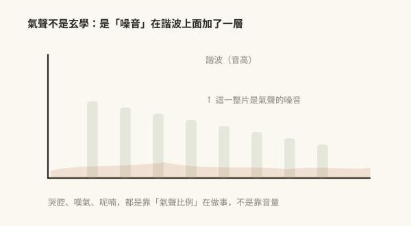
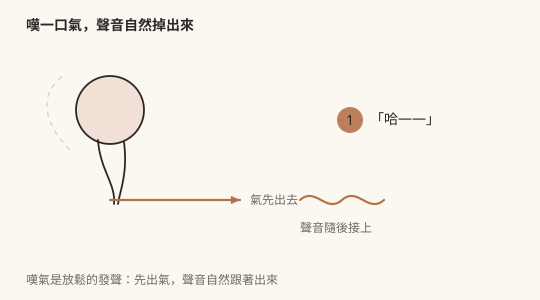

# [歌唱教學] 進階 第 39 章：語氣的微觀世界：哭腔、嘆氣與邊緣摩擦音的交織

## 先講結論

一首歌真正讓人紅眼眶的，常常不是高音，是那些很小的地方：字頭的顆粒、字尾的嘆息、聲音邊緣一點點往內收的委屈。這三種語氣都可以練，不是只能靠天生的感情。

練完你會發現：你的主歌開始有人味，而且你不需要真的哭，就能讓聲音聽起來快哭了。

## 常見誤解

很多人以為要有感情，就得讓自己真的難過。其實真的哽咽時，喉嚨是緊的、氣息是亂的，音準和閉合都會跑掉，唱出來是失控，不是動人。情緒是設計出來的，不是失控出來的。

另一種誤解是「氣泡音越多越有味道」。氣泡音像辣椒，一點提味，滿鍋都是就毀了。它是一種最低張力的振動，用得節制才聽得出意思（Elias et al., 2016）。

## 原理：為什麼會這樣

這三種語氣對應三種不同的聲帶與聲道狀態。

**哭腔**主要是喉頭稍微上提、聲帶閉合增加，聲道變短，共鳴偏向前上方，聽起來像帶點嗚咽的哀鳴。它不是喉嚨用力，是喉頭位置和聲道形狀的微調（Aura et al., 2022）。所以做完喉嚨不該痠。

**嘆氣**是聲帶突然放鬆，但氣流還在。原本出聲的振動停下來，只剩下氣，聽起來像聲音化開。它的關鍵是「聲帶先放、氣不要斷」。

**氣泡音**是聲帶非常放鬆，氣流以很低的壓力通過，產生極低頻、規律的細碎振動，聽起來像黑膠的劈啪聲。它其實有兩種方向：呼氣的和吸氣的，兩者在治療與教學上都被使用（Paolillo et al., 2021）。一般唱歌用到的多是呼氣的那一種，出現在字頭。

三個都用同一個原則：動作要小。做得太大，哭腔變鼻音、嘆氣變漏氣、氣泡音變成打嗝。

位置也有講究。哭腔常在情緒轉折或高音，但那只是風格偏好，任何音高都能用；嘆氣在句尾，因為那是力氣放掉的地方；氣泡音在字頭，因為那是聲音還沒完全出來的地方。放錯位置會很怪，例如每個字尾都加氣泡音，聽起來像一直在清喉嚨。

還有一件事：這三種都是音色，不是音量。加語氣時音量幾乎不變，改變的是聲音的邊緣和氣的比例。如果你一加哭腔就變大聲，那是在用力，不是在調整音色。

## 打個比方

**辣椒。** 一碗麵加一小匙辣油，你會注意到香氣；加半罐，你只吃得到辣。氣泡音是辣油，一滴就夠。判斷標準不是「有沒有感覺到」，是「拿掉之後會不會覺得少了一點」。

**吹熄蠟燭。** 你吹氣，火熄了，但煙還會飄一下才散。嘆氣就是那個煙：聲音的振動停了，氣流還在走。很多人做失敗是因為連氣一起停，火和煙同時消失，聽起來像被刀切斷。

**毛筆收筆。** 寫毛筆字，最後一筆不是直接離開紙面，是提筆、收尖。提太快會出現毛邊，提太慢會積墨。嘆氣就是那個提筆的動作：放掉一點壓力，讓線條自然變細。

## 現在就做

### 練習一：找委屈的「嗚」

1. 閉嘴，發一個偏高音的「嗚」，想像一隻委屈的小狗在討食。
2. 維持三秒，重複三次。

感覺：聲音集中，但邊緣是軟的，喉結上方有一點點往下的拉扯。做錯會怎樣：喉嚨痠、聲音擠，你是在用喉嚨壓，不是用喉頭位置。音量減半再找。

### 練習二：張嘴也不失去委屈

1. 保持剛才的狀態，慢慢張嘴，把「嗚」變成「啊」。
2. 音高不變。

感覺：「啊」不是開闊的，是有點往內收，像話講到一半吞回去。做錯會怎樣：變成開朗的「啊」，委屈感就不見了。嘴形小一點，再試一次。

### 練習三：嘆氣收尾

1. 唱一個三秒的長音「愛」。
2. 在第三秒把聲帶放鬆，只留氣流，變成一口氣音收尾。

感覺：聲音像煙散掉，不是被刀切斷。做錯會怎樣：變成突然斷掉，代表你連氣也停了。肚子繼續送氣，只放掉聲帶。

### 練習四：字頭的顆粒

1. 選一句主歌的第一個字。
2. 出聲前，先讓聲帶漏出極短的空氣顆粒，像「劈啪」一下，再滑進實音。

感覺：字像從疲憊裡勉強擠出來。做錯會怎樣：每句都加會很像在打嗝。一首歌限制在兩、三次，放在最安靜的地方。

### 練習五：四個字三層情緒

1. 找四個字，例如「我不明白」。
2. 排進去：字頭氣泡音、第二字轉哭腔、最後一字用嘆氣收。
3. 錄音聽。

感覺：四個字裡有三層情緒。做錯會怎樣：聽起來很做作，先拿掉一種，一次只用一種語氣。

### 練習六：用音準驗收

1. 把剛才的錄音播兩次：第一次聽情緒，第二次只聽音準。

感覺：好的語氣不會讓音準跑掉。做錯會怎樣：第二次聽發現音飄了，表示某一種語氣做太大，縮小它。

## 練完之後

做對的徵兆：語氣是加上去的，不是換掉原本的聲音；同一句唱三次，音準都一樣。

常見卡點是一投入就全部開到最大。記得這三種都是微調，小才是重點。練的時候寧可太小，上台再放大。

另一個卡點是用喉嚨做。哭腔和氣泡音都很容易被誤解成喉嚨用力，結果做完喉嚨癢。做對的話喉嚨是鬆的，改變的是閉合和氣的比例。如果做完會痛，先停下來，回到單純的長音，確認發聲是鬆的，再把語氣一點一點加回去。

還有一個健康的提醒：氣泡音是低負荷的振動，但一直壓在很低、很鬆的狀態唱整首，久了會覺得聲音「起不來」。它是調味，不是主食。聲帶不舒服時，先補水、減少清喉嚨，再回來練（Behlau & Oliveira, 2009）。

下一章要處理呼吸：換氣不是偷偷來的事情，它本身就可以是情緒的一部分。

## 延伸查證

- **Elias, V. S., Cielo, C. A., & Jotz, G. P. (2016).** Effect of Vocal Fry on Voice and on Velopharyngeal Sphincter. *International Archives of Otorhinolaryngology.* PMID: 27096021。氣泡音是低張力、低頻的振動，對嗓音與共鳴有可量測的影響。
- **Paolillo, N. P., Carrozza, L., & Osio, M. (2021).** Inspiratory Vocal Fry: Anatomical and Physiological Aspects, Application in Speech Therapy, Voice Therapy and Singing Pedagogy. *Journal of Voice.* PMID: 31708370。氣泡音有呼氣與吸氣兩個方向，兩者在治療與歌唱教學上都有用途。
- **Aura, M., Geneid, A., & Bjørkøy, K. (2022).** A Nasoendoscopic Study of "Head Resonance" and "Imposto" in Classical Singing. *Journal of Voice.* PMID: 32513553。所謂的「共鳴位置」其實是聲道形狀的改變；哭腔的往前上方，也是同一種調整。
- **Behlau, M., & Oliveira, G. (2009).** Vocal hygiene for the voice professional. *Current Opinion in Otolaryngology & Head and Neck Surgery.* PMID: 19342952。補水、避免清喉嚨、安排聲音休息，是專業用聲者的基本保養。
