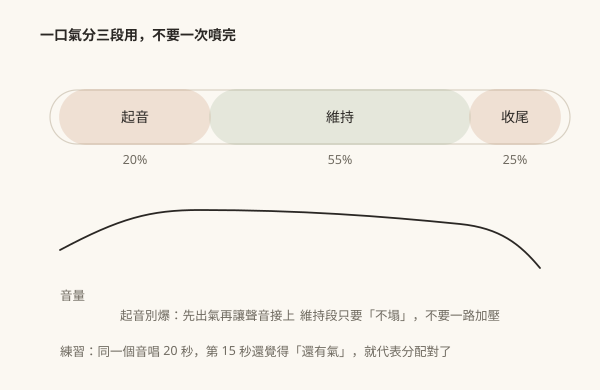
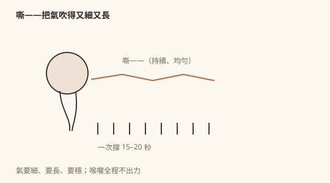
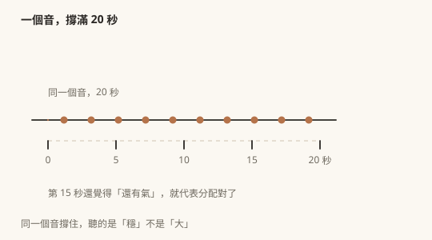
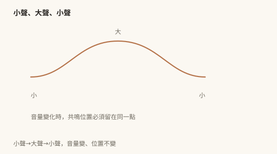
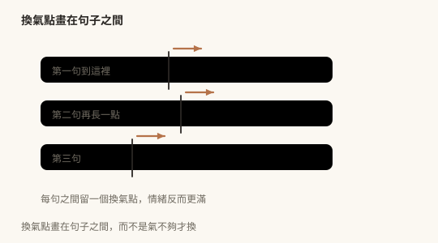

# [歌唱教學] 初階 第 4 章：氣息的穩定控制（吹衛生紙訓練、長音與動態氣息分配）

## 先講結論

有支撐不等於會控制。很多人第一句就把氣噴光，後面整段在硬撐；或是氣忽大忽小，聲音跟著抖。

這一章練三件事：氣流要均勻、長音要直、音量要能平滑地放大再縮小。

練完你會發現，唱不完一句通常不是肺活量不夠，是前面的氣用太快。

## 常見誤解

很多人以為「唱長音就要先吸很大一口」。吸太滿，身體會急著把氣排掉，第一句反而更容易暴衝，而且你會下意識一直想「什麼時候才可以換氣」。吸七、八分滿，肩膀不動，反而好用。

也有人以為「氣不夠就要用力擠」。氣不夠是分配問題，不是水量問題。你在句頭少放一點，句尾就有；你用力擠，只會讓聲音變緊、氣走得更快。

## 原理：為什麼會這樣

氣流穩定，聲音才會穩定。聲帶的振動靠氣流通過，氣流一變，音量與音高也跟著變。所以「聲音抖」常常不是聲帶的問題，是給氣不平均。你唱的是氣，聽到的卻是氣被切成什麼樣子。

音量也是同一個道理，但不是單靠氣流堆出來的。大聲確實會多用氣，可是你聽到的響度還跟共鳴與聲帶閉合有關；單純加大氣流，常常只是變成漏氣的噪音。

控制氣流的是吐氣的速度。下腹與腹部肌肉持續、緩慢地往內收，抵抗橫膈膜回升，氣就慢慢出來。你一開口就讓下腹全部縮到底，氣會在很短的時間內用光，句尾只剩虛音。支撐的做法每個人略有不同，你不必模仿特定一套軀幹動作，只要能做到「從頭到尾送得一樣多」（Thorpe et al., 2001）。

音量的變化也是同一件事。漸強是下腹多給一點壓力，聲帶閉合也跟著稍微增加；漸弱是兩者一起慢慢放掉，不是把喉嚨打開或關小。用喉嚨控制音量，等於直接去壓聲帶。

還有一個省力的做法：把「嗚」或長音做在吸管、或做半閉口（嘴唇微收）的狀態上。口腔後方多了阻力，聲帶可以用比較低的壓力維持振動，氣也比較不容易一下子流光（Titze, 2006）。這不是特效，是拿來檢查「你是不是靠氣流而不是靠喉嚨」的工具。

## 打個比方

**一筆長線。** 用水彩筆畫一條長線，起點太重，顏料堆成一團，後面就乾掉；手一抖，線就毛毛的。你要的是穩定的手，不是更多的顏料。失真的地方是：畫壞了可以重畫，聲帶不舒服要休息，所以寧可小聲、寧可短。

**澆花。** 一桶水從盆口倒下去，土會被沖出一個洞，水全流光。用灑水器慢慢走一圈，每寸土都吃得到水。同一桶水，差別在分配。

**斜坡，不是階梯。** 漸強要像推車上斜坡，一路推上去；用喉嚨控制則是走樓梯，一格一格跳，聽起來會「咔、咔」。

## 現在就做

### 練習一：吹衛生紙

1. 撕一張單層衛生紙，平貼在和嘴巴同高的牆面或鏡子上。
2. 站直，嘴巴距離衛生紙十到十五公分。
3. 手指輕壓衛生紙上緣，吸氣，嘟嘴對著中心吹。
4. 感覺氣流把衛生紙「釘」住之後，放開手指。
5. 讓它貼著十二到十五秒。

感覺：衛生紙下擺只有微微飄動。做錯會怎樣：馬上掉落，是氣流太弱或中斷，下腹要持續收；下擺啪啪作響，是吹太用力，把氣減半。在唱歌時，太用力就是漏氣。

### 練習二：平穩的「嗚」

1. 用說話最舒服的中低音，發「嗚——」。
2. 維持十五秒，音高與音量都不動。
3. 手放下腹，感覺它慢慢往內收。
4. 做三次。有吸管的話，第四次把「嗚」做在吸管上，比較兩次的省力程度。

感覺：聲音是一條直線。做錯會怎樣：最後五秒開始抖，不要用喉嚨夾住；把下腹的支撐多留一點，或把長度縮到十秒，先把直線練出來。

### 練習三：橄欖球（小聲、大聲、小聲）

1. 吸氣，用很小的音量發「嗚——」。
2. 三秒內平滑漸強到飽滿，但不要破音。
3. 停在一到兩秒。
4. 再三秒平滑漸弱，最後變成純氣流，不要突然斷掉。
5. 做三次。

感覺：整個過程肩膀、下巴都不動，只有下腹的壓力在變。做錯會怎樣：漸強時下巴往前、肩膀抬起，代表你用上半身代替了下腹。把音量上限降低，先求平滑。

### 練習四：一句話的分配

1. 挑一句你常唱到沒氣的歌詞。
2. 先照原來的唱法唱一次，注意是在哪個字沒氣。
3. 第二次，把句頭的氣減半，平均分配到每個字。
4. 第三次，在句尾留下一點氣，不要唱到完全空。

感覺：句尾還有氣，聲音沒有變小。做錯會怎樣：如果為了省氣而讓聲音變虛，那是氣給太少，不是分配問題；回到練習二，先確認氣流本身是穩的。

## 練完之後

做對的徵兆：一句唱完還有餘氣；長音從頭到尾一樣粗；漸強漸弱聽起來是斜坡，不是階梯。

常見卡點是「越唱越大聲」。情緒一來，音量就往上跑，氣也用得快。練習時不開麥克風、刻意小聲，是為了聽清楚氣流，不是因為小聲才好聽。

另一個卡點是捨不得停。氣快沒了還硬撐，身體就會用喉嚨補。正確做法是提早換氣，或把樂句切短。唱歌不是憋氣比賽，硬撐完一句通常換來一段沙啞。連續練這幾項超過二十分鐘，中間要補水、讓聲音休息，這比多練兩輪有用（Behlau & Oliveira, 2009）。

下一章要處理共鳴。氣流穩了，接下來要讓聲音在對的空間裡放大，而不是靠音量硬撐。

## 延伸查證

- **Titze, I. R. (2006).** Voice training and therapy with a semi-occluded vocal tract: rationale and scientific underpinnings. *Journal of Speech, Language, and Hearing Research, 49*(2), 448–459. 為什麼把長音做在吸管或半閉口狀態上會比較省力：口腔後方增加阻力，聲帶可用較低的壓力振動。PMID 16671856。
- **Thorpe, C. W., Cala, S. J., & Chapman, J. (2001).** Patterns of breath support in projection of the singing voice. *Journal of Voice.* 支撐不是單一動作，不同歌手用不同的軀幹策略；重點在氣流送得穩，不在姿勢像不像誰。PMID 12269638。
- **Behlau, M., & Oliveira, G. (2009).** Vocal hygiene for the voice professional. *Current Opinion in Otolaryngology & Head and Neck Surgery.* 長時間用聲時的補水與休息建議；氣流練習做多了，保養比硬撐重要。PMID 19342952。
