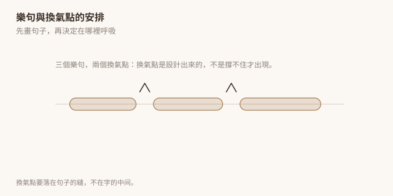
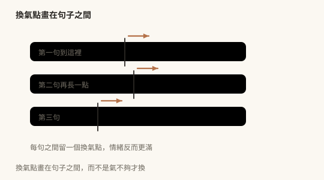
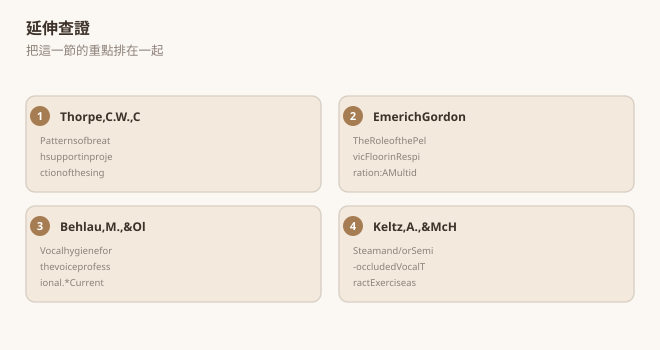

# [歌唱教學] 進階 第 40 章：樂句的呼吸點設計：將換氣化為情感張力的一部分

## 先講結論

換氣不是沒氣了才做的補救。在流行樂裡，呼吸聲本身就可以是表演的一部分：它可以很明顯，也可以完全聽不到，取決於你要表達什麼。重點是你設計它，不是被它打斷。

練完你會發現：你可以在一句話中間停下來吸氣，聽的人不會覺得你斷掉，反而更專心。

## 常見誤解

很多人以為吸氣一定要無聲，不能讓觀眾發現。那是合唱與古典聲樂的規矩。流行歌貼在耳朵旁邊唱，完全無聲的呼吸有時反而讓人覺得像機器。

另一種誤解是「氣越飽越好」。吸到肩膀聳起來、胸口繃住，第一句反而變硬，後面的句子也跟著亂。夠用就好。

還有一種：把換氣當成樂句的結束。其實換氣點可以放在句子中間，製造一個懸空，那是語氣，不是失誤。

## 原理：為什麼會這樣

安靜吸氣時，聲帶是打開的，氣流沒有摩擦。要讓吸氣有情緒，就讓聲帶稍微靠近一點，氣流通過時產生摩擦聲。這和講話講到激動時倒抽一口氣是同一件事。

吸氣的速度也會改變感覺。急促、有摩擦的吸氣，聽起來像渴望或緊張；緩慢、無聲的吸氣，聽起來像壓抑或平靜。同一個句子，換一種吸氣，整句的體溫就不一樣。

換氣的位置同樣有表情。在句號換氣，是正常說話；在名詞和動詞中間換氣，會製造一個懸空，聽的人會想知道後面是什麼。這個效果用一次很強，用多了會讓人覺得你氣不夠。

還有一個常被忽略的點：吐氣也是呼吸的一部分。句尾如果總是把氣全部吐光，下一句的吸氣就會很急。留一點氣在身體裡，吸氣就可以小聲、快、不費力。所以換氣不是「吐完再吸」，是「留下一點，再補進去」。

支撐在這裡的角色也值得說清楚：支撐不是一個固定的動作，不同歌手用不同的軀幹策略達到同一個結果（Thorpe et al., 2001）；下腹與骨盆底在呼吸時是穩定，不是繃緊（Emerich Gordon & Reed, 2020）。你要找的是自己身上能重複的那一種，不是模仿某個人的姿勢。

## 打個比方

**加油。** 沒有人開到油箱見底才加油，也不會每次加油都加到滿出來。你會在還有油的時候，補到夠用。換氣就是這樣：小口、多次，比大口、少次穩定。吸到滿，等於把油箱加到溢出來，第一句就會被嗆到。

**標點符號。** 句號是正常換氣，逗號是偷氣，破折號是懸空。一篇文字如果每個逗號都停三秒，讀起來就斷了。歌詞也一樣：呼吸點是標點，不是段落。

**拉弓。** 弓拉到底還能再拉嗎？不能。留一點空間，下一弓才拉得順。句尾把氣吐光，等於把弓拉到極限，下一句只能硬扯。

## 現在就做

### 練習一：先聽有摩擦的吸氣

1. 微張嘴，假裝看到一件震驚的事，倒抽一口氣，聽那個聲音。
2. 做三次，確認每一次都有聲音。

感覺：氣流擦過喉嚨深處，有點涼。做錯會怎樣：變成嘴巴的「嘶」聲、肩膀跟著抬，先放鬆肩膀，只讓喉嚨產生摩擦。

### 練習二：吸氣當引信

1. 用剛才的吸氣，接一句你熟悉的副歌開頭。
2. 吸完不要停，直接把氣變成聲音。

感覺：吸氣像引信，聲音是爆炸。做錯會怎樣：吸完停了一拍才唱，張力就斷了。把吸氣縮短，緊接在拍子前。

### 練習三：無聲的小偷氣

1. 用鼻子和嘴巴同時快速吸氣，像嚇到一樣，但不要出聲，只吸零點幾秒。
2. 找一句密集的歌詞，在兩個字之間插入這個短吸氣，只補一點點，夠唱下面三個字就好。

感覺：氣息掉到肚子，胸口和肩膀不動；句子沒有斷，但你有新的氣。做錯會怎樣：胸口鼓起來、肩膀上升，代表你吸到上胸了。先吐完氣，再從鼻子和嘴角同時進氣。吸氣太大聲被聽出來，換一個字與字之間的空隙。

### 練習四：換一個位置，換一種表情

1. 拿一句歌詞，例如「我無法眼睜睜看著你離開」，先照文法在句尾換氣，唱一次。
2. 改成在「看著」後面停下來，吸一口有摩擦的氣，再說「你離開」。
3. 錄音比較。

感覺：第二個版本多了一個懸空。做錯會怎樣：聽起來只是忘詞，是停頓太長。縮短到半拍左右。

### 練習五：在歌詞上畫記號

1. 明顯的吸氣畫 V，無聲的偷氣畫小逗號。
2. 一首歌只安排一個 V，放在最需要爆發的地方。

感覺：呼吸變成編曲的一部分。做錯會怎樣：每個地方都畫 V，整首會很喘。先只留一個。

### 練習六：有聲與無聲，各錄一次

1. 同一個句子，做「有聲吸氣」和「無聲吸氣」兩個版本，各錄一次。
2. 閉眼聽：哪一個比較像在講話，哪一個比較像表演？

做錯會怎樣：聽不出差別，把有聲的那個再放大一點，先確定你抓得到兩種感覺，再縮回合理的音量。

## 練完之後

做對的徵兆：唱完之後氣是夠的，不是撐到最後一句才爆；錄音裡聽到呼吸，但不覺得礙耳。

常見卡點是一緊張就忘記偷氣，句子越唱越長。把換氣點寫在歌詞上，跟歌詞一起背。

另一個卡點是吸太大口。每次只補需要的量：如果你只缺三個字的氣，就只吸三個字的量。小口、多次，比大口、少次穩定。

保養也順便講：口乾的時候，吸氣的摩擦會變大、聲音也容易沙。練唱前後補水，比一直清喉嚨有用（Behlau & Oliveira, 2009）。早上起床先做幾分鐘蒸氣或半閉口暖嗓再練呼吸，會比硬開嗓舒服（Keltz & McHenry, 2022）。

如果換氣時開始頭暈、手麻，先停下來正常呼吸。那不是「氣通了」，通常是過度換氣。

下一章要談的是更抽象的一層：怎麼讓自己真的進入歌曲的畫面和情境，而不是只在做語氣。

## 延伸查證

- **Thorpe, C. W., Cala, S. J., & Chapman, J. (2001).** Patterns of breath support in projection of the singing voice. *Journal of Voice.* PMID: 12269638。支撐不是單一動作，不同歌手用不同的軀幹策略達到同一結果；換氣方式也一樣，不必全盤照抄。
- **Emerich Gordon, K., & Reed, O. (2020).** The Role of the Pelvic Floor in Respiration: A Multidisciplinary Literature Review. *Journal of Voice.* PMID: 30447797。下腹與骨盆底在呼吸中的角色；小口吸氣能讓氣掉到這裡，而不是停在胸口。
- **Behlau, M., & Oliveira, G. (2009).** Vocal hygiene for the voice professional. *Current Opinion in Otolaryngology & Head and Neck Surgery.* PMID: 19342952。補水、避免清喉嚨、安排聲音休息的實證建議。
- **Keltz, A., & McHenry, M. (2022).** Steam and/or Semi-occluded Vocal Tract Exercise as Morning Vocal Warm-up Strategy. *Journal of Voice.* PMID: 32988703。蒸氣與半閉口練習可以當早晨暖嗓；蒸氣是舒緩，不是治療。

