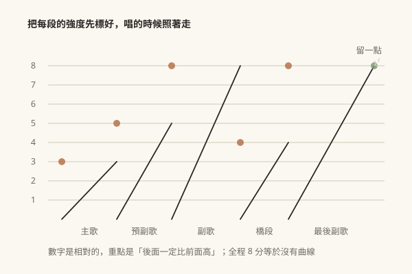
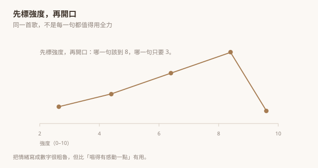

# [歌唱教學] 進階 第 41 章：沉浸式演繹：結合畫面感與自我投射的心理建設

## 先講結論

技術都到位了，聽起來卻有點油。通常不是感情不夠，是你腦子裡下的指令是「這裡要放感情」。情緒是抽象的，大腦沒辦法執行「給我八分的難過」，但可以執行「你看見他轉身，手裡那杯咖啡還是熱的」。

這一章要你把形容詞換成畫面。練完之後，你不需要提醒自己「要難過」，聲音自己會變。

## 常見誤解

很多人以為投入感情就是皺眉、擠出哭腔、讓自己看起來很慘。這是從外面演進去，你一邊唱一邊還在檢查自己「演得像不像」，聽的人也聽得到那個計算。

另一種誤解是「我沒經歷過那種事，所以唱不好」。你不需要經歷一模一樣的情節，只需要找到質地相同的情緒。

## 原理：為什麼會這樣

身體會對畫面有反應。你真的想起某件事，呼吸會變淺、喉嚨會收、眼睛會熱。這些變化會直接改變聲帶的閉合程度和聲道形狀，比任何刻意的技巧都細。

反過來，如果你只下達「悲傷」這個詞，身體不知道要做什麼，只好搬出你記得的悲傷姿勢去演，聽起來就會制式。

所以做法是把形容詞換成感官細節：光線、溫度、距離、氣味。細節越具體，身體的反應越真。這裡有個限度：不是要你真的崩潰。崩潰會讓呼吸亂掉、聲音失控，你要的是「像」，不是「是」。

還有一件事：畫面要能重複。你不能每次都靠當下心情，心情不穩定。所以設定要寫下來，每次唱之前讀一遍。台上靠的不是當下的情緒，是一套隨時叫得出來的方法。

## 打個比方

**你是燈光師，不是演員。** 你不需要在台上真的哭，你需要把燈打對。同一個房間，換一顆燈泡、改一個角度，整個空間的感覺就變了。你要調的是「光線、溫度、距離」這幾顆燈，不是把自己逼出眼淚。對回機制：真正改變聲音的是呼吸深度、喉部鬆緊和聲道形狀，而這三樣是被具體感官牽動的，不是被形容詞牽動的。

**同一句台詞的兩種講法。** 「你回來啦」——對著剛下班的家人說，和對著三年沒見的人說，字一樣，聲音完全不同。你沒有換演技，你換的是「對誰說、在哪裡說」。設定換了，同一句歌詞的氣、重音、尾音就自己移位。

**導航要輸地址，不是輸「去一個好地方」。** 你給大腦「很孤單」，它不知道要轉哪個彎；你給它「晚上十一點的便利商店，只有你在」，它就有路了。這個比喻失真在於：導航會算出最短路徑，你的身體不會，它只給你一個大概的方向，剩下的每次都要你自己微調。

## 現在就做

這一章是紙上作業加一次實驗，不是發聲練習。

1. 挑一首你要唱的歌，先不要唱。用一張紙回答三個問題：這段是什麼時間、什麼光線？空氣是冷還是熱、你手裡拿著什麼？你在多大的空間裡、對誰說話？寫成一句話，例如「冬天凌晨的廚房，我只穿著襪子，對著還沒關的火」。不要寫「很悲傷」。感覺：歌詞突然有了一個場景，你會在腦中看見一個房間。做錯會怎樣：如果你寫出來的是形容詞，重寫，直到腦中能浮出一個具體的房間或街道。

2. 把這三句寫下來的設定唸給自己聽，然後唱第一段主歌。錄音。感覺：聲音比平常小、比平常慢，句子之間的空隙變長。做錯會怎樣：如果唱起來跟平常一模一樣，表示設定沒有進到身體；閉眼重讀一次，唸到有一點感覺再開口。

3. 換一個完全相反的設定：把「冬夜、小房間」改成「盛夏、海邊」。同一段主歌再唱一次，錄音。感覺：聲音自動變亮、變開，母音變寬。做錯會怎樣：如果兩次聽起來一樣，先只改一個元素，例如光線，其他不動。

4. 找一句你覺得「沒經歷過所以唱不出來」的歌詞，寫下它的核心情緒，例如「失去一個再也找不回來的東西」。然後寫一件你自己的、質地相同的事：一隻寵物、一次落榜、一次搬家。唱的時候想那件事，不要想歌詞裡的主角。感覺：歌詞變成你自己的句子。做錯會怎樣：如果一想到那件事就唱不下去，換一件比較遠的、濃度低一點的。唱到失控不是目標。

5. 設定視線的距離：主歌看著前方三十公分，像對一個人低語；副歌看向房間最遠處，像對外面喊。同一句唱兩次，只改眼睛看哪裡。錄音。感覺：身體會自己調整音量和支撐，你不用下指令。做錯會怎樣：如果眼神換了但聲音沒變，把頭也跟著轉一點，讓脖子和胸腔一起進入。

6. 錄一次「只是把歌詞唸出來」的版本，不唱旋律，照著設定講話；再錄一次完整的歌。比較兩者的語氣是不是同一件事。感覺：一致就表示畫面真的進來了。做錯會怎樣：不用全部重錄，先找出哪一句「講」和「唱」差最多，只針對那一句重來。

7. 把最有感的那組設定寫在歌詞最上面。以後每次唱這首歌，先讀一次再開口。

## 練完之後

做對的徵兆：唱完會有一點累，但不是喉嚨累，是像講完一段長話；錄音裡的停頓和呼吸都變得有道理；同一首歌隔天再唱，你還叫得出那個畫面。

常見卡點是設定寫得很漂亮，一開口又回到技術模式。解法是先在腦中讓畫面停留三秒再出聲，不要一邊想畫面一邊想「等一下那個高音」。

另一個卡點是入戲太深，唱到哽咽、氣吸不進來。那不是投入，是失控。你要的是「像」，隨時可以把濃度調低一格。

下一章換到器材：你已經會用身體唱了，接下來要讓麥克風替你工作。

## 延伸查證

- **Reed, C. N., Pearce, M., & McPherson, A. (2024).** Auditory imagery ability influences accuracy when singing with altered auditory feedback. *Music & Science.* PMID: 39219861。心裡先聽見、先想像的能力，會實際影響唱出來的準確度——「先在腦中發生」不是玄學，是可以被測量的技能。
- **Mürbe, D., Pabst, F., & Hofmann, G. (2002).** Significance of auditory and kinesthetic feedback to singers' pitch control. *Journal of Voice.* PMID: 12002886。音準同時靠耳朵和身體感覺；這也解釋為什麼只想「感覺」而不給具體畫面時，控制會變粗。
- **Peultier-Celli, L., Audouin, M., & Beyaert, C. (2022).** Postural Control in Lyric Singers. *Journal of Voice.* PMID: 32456837。歌唱時的姿勢控制與平衡策略：身體狀態會直接影響發聲，不只是「心情」在影響聲音。
