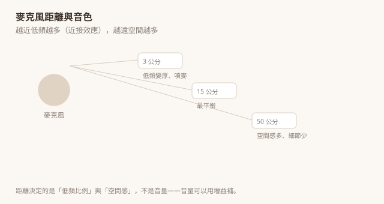

# [歌唱教學] 進階 第 42 章：麥克風聲學美學：距離 (Proximity Effect) 與角度的專業掌控

## 先講結論

麥克風不是拿著不動的擴音器。你離它多近、從哪個角度唱，會直接改變音色和音量。靠近單一指向性麥克風時低頻會變多，退開就變乾淨；稍微偏一個角度，高頻會變柔。學會用距離和角度控制自己，你就不需要每一句都靠喉嚨硬拚。

練完你會發現：主歌可以很小聲卻很厚，副歌很大聲卻不破。

## 常見誤解

很多人以為麥克風拿遠一點比較安全，所以從頭到尾都固定在同樣的距離。結果唱小聲時聲音被伴奏吃掉，唱大聲時又爆掉。

另一種誤解是「爆音是麥克風壞了」。其實大部分是氣流直接打在收音頭上，換個角度就解決。

## 原理：為什麼會這樣

先講近接效應。當你靠近單一指向性麥克風，低頻會相對被放大。這是物理現象，不是麥克風在「加料」。所以你貼近唱，聲音會變厚、變暖；退到十幾公分，低頻減少，聲音會變乾淨、清楚。注意：全指向麥克風沒有這個效果，唱之前先確認手上是哪一種。

再講指向性。心形指向的麥克風，正前方收音最強，背後最弱。這代表你可以把舞台上的喇叭或監聽放在它的背面，回饋的機率會低很多。但它不是絕對隔音，側面還是收得到一些。

角度也有差。正對麥克風時高頻最亮，齒擦音（s、sh）的雜音也最明顯；稍微偏離軸心，高頻會被柔化，聲音變圓。噴麥（P、B 的爆破音）則是靠角度閃開：讓氣流擦過麥克風，不要正面撞上去。

最後一個常被誤會的是壓縮。壓縮器的工作是縮小音量落差，讓小聲的地方聽得見、大聲的地方不爆。它會讓整體聽起來更平均，代價是動態變小，而把小聲拉高的同時，底噪也會跟著被拉高。所以「唱得平均」比「事後壓平」好聽。

距離也不是固定的。有經驗的歌手會在同一句裡微調：唱到氣音時貼近，唱到重音時退開，甚至在同一個字裡做。這個動作很小，觀眾幾乎看不到，但錄音裡會聽得很清楚。

## 現在就做

1. 找一支麥克風（沒有就用拳頭代替），離嘴唇一到兩公分，用很小的氣音唱一句。再退到十五公分唱同一句。各錄一次。感覺：近的時候低頻明顯變多、聲音變厚；遠的時候變乾淨。做錯會怎樣：如果兩次聽起來一樣，可能麥克風是全指向的，或是你退得不夠遠。

2. 用同一個音量，把麥克風往左偏十五度再唱。感覺：高頻的「嘶」聲變少，聲音變圓。做錯會怎樣：如果偏太多，聲音會變悶、變小；十五度就夠，不用整支歪掉。

3. 練「拉推」：唱小聲時靠近，唱大聲前先把麥克風往外推。先用嘴巴發出「破」的音，練習在出聲前把頭微偏。感覺：氣流從麥克風旁邊擦過，不是正面撞上。做錯會怎樣：如果還是「砰」一聲，角度不夠，或你太貼近。

4. 放一首有大副歌的歌，跟著對嘴。主歌把拳頭貼近嘴唇，副歌前把拳頭推出去二十公分。反覆五次。感覺：手比喉嚨更早做準備。做錯會怎樣：如果每次都是聲音出來才推，慢半拍；提前一拍推。

5. 用同樣的音量唱五個母音：阿、衣、嗚、欸、喔，錄音看波形。感覺：「阿」的波形比較圓潤飽滿，「衣」比較尖細密集。做錯會怎樣：如果某個母音明顯比別人大聲或小聲，微調嘴形和支撐，讓五個母音的響度接近，後製會輕鬆很多。

6. 挑一段有大小聲變化的歌，練習「一句裡換兩次距離」：小聲時靠近，大聲時退開，回到小聲再靠近。對著鏡子練手的位置。感覺：手會比聲音早動。做錯會怎樣：如果手換得太晚，大聲那一下還是會爆；提前半拍移動。

## 練完之後

做對的徵兆：你的手在句子之間自己會移動，不需要想；錄音裡沒有爆音，小聲的地方也聽得清楚。

常見卡點：一投入就忘記麥克風，整個人往前撲。把「距離」當成編曲的一部分，跟歌詞一起記。

下一章進錄音室：戴上耳機之後，你聽到的自己會變得很不一樣。
