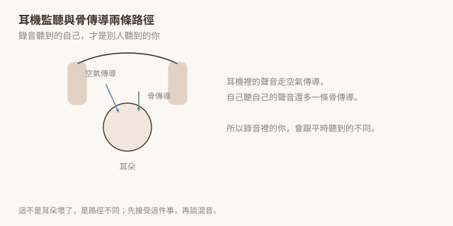

# [歌唱教學] 進階 第 43 章：錄音室實戰 (一)：耳機監聽的適應與外耳聽覺重塑

## 先講結論

現場很會唱的人，一進錄音室常覺得自己不會唱了。原因很單純：你平常靠氣傳導和房間反射判斷聲音，戴上耳機之後，氣傳導被耳機訊號蓋掉、房間反射也消失；骨傳導一直都在，只是和耳機訊號混在一起，大腦一時對不上。監聽耳機不會美化你，它把細節放大。

這一章要你在「太清楚」的狀態下還能穩定唱歌。練完你會發現：你不再被耳機裡的聲音嚇到。

## 常見誤解

很多人以為錄音室聽到的聲音不真實，所以不能相信它。其實它比現場更接近聽眾最後聽到的樣子。

另一種誤解是「戴耳機聽不到自己，就要唱更大聲」。這是進錄音室最常見的陷阱：越聽不到越用力，錄完喉嚨就啞了。

## 原理：為什麼會這樣

平常唱歌，你同時聽到兩件事：空氣傳來的聲音，和透過頭骨傳到內耳的振動。後者讓你覺得自己的聲音很厚、很大。戴上耳機之後，外面的聲音被蓋掉，骨傳導還在，但它和耳機裡的電子訊號混在一起，大腦一時對不上。耳道被塞住時，體內的振動也不容易散出去，你會覺得低頻特別重——所以你聽到的「自己」和平常是兩個版本。

監聽耳機的設計是盡量平坦，不特別強調低音或高音。這不是為了讓你聽得爽，是為了讓你聽到問題：氣不穩、咬字含糊、音準偏了一點，都會變得很明顯。第一次聽會不舒服，因為你從來沒有這麼清楚地聽過自己。

還有一件事：耳機裡的殘響通常很少，聲音會顯得乾。這不是你變難聽，是少了房間的幫忙。

監聽音量也要注意。太小聲，你會為了聽清楚而用力；太大聲，耳朵很快疲勞，錄到後面音準會越來越差（Bottalico et al., 2017）。找到一個「聽得清楚但不刺耳」的音量，錄完一首歌耳朵不該嗡嗡叫。

最後一個誤會：耳機裡聽到的「乾」，不代表成品會乾。錄音室通常會另外加空間效果，那是後製的工作。你不需要在唱的時候想辦法讓聲音變濕，只要把音準、節奏、情緒錄好。

## 打個比方

**戴著耳塞游泳。** 你不是不會游，是聽不到水和自己的呼吸，所以節奏亂了。把耳塞拿掉一半（只戴一邊），身體馬上找回原本的協調。對回機制：你失去的不是能力，是回饋管道；把一部分氣傳導還給你，動作就回來了。

**用手電筒檢查牆面。** 監聽耳機像把手電筒貼著牆照：每一顆灰塵、每一道補土都看得見。現場演出像開著房間大燈，好不好看見得出來，細節看不到。手電筒不會把牆弄髒，它只是讓你第一次看清楚。比喻失真在於：手電筒照哪由你決定，耳機卻是全部一起送上來，所以你會被細節淹沒，需要主動選擇「這次只聽什麼」。

**開車看後照鏡。** 耳機裡的自己是後照鏡：真實、即時，但視野窄，而且左右相反（聽起來比較扁、比較薄）。你不可能盯著後照鏡開車，但也不能沒有它。真正要練的是「看一眼就回來」，不是一直盯著。

## 現在就做

1. 找一副耳機，播放一首你熟悉的歌，只戴一邊。感覺：另一耳還聽得到房間的聲音。做錯會怎樣：如果兩邊都戴、覺得自己被關在盒子裡，先拿下一邊，讓身體放鬆再開始。

2. 調整耳機裡的比例：伴奏要聽得到鼓和低音，自己的聲音只比伴奏稍微突出。感覺：你可以同時跟上拍子、又聽得到自己的音準。做錯會怎樣：如果自己的聲音大到蓋掉伴奏，你會越唱越大聲；把自己調小一點。

3. 只戴一邊耳機唱一段。戴著的那耳聽伴奏，沒戴的那耳聽自己聲音的氣傳導和房間反射。感覺：聲音變得比較自然，不像在真空裡。做錯會怎樣：如果左右不平衡、抓不到音準，先唱慢歌，習慣了再提速。

4. 錄一段，用耳機回放，假裝這是別人在唱。只聽三件事：有沒有跟上拍、音有沒有飄、字有沒有糊。感覺：像在檢查，不像在欣賞。做錯會怎樣：如果一聽就開始挑剔音色、覺得難聽，把注意力拉回拍子和音準，音色是最後才處理的。

5. 同一段錄音再聽一次，這次只聽「換氣」。感覺：呼吸的位置比你以為的明顯很多。做錯會怎樣：如果呼吸聲大到蓋過字，先別急著改唱法，這是下一章的材料。

6. 把監聽音量調小唱同一句，再調大唱一次。感覺：小聲時你會往前傾、想用力；大聲時整個人往後退。做錯會怎樣：如果兩種音量唱出來差很多，表示你被耳機音量帶著走；固定一個音量多練幾次，建立「不管耳機多大聲，我都這樣唱」的記憶。

## 練完之後

做對的徵兆：戴上耳機不會急著用力；你能一邊聽伴奏一邊聽自己，不需要靠喊；連續錄三段，第四段的音準沒有變差。

常見卡點是第一次錄音一直想「我的聲音怎麼這麼扁」。那是少了房間反射和氣傳導的加成，骨傳導沒有變少，不是你的聲音變了。多錄幾次，耳朵會重新校正。

另一個卡點是「不敢聽自己的錄音」。很多人錄完就不想播。先從「只聽一段」開始，每次只聽一個元素，不要一次聽全部。聽久了，你會從「評分」變成「觀察」。

下一章要處理分段錄音：一首歌不是一次唱完，而是很多小段拼起來的，怎麼讓它聽起來像一口氣。

## 延伸查證

- **Bottalico, P., Graetzer, S., & Hunter, E. J. (2017).** Effect of Training and Level of External Auditory Feedback on the Singing Voice: Pitch Inaccuracy. *Journal of Voice.* PMID: 26948385。外部回饋音量過大時，音準反而變差——監聽開太大不是聽得更準，是更不準。
- **Mürbe, D., Pabst, F., & Hofmann, G. (2002).** Significance of auditory and kinesthetic feedback to singers' pitch control. *Journal of Voice.* PMID: 12002886。音準同時依賴聽覺與身體感覺；戴耳機時這兩條路會衝突，所以會出現「聽得到卻唱不準」。
- **Reed, C. N., Pearce, M., & McPherson, A. (2024).** Auditory imagery ability influences accuracy when singing with altered auditory feedback. *Music & Science.* PMID: 39219861。回饋被改變時，能在心裡先「聽見」目標音的人表現較好——這就是錄音室最需要的預先想像。
