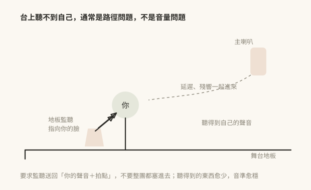
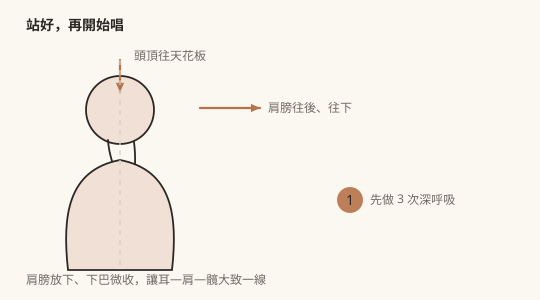

# [歌唱教學] 進階 第 47 章：現場演出攻略：克服肌肉僵硬與舞台空間聲學的適應

## 先講結論

上台會破音、會走音，通常不是你突然不會唱，是身體進入緊張狀態：喉嚨乾、肩膀緊、呼吸變淺。再加上場地的回音、監聽喇叭、觀眾的聲音，和平常練習的環境完全不一樣。這一章要練的是在干擾裡維持穩定。

練完你會發現：你可以在很吵的台上，唱得跟房間裡差不多。

## 常見誤解

很多人以為一緊張，腎上腺素會幫你飆高音。腎上腺素確實給你力氣，但它同時讓肌肉變緊、呼吸變淺，精細的控制反而變差。越高音越需要放鬆，而你剛好把放鬆關掉了。

另一種誤解是「在台上要更用力唱，才聽得到自己」。越用力，喉嚨越緊，音準越容易跑，而且頸肩的代償會跟著上來（Pettersen et al., 2005）。

## 原理：為什麼會這樣

緊張時，身體進入準備逃跑的狀態：口水變少、喉嚨乾、肩膀和下巴繃緊、呼吸跑到胸口。這些反應在危急時有用，在唱歌時卻剛好把最需要放鬆的地方鎖住。頸部與肩部的肌肉在音越高、越大聲時活動越明顯，這是代償，不是力量。

舞台的聽覺也不一樣。你聽到的不只是自己，還有監聽喇叭、樂器從背後傳來的聲音，以及打到場地最後面再彈回來的回音。回音通常比你的聲音晚一點，如果你跟著它唱，整首會越來越慢。

所以現場有兩個任務：上台前把身體從緊繃拉回來；在台上只聽該聽的東西，不要被回音帶走。

還有一點：緊張不是完全消失才算準備好。適度的緊張讓你專注。你要做的不是消滅它，是不要讓它接管呼吸和下巴。

監聽音量也是變數。外部回饋開得太大，音準反而會變差（Bottalico et al., 2017）。所以「聽不到就開大」是錯的解法：開到聽得清楚就停，剩下的靠身體記住的感覺。

## 打個比方

**上場前的車子暖車。** 你不會發動就跑高速公路。先怠速一分鐘、慢慢踩油門，讓機油走到每個地方。上台前的彎腰、嘆氣、重心左右移，就是暖車：不是為了放鬆好聽，是讓氣流和肌肉先回到工作溫度。對回機制：暖的是呼吸肌與喉部，不是心情。

**在移動的車上寫字。** 台下有觀眾、有回音、有燈光，車子在晃。你沒辦法讓車停下來，但可以把筆握穩、把紙壓好。握穩筆就是「腳踩地、肩膀低、下巴鬆」這三件事；紙壓好就是「只聽鼓和低音」。比喻失真在於：寫字可以停下來重寫，現場不行，所以你只能靠事前練好的三個錨點。

**回音是隔壁桌的對話。** 你講話時旁邊有人慢半句複述你，你如果跟著他講，就會結巴。正確做法是繼續講你的，讓他的聲音落後。台上也一樣：跟著拍子唱，不要等回音。

## 現在就做

1. 上台前十分鐘，找一個角落，彎腰讓上半身垂下，像布娃娃。輕輕左右搖晃下巴，確認它是鬆的。感覺：肩膀的重量往下掉。做錯會怎樣：如果彎腰會頭暈，改成坐著，把頭低下來就好。

2. 用鼻子和嘴角同時吸氣，把氣吸到側腰和下背，再發一個很鬆的長嘆「哈——」。做三次。感覺：肋骨往兩側開，吐完之後肩膀比之前低。做錯會怎樣：如果吸氣時肩膀上升，先把氣吐乾淨，再吸。

3. 站起來，膝蓋微彎，不要打直，左右移一下重心。感覺：大腿微微出力，像站在有點軟的地上。做錯會怎樣：如果膝蓋打直、整個人往後仰，容易頭暈，氣息也會跟著上浮。

4. 在練習室放一首歌，戴耳機，故意在耳機裡加一個明顯的延遲，讓自己的聲音晚半拍才回來。跟著伴奏唱完一段，不要被延遲拖走。感覺：你會很想等那個聲音，但你要相信拍子。做錯會怎樣：如果越唱越慢，把延遲關掉，先練「看著節拍器唱」的穩定度。

5. 一邊原地踏步，一邊唱一首節奏輕快的歌。踏步要穩，聲音不能跟著晃。感覺：下半身在動，上半身和氣息保持穩。做錯會怎樣：如果聲音跟著每一步抖，先只踏步不唱，確認腳步穩了再開口。

6. 設計一個「間奏動作」：在沒有人聲的幾小節裡，轉頭、吐氣、讓下巴鬆掉，或做三秒的唇震動。上台時真的做。感覺：喉嚨在空檔被重置。做錯會怎樣：如果轉頭會影響下一句的進氣，改成只吐氣、放鬆肩膀。

7. 找全曲最高的一句，練「往下踩」：唱那個音時，前腳往地板踩一下，身體微蹲，不要抬頭、不要墊腳尖。感覺：力量從腳底上來，脖子是鬆的。做錯會怎樣：如果一唱高音就抬頭、整個人往上飄，聲音會卡在喉嚨；先只練動作，不唱。

8. 做一次「噪音排練」：播伴奏，把音量開到比平常大，同時請人在旁邊講話或製造雜音，你在中間唱完一段。感覺：你會發現自己開始只抓鼓和低音。做錯會怎樣：如果聽不到伴奏、整個人亂掉，把伴奏調小一點，先求穩定，再求抗噪。

## 練完之後

做對的徵兆：上台前手腳是熱的、肩膀是低的；唱完喉嚨不痛，痠的是腿；即使監聽很差，你還是唱在同一個拍子上。

常見卡點是一緊張就全部忘掉，回到用喉嚨唱。把「膝蓋微彎、肩膀放鬆、下巴鬆」寫在歌單上，上台前看一眼。

另一個卡點是被觀眾影響。看到台下有人低頭、有人講話，你會開始懷疑自己。把注意力放回身體：腳踩穩、肩膀低、下巴鬆。你控制不了觀眾，只能控制這三個地方。

下一章要換曲風：同一組聲帶，唱民謠、抒情和輕搖滾，參數要怎麼調。

## 延伸查證

- **Pettersen, V., Bjørkøy, K., & Torp, H. (2005).** Neck and shoulder muscle activity and thorax movement in singing and speaking tasks with variation in vocal loudness and pitch. *Journal of Voice.* PMID: 16301107。越大聲、越高音，頸肩的肌肉活動越明顯——那是代償，不是支撐。
- **Bottalico, P., Graetzer, S., & Hunter, E. J. (2017).** Effect of Training and Level of External Auditory Feedback on the Singing Voice: Pitch Inaccuracy. *Journal of Voice.* PMID: 26948385。外部回饋音量太大時音準反而變差；台上把監聽開爆，是走音的常見來源。
- **Peultier-Celli, L., Audouin, M., & Beyaert, C. (2022).** Postural Control in Lyric Singers. *Journal of Voice.* PMID: 32456837。歌唱時的姿勢控制與平衡策略；膝蓋微彎、重心可移，是可以用來對抗緊張的具體變數。
