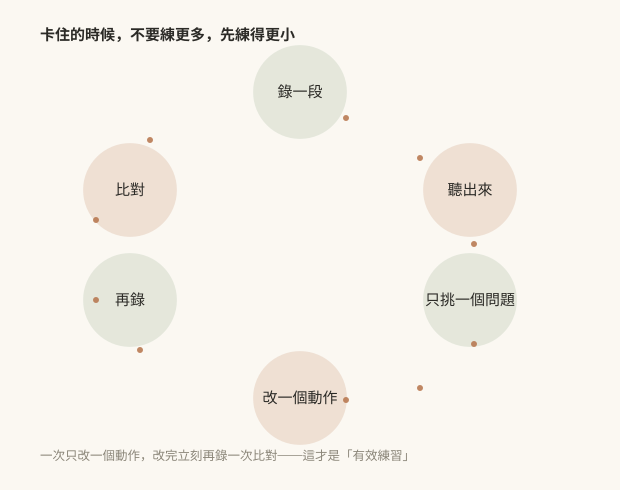

# [歌唱教學] 進階 第 49 章：突破瓶頸期：當練習失去方向時的自我檢視與重置清單

## 先講結論

練到某個階段，你會突然覺得自己變難聽：以前唱得上去的音變吃力，以前很自然的語氣變做作。這通常不是退步，是舊習慣和新能力在打架。這時候最不該做的，就是加倍練。

練完你會發現：你有一套檢查流程，知道哪裡卡住，而不是一直重唱。

## 常見誤解

很多人以為遇到瓶頸，只要更努力就會過。其實在錯誤的狀態下多練，只是把錯誤的動作練得更熟。

另一種誤解是「休息就是偷懶」。聲音不對的時候，停下來兩天，往往比硬練兩週有用。

## 原理：為什麼會這樣

唱歌靠的是肌肉記憶。當你學了新技巧，舊的代償動作不會馬上消失，兩套動作會同時存在。這段時間聲音會不穩定，因為身體還不確定該用哪一套。這就是瓶頸。

如果在這時候加大練習量，身體會選擇比較熟的那一套，通常是舊的、錯的那一套，因為它比較省力。所以你越練，錯的越固定。

休息的作用不是放空，是讓身體有時間把新的動作寫進去，同時讓疲勞的肌肉恢復。除了一直唱，還要換一種方式練：放慢、拆小、只練一個變數。

還有一個很容易被忽略的原因：你聽得出問題，代表你的耳朵進步了，但身體還沒跟上。這種時候聲音其實沒有變差，是你終於聽得出以前的粗糙。知道這一點，會少很多焦慮。

## 現在就做

1. 先做一次「三天紀錄」。這三天照常練，但每天錄一句同樣的樂句，晚上聽，只寫三件事：哪裡緊、哪裡不穩、哪裡聽起來不是你想要的。感覺：你會發現問題其實固定出現在同一兩個地方。做錯會怎樣：如果每天都寫「全部都很爛」，範圍太大，改成只聽一個音或一句。

2. 如果連續三天聲音都不對，停唱兩天。不練聲、不哼歌，也不要用氣音講悄悄話，氣音比正常說話更磨聲帶。多喝水、早點睡。感覺：休息期間喉嚨可能有一點輕微異感，屬正常。做錯會怎樣：如果停了兩天還是痛，這不是瓶頸，去看醫生。

3. 回來之後，只發一個最舒服的說話音高的「嗚」，持續五秒。邊發邊檢查：下巴鬆嗎？舌根軟嗎？肩膀有聳嗎？只要有一個地方緊，就停下來，搖一搖放鬆，再試。感覺：像重新開機。做錯會怎樣：如果一開口就想唱高音，先忍住，前十分鐘只做這個。

4. 挑最卡的那一句，做「拆解三遍」。第一遍拿掉歌詞，用打嘟嚕唱旋律。第二遍用「嗚」唱。第三遍才加歌詞。感覺：通常第一遍最輕鬆，加了歌詞才卡。做錯會怎樣：如果打嘟嚕也卡，問題在氣息或音高，不在咬字；先放慢再唱。

5. 做一份五點檢查表，寫在手機備忘錄：氣流穩不穩、力量在肚子還是脖子、喉結有沒有往上跑、高音時嘴巴是不是張太大、我是在唱故事還是在表演技巧。每次卡住，照順序問一次，不要重唱。感覺：從「一直試」變成「找原因」。做錯會怎樣：如果五點都檢查了還是卡，換一句，不要在同一句上耗半小時。

6. 每天練唱前，用最放鬆的狀態唱一遍簡單的兒歌，像小孩子講話那樣。感覺：回到零負擔的發聲。做錯會怎樣：如果連兒歌都唱得緊，今天就只做放鬆，不練技巧。

7. 每週寫三行檢討：這週哪一句變好了、哪一句還在卡、下週只練哪一個。感覺：進步變得看得見。做錯會怎樣：如果寫不出「變好的地方」，把錄音往前翻兩週，你會聽到差別。

8. 找一首你很久沒唱、以前唱得很順的歌，唱一次。感覺：通常會發現它變簡單了，因為你的基準線提高了。做錯會怎樣：如果還是很卡，把它拆成旋律和歌詞兩軌，先只唱旋律。

## 練完之後

做對的徵兆：你不再一卡住就從頭重唱，而是知道要先檢查哪一個環節；休息兩天後，聲音通常會比之前鬆。

常見卡點：把瓶頸當成「不夠努力」，於是練更久。記得，瓶頸期要減量、拆解、換方法，不是加量。

另一個卡點是「跟別人比」。你會看到有人進步很快，然後覺得自己沒救。每個人的起點和練習方式不同，你唯一能比的是上個月的自己。把舊錄音留著，那是最誠實的進度表。

下一章是最後一章：當技術不再是問題，你要處理的是「你的聲音聽起來像誰」。
