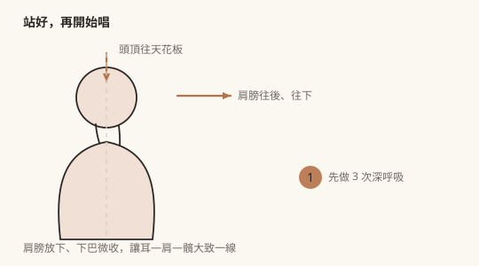
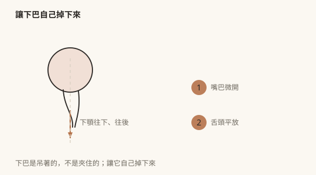

# [歌唱教學] 初階 第 5 章：身體的共振地圖：解鎖肩頸與下巴的緊繃（唱歌時的正確姿勢與放鬆技巧）

## 先講結論

你的身體是聲音的放大器，但前提是通道要通。肩膀一聳、下巴一咬，放大器就變成消音器。

這一章把共鳴地圖畫出來：胸腔、口腔與咽喉、鼻腔與頭部三個區域，靠同一條通道連著，閘門在脖子和下巴。閘門不開，三個區域都進不去。

練完你會知道震動應該出現在胸口或嘴唇，而不是卡在喉嚨；也會有一個三十秒就能回到正確姿勢的方法。

## 常見誤解

很多人以為「共鳴就是把聲音推到某個位置」。推不了。共鳴腔不會因為你用力就變大，它只會因為通道打開而被動地參與。你愈想「送上去」，喉嚨就愈緊。

另一個誤解是「聲音悶，所以要更用力唱開」。悶通常是通道被壓住，再用力只會壓得更緊。還有一個相關的混淆：嘴巴張大不等於喉嚨打開。有人唱高音把嘴張得很大，舌根卻往後縮，通道反而更窄。

## 原理：為什麼會這樣

聲帶發出的原聲很小，要靠聲道與身體的空間修飾、放大。主要的三個區域是：

- **胸腔**：鎖骨以下一帶。低音時氣管與胸壁會產生摸得到的震動，教學上叫「胸腔共鳴」，但肺不是共鳴箱，這股震動主要是觸覺。
- **口腔與咽喉腔**：嘴巴到喉嚨後方。管咬字與中頻，是流行歌的主戰場，也是最有彈性的一段：喉結高低、舌根鬆緊都會改變它的大小。
- **鼻腔與頭部空腔**：兩眼之間、鼻樑後方一帶。鼻腔會加一點低頻色彩，也修飾中高頻泛音；真正的「亮」主要來自喉嚨上方通道收窄產生的高頻能量群（Lee et al., 2008）。

三區不是分開工作，比例會隨音高與母音改變。連通它們的是同一條通道：喉嚨、舌根、下巴。這幾個地方一緊，聲音就上不去也下不來。

順便把一個常見說法講清楚：所謂「頭腔共鳴」不是頭骨在振動。內視鏡研究顯示，古典唱法講的「頭聲」與「imposto」，對應的是聲道形狀的改變，不是聲音真的跑進頭骨裡的空腔（Aura et al., 2022）。你感覺到的震動主要來自鼻腔與聲道，教學上沿用這個說法沒問題，但不要把它當成一個空音箱。

姿勢的關鍵是中軸線。頭在肩膀正上方，肩膀下沉，肋骨自然打開，氣管才是直的，橫膈膜也有空間下降。你不需要挺胸，也不需要收小腹；挺胸會鎖住上胸與肋間，收小腹則限制橫膈膜下降，兩者都讓氣吸不深。站得穩的策略因人而異，不要硬套一個體態（Peultier-Celli et al., 2022）。

## 打個比方

**三間房間與一扇門。** 三個空間靠同一條走廊連著，門在脖子和下巴。門半關著，你站在哪一間都聽不到聲音。你要做的不是把喇叭開大，是去把門拉開。

**看儀表板開車。** 「聲音要靠前」「要打到面罩」這些話，等於叫你憑引擎聲判斷車況。手放胸口、手碰鼻樑，就是儀表板：震動在哪裡，數字就在哪裡。

**窗戶全開，窗簾卻拉著。** 嘴巴張很大、裡面卻悶，就是這個畫面。真正的開在口腔後方，你從外面看不到，只能用聲音與震動感判斷。

比喻失真的地方是：門和窗簾都是你手動的，人體的通道一半是反射。所以不是「用力拉開」，是「不要關它」。

## 現在就做

### 練習一：提線木偶

1. 雙腳與肩同寬，膝蓋微彎。
2. 想像頭頂有一根線把你往上拉，脖子後方拉長。
3. 肩膀順著地心引力往下沉，胸口自然打開，不要刻意挺胸。
4. 下巴微收，視線平視，維持五次呼吸。

感覺：頭頂往上、肩膀往下，兩個方向同時存在。做錯會怎樣：如果胸口挺出去、腰痠，那是挺胸不是延伸。把肋骨放回原位，只拉長脖子後方。

### 練習二：鬆開咀嚼肌

1. 食指中指放在耳朵前方，張嘴閉嘴，找到會滑動的關節。
2. 在關節與下巴兩側咀嚼肌上輕輕畫圈一到兩分鐘。
3. 手放下，讓下巴像打瞌睡一樣自然掉下來。
4. 發一個慵懶的「阿——」，五秒，做兩次。

感覺：聲音變寬、變厚，喉嚨沒有卡。做錯會怎樣：如果下巴掉下來後聲音變悶，是舌頭往後縮了。舌尖輕碰下門牙內側，讓舌頭留在前面。

### 練習三：哼鳴掃描

1. 閉唇、牙齒微張、舌頭平放，發「嗯——」。
2. 手貼胸骨，用低音哼，找胸口震動最明顯的高度。
3. 音高稍微往上，哼在說話附近的高度，注意嘴唇發癢、震動。
4. 各做三次。

感覺：低音震在胸口，中音震在嘴唇。做錯會怎樣：如果震動卡在喉嚨、脖子痠，是肩頸或下巴又用力了。停下來，回到練習一的姿勢再哼。

### 練習四：帶著地圖唱一句

1. 挑一句你熟悉的歌詞。
2. 先哼旋律，確認震動在胸口或嘴唇。
3. 再用母音唱一次，保持同樣的震動位置。
4. 觀察唱完喉嚨是否鬆。

感覺：聲音像從身體出來，不是從喉嚨刮出來。做錯會怎樣：如果字一多就全擠回喉嚨，把速度放慢一半，一個字一個字確認位置。

## 練完之後

做對的徵兆：小聲唱也有厚度；震動出現在手掌或嘴唇，不在喉嚨；嘴巴張大時聲音不會變得更悶；唱完脖子不痠。

常見卡點是「一唱快就忘」。先把句子拆短，寧可慢，也不要讓舊習慣回來。每次練習前花三十秒排姿勢，比唱完再補救有用。

另一個卡點是把「亮」做成「扁」。為了讓聲音靠前，把嘴型壓扁、下巴往前，聽起來會像感冒。亮的來源是聲道與高頻能量，不是把聲音擠到鼻子前面。

下一章要往源頭走：聲帶是怎麼閉合的，為什麼會漏氣、為什麼會破音。

## 延伸查證

- **Aura, M., Geneid, A., & Bjørkøy, K. (2022).** A Nasoendoscopic Study of "Head Resonance" and "Imposto" in Classical Singing. *Journal of Voice.* 內視鏡觀察顯示「頭腔共鳴」對應的是聲道形狀改變，不是聲音在頭骨裡放大。PMID 32513553。
- **Lee, S. H., Kwon, H. J., & Choi, H. J. (2008).** The singer's formant and speaker's ring resonance: a long-term average spectrum analysis. *Clinical and Experimental Otorhinolaryngology.* 歌手共振峰（約 2.8–3.2 kHz 附近的能量群）可以被量測，是「亮」的來源之一。PMID 19434279。
- **Peultier-Celli, L., Audouin, M., & Beyaert, C. (2022).** Postural Control in Lyric Singers. *Journal of Voice.* 抒情歌手的姿勢控制策略不同，重點是找到自己站得穩又能呼吸的版本。PMID 32456837。
