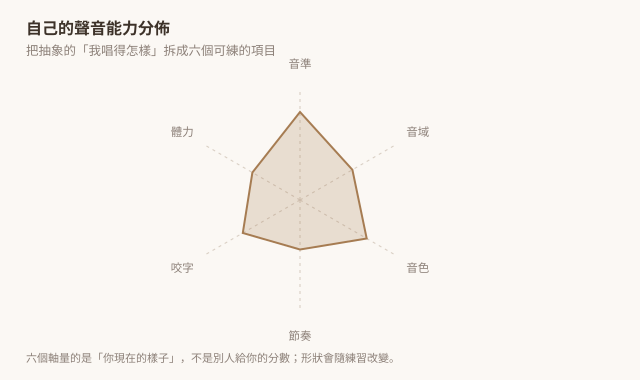

# [歌唱教學] 進階 第 50 章：建立個人聲音品牌：不盲從模仿，淬鍊你獨特的聲音指紋

## 先講結論

技術到了一個程度，剩下的問題不是「會不會唱」，是「聽起來像誰」。如果你唱每首歌都像原唱，聽的人記住的是原唱，不是你。聲音品牌不是把自己變得奇怪，是把你本來就有的特質挑出來、固定下來、重複使用。

練完你會發現：別人聽你的錄音，不用看名字就知道是你。

## 常見誤解

很多人以為特色就是「跟別人不一樣」，所以刻意壓沙、裝慵懶、加很多轉音。刻意做出來的特色，聽起來會像在模仿某一種風格。

另一種誤解是「唱得像原唱才是唱得好」。學習階段這是對的，但一直停在這裡，你的聲音就只是一個複製品。

## 原理：為什麼會這樣

人的聲音本來就有指紋：聲帶的長度厚度、共鳴腔的形狀、說話的習慣，這些加起來讓每個人的聲音都不一樣。問題是，大部分人在學唱歌的過程中，會把這些特質當成缺點修掉，最後每個人都唱得很標準，也很像。

品牌的形成靠三個東西：你選什麼歌、你在哪裡用力、你重複什麼。同一個小習慣，用一次是偶然，重複使用就會從偶然變成你的簽名。

但要有一個前提：這個特質不能傷聲帶。沙啞如果是靠擠壓做出來的，遲早會壞；如果是聲帶本來就有的振動特質，就可以拿來用。這一條不是道德勸說，是力學：靠擠壓換來的音色，是用黏膜去換的。

還有一個容易被忽略的工具：把音域畫出來。音域圖是客觀量測，不是憑感覺說「我唱得到」（Berger et al., 2022）。你畫一次就會知道自己的黃金區在哪、哪裡是硬撐上去的，選歌和定調就有依據，而不是每次靠試唱。

## 打個比方

**手寫字。** 每個人寫「我」都不一樣，沒有人是故意寫醜的。你的字之所以認得出來，是因為筆畫的轉折、大小、速度固定。聲音品牌也一樣：不是發明一個新字形，是把你本來就有的那個轉折固定下來、每封信都用。對回機制：固定的東西是咬字習慣、句尾處理、共鳴位置，不是音色本身。

**一間店的招牌菜。** 餐廳不是每道菜都要驚喜，是有一道菜讓人專程來。那道菜通常不複雜，但每次味道都一樣。你要練的是「每次唱這一句，都做同一個選擇」。

**指紋不會因為你洗手就變。** 你可以練技術、換曲風、改咬字，但底下那組聲帶和腔體不會變成別人的。比喻失真在於：指紋完全不能改，聲音可以改一部分——可以改的是習慣，不能改的是構造。搞清楚哪個是哪個，你才不會花十年去追一個不屬於你的音色。

## 現在就做

這一章是三份清單和一個實驗，不需要練聲。

1. 找出三段你近期錄音、風格不同的歌，閉眼聽，假裝是別人唱的。寫下：哪個音域聽起來最舒服、最不費力？那就是你的黃金區。以後選歌、定調，先看它在不在這一區。感覺：你會發現自己一直在避開某一區。做錯會怎樣：如果三段都聽不出共同點，先只聽「最低音到最高音」的範圍，用筆畫出來。

2. 用三個形容詞寫下你的音色，例如「乾淨、薄、有點鼻音」。不要寫「好聽」「有感情」這種大家都知道卻沒有資訊的詞。感覺：寫完會有點不好意思，那是正常的。做錯會怎樣：如果寫不出來，拿給一個誠實的朋友聽，請他講三個詞，你再篩選。

3. 找出一個你改不掉的小習慣：字尾會不自覺漏氣、某幾個母音偏扁、句尾會往下掉。先確認它不痛、不啞。然後選一首歌，在固定的地方刻意用它，例如每段主歌的最後一個字。錄音。感覺：同一個習慣重複出現後，聽起來就不再像失誤，而像刻意的選擇。做錯會怎樣：如果每次用的地方都不一樣，聽起來會像失誤；先固定在一個位置。

4. 寫下你唱歌時的「身分」：你是在深夜酒館講故事的人，還是下午在窗邊陪人發呆的人？用一句話寫。然後檢查目前唱的歌，有哪幾首和這個身分不合。感覺：有些歌你其實不該唱。做錯會怎樣：如果每個身分都想要，先選一個，練三首歌，再換。

5. 拿一首大家都熟的簡單歌，例如生日快樂，用完全不同的速度、語氣、共鳴唱一次：先照原版，再改成慢的、收的、像講話的，錄兩次比較。感覺：同一首歌可以變成你的。做錯會怎樣：如果改完聽起來只是「唱錯」，表示改得不夠；先改速度，再改音量，一次只改一個。

6. 把步驟二的三個形容詞寫在麥克風旁邊。每次錄音前看一眼，錄完再問自己：這次有做到嗎？感覺：每次開口前有一個定調。做錯會怎樣：如果每次都不一樣，先把形容詞減到兩個。

7. 每個月挑一首你錄得最好的歌，只聽三個地方：黃金區有沒有發揮、那個小習慣有沒有出現、整首的動態是不是你要的。三個都對，才留下來。感覺：你開始在「製作」自己的聲音，不只是唱。做錯會怎樣：如果每次都不滿意，把標準降低，先只要求一個條件。

## 練完之後

做對的徵兆：有人聽你的錄音會說「這聽起來像你」，而不是「你唱得像某某人」；你選歌開始有理由；你能講出自己三個形容詞，而且別人也同意。

常見卡點是一聽到別人厲害，就回頭模仿。模仿可以學技術，但不要停在模仿的結果。學完就放下，回到你自己的三個形容詞。

另一個卡點是把「特色」當成「不練技術的藉口」。特色是加分，不是替代品。音準不穩、氣不夠，聽的人不會說那是有個性。

到這裡，這套進階課結束了。接下來沒有新的技巧清單，只有三件事：持續錄音、持續聽、持續選。你的聲音品牌不是想出來的，是唱出來的。

## 延伸查證

- **Berger, T., Fuchs, M., & Dippold, S. (2022).** Standardization and Feasibility of Voice Range Profile Measurements in Epidemiological Studies. *Journal of Voice.* PMID: 32402662。音域圖是客觀量測，不是憑感覺；畫一次就知道自己的黃金區在哪。
- **Behlau, M., & Oliveira, G. (2009).** Vocal hygiene for the voice professional. *Current Opinion in Otolaryngology & Head and Neck Surgery.* PMID: 19342952。補水、避免清喉嚨、聲音休息的實證建議；特色不能建立在每天磨聲帶的動作上。
- **Mitchell, H. F., & Kenny, D. T. (2010).** Change in vibrato rate and extent during tertiary training in classical singing students. *Journal of Voice.* PMID: 19850446。顫音的速率與幅度是可以被訓練改變的獨立參數——你以為的「天生音色」，有一部分其實是習慣。
