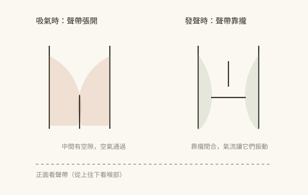
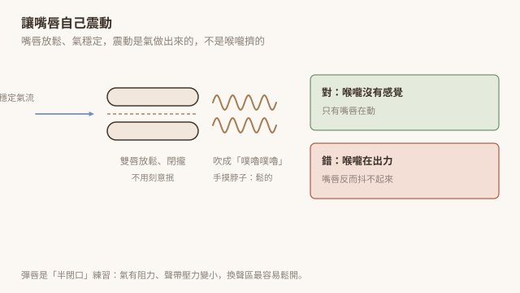

# [歌唱教學] 初階 第 6 章：聲音的源頭：簡單認識聲帶閉合 (為何會破音或漏氣？基礎的彈唇音練習)

## 先講結論

漏氣和破音，看起來是兩件相反的事，其實同一個原因：聲帶的閉合與氣流沒對上。

閉合太鬆，氣從縫裡漏掉，聲音虛、氣用得快。閉合被外面夾太緊，氣一衝就翻，聲音斷掉。

這一章用嘴唇的阻力去幫聲帶找到中間值。彈唇不是暖身儀式，它是在直接練「氣流和閉合怎麼配合」。

## 常見誤解

很多人以為破音是因為「氣不夠、不夠大聲」，所以一破音就更用力推。其實破音常常是氣太猛、閉合太死，兩邊硬碰硬，聲音就翻掉。

也有人以為漏氣是「聲帶壞了」。大部分情況只是閉合太鬆，氣沒有全部拿去做振動。把閉合稍微帶起來，聲音就會集中，氣也夠用。

## 原理：為什麼會這樣

聲帶是喉嚨裡兩片 V 字形的組織。呼吸時它們張開，空氣通過；發聲時它們靠攏，氣流把它們推開又被吸回，快速地一開一合，這就是振動。聲音需要兩件事同時成立：聲帶靠攏，加上穩定的氣流。

漏氣：聲帶沒有完全靠攏，中間留著縫，氣直接跑出去。你聽到的是氣音，聲帶沒有被有效振動。因為氣走太快，你會覺得肺活量不夠，其實沒有。

破音：通常發生在換音高的時候。音高往上，聲帶要從厚變薄；如果外面的肌肉把喉嚨夾緊、氣流又猛，聲帶來不及平順地換過去，就會突然翻掉。研究把這種翻轉描述成閉合方式的兩態切換：同一條聲帶，換的是靠攏的位置與用力比例，不是換一條聲帶（Titze et al., 2014）。所以破音不是聲帶不聽話，是調整與氣流沒接上。

順便說一個常見混淆：有氣音不代表溫柔。一點氣音可以當表情，整首都漏氣就不一樣，那會讓聲帶一直泡在氣流裡，唱久容易累。

彈唇為什麼有用？嘴唇的振動會給氣流一點阻力，像一個小小的氣墊，讓氣流變得平均。口腔後方多了阻力，聲帶可以用比較低的壓力維持振動（Titze, 2006）。氣流平穩，聲帶就不用被夾死也能閉合，身體會自己找到那個中間值。吸管發聲也是同一個原理，練的是聲道與聲門的配合，不是練嘴型（Guzman et al., 2013）。

## 打個比方

**氣球的出氣口。** 手指捏太鬆，氣全漏掉；捏太死，一放就爆衝。中間那個「有一點阻力但不鎖死」的力道就是目標。失真的地方是：聲帶不是用手指控制的，你是用氣流與放鬆讓它自己協調。

**跳繩。** 手轉太快、腳跟不上，就絆倒；手轉太慢，繩子會落地。破音就是手和腳沒對上，不是繩子壞了。

**吹泡泡。** 泡泡棒的口徑固定，你吹太快泡泡會破，吹太慢冒不出來。同一個口徑，差別只在氣送得多快。

## 現在就做

### 練習一：先讓嘴唇震動

1. 食指中指輕放在嘴角兩側，往中間、往上輕推，讓嘴唇嘟起來。
2. 吸氣，肩膀不動。
3. 只吐氣，讓嘴唇發出「噗——」，先不要出聲。
4. 維持五秒，做三次。

感覺：嘴唇像被氣流帶著抖，臉頰不僵。做錯會怎樣：嘴唇一動也不動，是抿太緊或氣不夠。手指再幫忙推一點，氣稍微集中，但不要用力吹。

### 練習二：加上聲音

1. 同樣的嘴型，吸氣。
2. 一邊「噗——」一邊發出輕鬆的「嗚」，像摩托車怠速。
3. 維持十到十五秒。
4. 做三次。

感覺：嘴唇震動和聲音同時存在，喉嚨沒有擠。做錯會怎樣：只剩風聲、沒有聲音，是閉合沒帶起來。先發一個短短的「呃」找到聲帶靠攏的感覺，再接回彈唇。

### 練習三：會轉彎的摩托車

1. 用舒服的中低音啟動彈唇。
2. 不斷氣，讓音高慢慢往上滑，像警報器。
3. 到最高的地方不停留，平滑滑回來。
4. 做五次。

感覺：嘴唇一直在震，音高在移動。做錯會怎樣：滑到一半嘴唇停住，是喉嚨夾緊了。把最高音降低、範圍縮小，先求不斷。

### 練習四：用一句歌詞收尾

1. 挑一句你唱了會漏氣或破音的句子。
2. 先用彈唇把旋律跑一次。
3. 再用「嗚」唱同樣的旋律。
4. 最後才把歌詞放回去。

感覺：歌詞放回去時，喉嚨的位置和彈唇時差不多。做錯會怎樣：一加歌詞就變緊，是咬字用下巴了。回到「嗚」的狀態，字先輕輕帶過。

## 練完之後

做對的徵兆：彈唇可以維持十秒以上不中斷；滑音上下時喉嚨不痠；唱歌時氣音變少，句子結尾不會突然沒氣。

常見卡點是「越彈越高」。音高往上，人會想加力，結果嘴唇停了、喉嚨緊了。彈唇練的是放鬆與平均，不是音域比賽。

另一個卡點是只做彈唇，不帶回歌裡。它是工具，你要把它接回真實的句子，才知道有沒有用；接回去之後如果又漏氣，通常不是閉合退步，是你唱到那句時氣已經給太多。

下一章要處理咬字。閉合穩了，接下來要讓字清楚，但不能把通道咬死。

## 延伸查證

- **Titze, I. R. (2006).** Voice training and therapy with a semi-occluded vocal tract: rationale and scientific underpinnings. *Journal of Speech, Language, and Hearing Research, 49*(2), 448–459. 彈唇、哼鳴、吸管為什麼有效：口腔後方增加阻力，聲帶可用較低的壓力振動。PMID 16671856。
- **Titze, I. R., et al. (2014).** Bi-stable vocal fold adduction: a mechanism of modal–falsetto register shifts and mixed registration. *Journal of the Acoustical Society of America.* 換音高時的「翻掉」是閉合方式的切換，不是換一條聲帶。PMID 25235006。
- **Guzman, M., Laukkanen, A. M., & Krupa, P. (2013).** Vocal tract and glottal function during and after vocal exercising with resonance tube and straw. *Journal of Voice.* 吸管與共鳴管發聲對聲道與聲門功能的影響，和彈唇是同一類練習。PMID 23683806。
