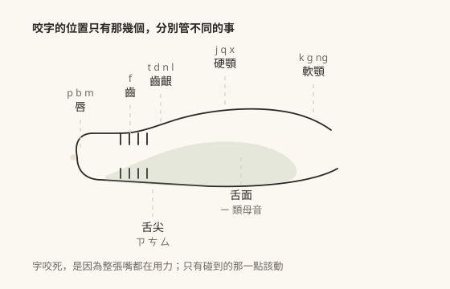
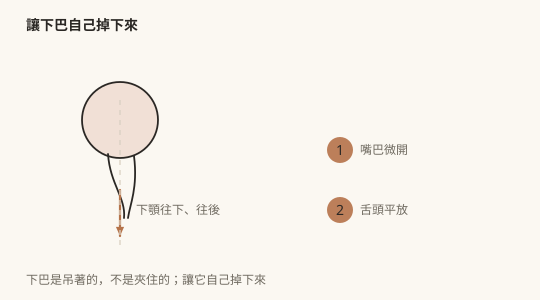

# [歌唱教學] 初階 第 7 章：咬字與發音：清晰傳達歌詞的第一步 (唇齒舌的基礎協調，不咬死字)

## 先講結論

字不清楚，通常不是咬得不夠用力，是你用下巴在咬。下巴一開一合，通道就跟著開開關關，氣流被切斷，聲音變扁、變累。

真正做咬字的是嘴唇、牙齒、舌頭和上顎。下巴的工作只有一個：保持通道打開。

這一章會讓下巴暫時停職，確認唇舌自己就能把字說清楚，再把子音輕巧地放回母音上。

## 常見誤解

很多人以為「唱清楚」就是把每個字咬得很重，像吵架一樣一字一頓。你試一次就知道：這樣唸，下巴會上下咀嚼，喉嚨也跟著緊。

其實子音只需要很短的一下，清楚來自位置對、時間準，不是力量大。子音太重，聲音會變成一顆一顆，旋律的線就斷了。

還有一個誤解是「字糊是因為嘴沒張開」。有時候剛好相反：嘴張得太大、下巴掉太多，舌頭反而來不及定位，字更糊。

## 原理：為什麼會這樣

中文的音節可以拆成兩部分：開頭的子音（聲母），和後面可以延長的母音（韻母）。像「想」是 ㄒ 加 ㄧㄤ，「愛」沒有聲母，直接從 ㄞ 開始。

子音是短暫的：用嘴唇閉合、舌尖頂住、氣流摩擦，一下就結束。母音是開口的：口腔形狀固定，氣流可以一直出來。所以你拉長音的時候，響的永遠是母音，子音只有一瞬間。這也是為什麼難唱的樂句，先把子音拿掉只唱母音，通常會馬上變順。

還有一個常被忽略的角色：ㄧ、ㄨ、ㄩ 這三個介音。它們是韻母的開頭，從子音滑向主母音，像一段過渡，不該被當成重重的子音來咬。

母音不能隨便唱，因為口腔形狀一改，聲音的頻譜就跟著改。研究量測歌唱音量變化時的聲道共鳴調整，發現這些調整是真實可測的動作，不只是「感覺」；換句話說，你改的是口腔與咽腔的形狀，不是用力的大小（Vurma, 2022）。而母音形狀也直接影響高頻能量怎麼分布，這也是為什麼同一個音，唱「阿」和唱「伊」聽起來亮度差很多（Lee et al., 2008）。

下巴為什麼不能參與？因為下巴連著顳顎關節，它一動，整個口腔後方也跟著動。你每咬一個字，通道就縮一下；連續幾個字下來，氣流被切成好幾段，聲音就沒有連貫的線。

## 打個比方

**河與落葉。** 母音是一條河，子音是河面上的落葉。落葉碰一下水面就過去，不會把河擋住。你如果拿刀往河裡砍，水花四濺，河也斷了。失真的地方是：落葉完全被動，子音需要準確的動作，你要的是輕而準，不是完全不做。

**蓋印章。** 章要蓋得清楚，靠的是位置對、力道剛好、一下就起來。你在紙上轉一圈壓實，字反而糊掉。

**鼓棒。** 鼓棒碰到鼓皮就離開，聲音是鼓皮自己響的。子音就是那一下接觸，響的是後面的母音。你把鼓棒壓在鼓皮上不放，鼓就不響了。

## 現在就做

### 練習一：下巴罷工

1. 食指輕抵下巴正下方，像一個監視器。
2. 嘴巴微開約一根半手指寬，保持不動。
3. 用這個嘴型慢慢唸一句歌詞，例如「我想我已經愛上你」。
4. 唸兩遍。

感覺：一開始像大舌頭，字有點糊，但嘴唇和舌頭很忙。做錯會怎樣：下巴還是上下動，就用食指稍微頂住，嘴型縮小一點；不要為了清楚而把下巴放出來。

### 練習二：只留母音

1. 把句子拆成母音：「我」留 ㄛ、「想」留 ㄧㄤ、「已」留 ㄧ、「經」留 ㄧㄥ、「愛」留 ㄞ、「上」留 ㄤ、「你」留 ㄧ。
2. 用平穩的氣把這串母音唱在旋律上。
3. 每個母音之間要滑過去，不能斷。
4. 唱三遍。有吸管的話，把這串母音做在吸管上，線條一斷你馬上會聽到（Guzman et al., 2013）。

感覺：聲音是一條連續的線，沒有頓點。做錯會怎樣：每個母音都重新起音、有「喀」的感覺，是氣流還沒穩聲帶就先猛然閉合，形成硬起音。讓氣流先於聲帶啟動，只換口腔形狀。

### 練習三：把子音放回去

1. 維持剛才母音的連續感。
2. 在每個母音前面，用嘴唇或舌尖輕輕碰一下子音。
3. 碰完立刻回到母音，不要停。
4. 唱三遍。

感覺：字變清楚了，但線沒有斷。做錯會怎樣：一放子音，下巴又開始咀嚼，就回到練習一，確認下巴的位置，再把子音減輕。

### 練習四：用在自己的歌上

1. 挑一段你覺得字很糊、或唱起來很卡的副歌。
2. 先只唱母音一遍。
3. 再把子音輕輕放回，唱一遍。
4. 比較兩次的下巴與喉嚨。

感覺：第二次應該比第一次清楚，但不比第一次緊。做錯會怎樣：加回歌詞就變緊，表示子音還是太重；把子音再減一半。

## 練完之後

做對的徵兆：字清楚，但句子是連的；唱快歌時下巴不會痠；同一句唱三次，聲音不會越唱越扁。

常見卡點是「為了清楚而變重」。清楚和重是兩件事，你可以小聲卻很清楚，也可以很大聲卻聽不懂，關鍵在子音的位置與時間。

另一個卡點是只練慢歌。慢歌給你時間把每個字慢慢做，快歌才是考驗；用同樣的母音河流方法練快句，效果更明顯。

下一章要進入共鳴。字放在對的空間裡，會比用力咬更容易被聽懂。

## 延伸查證

- **Vurma, A. (2022).** Amplitude Effects of Vocal Tract Resonance Adjustments When Singing Louder. *Journal of Voice.* 音量增加時，聲道共鳴的調整是可量測的動作，不只是「感覺」；改的是形狀，不是力氣。PMID 32624371。
- **Lee, S. H., Kwon, H. J., & Choi, H. J. (2008).** The singer's formant and speaker's ring resonance: a long-term average spectrum analysis. *Clinical and Experimental Otorhinolaryngology.* 母音與聲道形狀會改變高頻能量群（歌手共振峰約在 2.8–3.2 kHz 附近）。PMID 19434279。
- **Guzman, M., Laukkanen, A. M., & Krupa, P. (2013).** Vocal tract and glottal function during and after vocal exercising with resonance tube and straw. *Journal of Voice.* 吸管發聲對聲道與聲門的影響；拿它檢查母音線條有沒有斷，很好用。PMID 23683806。
