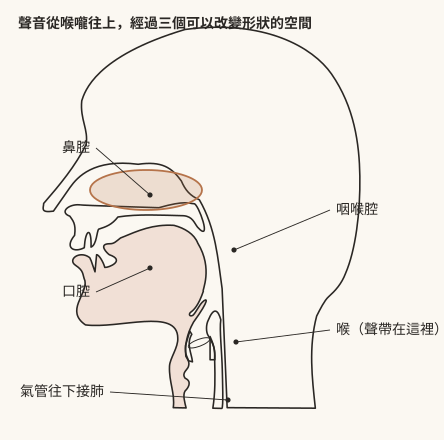
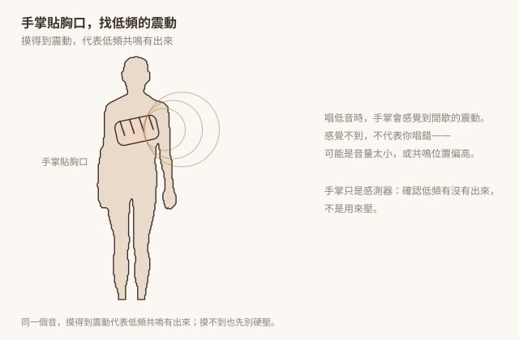

# [歌唱教學] 初階 第 8 章：尋找身體的天然音箱：什麼是共鳴？

## 先講結論

你唱歌的聲音不夠厚、不夠亮，通常不是聲帶有問題，是把聲音關在喉嚨裡。人體有幾個區塊可以幫聲音加分，位置擺對時，同樣的力道聽起來會大很多。

這一章要教你找到那幾個空間，並且用觸覺確認自己有沒有放對，而不是靠「我覺得有」。

練完你會感覺到的改變：唱同樣的音量，喉嚨比較不累；中低音變厚，高音變亮。

## 常見誤解

很多人以為聲音越大，就是喉嚨越用力，所以一唱不上去就開始擠。

其實剛好相反。聲帶自己發出的聲音非常小，像一根懸空的琴弦被撥一下，只有「叮」的一聲。你聽到的音量，是這個微弱的振動經過聲道與身體幾個空間修飾之後的結果。擠喉嚨不會讓通道變大，只會讓聲帶被夾住。

另一種誤解是「共鳴就是把聲音往某個地方推過去」。推不了。共鳴腔是被動的：你把喉嚨打開、把位置擺對，振動自然會在那裡放大；擺錯地方，它就縮回去。

## 原理：為什麼會這樣

聲音在三個區域被修飾，各自偏重的頻段不太一樣：

- **胸腔**：低音時，聲帶的振動沿著氣管與胸壁傳上來，手掌摸得到。教學上叫它胸腔共鳴，但肺不是一個共鳴箱；這股震動主要是觸覺，不是空腔在放大。
- **咽喉腔**：聲帶到口腔之間這段。它最有彈性——喉結高低、舌根鬆緊都會改變它的大小，所以對音色的影響最大。
- **鼻腔與頭部空腔**：兩眼之間、上顎上方與鼻咽一帶。鼻腔會加入一點低頻色彩，也修飾中高頻泛音。

三區不是分開工作，而是同時參與，只是比例不同。中低音時胸口的震動感多一些，高音時臉上的震動感多一些。控制比例的方法不是「用力往哪裡送」，而是調節通道：喉嚨放鬆、嘴巴形狀改變、軟顎抬起或放下。

那股「亮」是從哪裡來的？很大一部分來自喉嚨上方、會厭周圍那一小段通道收窄。管腔變小、形狀對了，高頻能量會聚成一群，量測上就是所謂的歌手共振峰（Lee et al., 2008）；用電腦模型改變會厭腔的形狀，也確實能把這群能量調得更集中（Vampola et al., 2024）。所以亮不是用力擠出來的，是把通道形狀調對。

這裡有個地方要小心：「頭腔共鳴」不是真的在頭骨裡放大聲音。頭骨不是琴箱，裡面的鼻竇對放大也很有限。內視鏡研究顯示，古典唱法說的「頭聲」，對應的是聲道形狀的改變（Aura et al., 2022）。你感覺到的「聲音在頭上」是振動感，不是有一個空腔在運作。

## 打個比方

**吉他琴身。** 琴弦懸空拉緊再撥，聲音很小；裝進木箱裡，同樣的振動會大很多。差別不在弦，在箱。失真的地方是：吉他的箱子是固定的，人的聲道會隨吞嚥、音高、母音一直改變形狀。

**燈罩。** 同一個燈泡，裝上燈罩不會變得更亮，但光會集中到你需要的方向。共鳴做的是這件事：改變能量的分布，不是無中生有。

**把水管口壓小。** 手指把出水口壓窄，水柱變細，卻射得更遠。咽部收窄就是這個動作，只是你要壓的是通道形狀，不是喉嚨的力氣。

## 現在就做

### 練習一：先證明「共鳴比用力有效」

1. 微微張嘴，用平常說話的音量發一個「啊」，喉嚨保持鬆。
2. 用同樣的音量、同樣的高度再發一次，這次把嘴巴張大、下巴放鬆往下，像打哈欠的開頭。
3. 比較兩次。第二次音量應該差不多，但聲音明顯更厚、更開。

做錯會怎樣：如果第二次是靠喉嚨用力「撐」出來的，聲音會變緊、喉嚨會癢。那就停下來，先只做嘴巴的動作，不要加力氣。

### 練習二：找到胸腔的振動

1. 手掌平放在胸口中央。
2. 閉著嘴巴發「嗯」，音高比說話再低一點。
3. 慢慢把音壓低，直到手掌感覺到明顯的振動。
4. 記住這個音高，這是你胸口震動最明顯的位置。

做錯會怎樣：若你為了壓低而用力擠、脖子變粗，代表音高已經低過你能放鬆唱的位置。往上退半個音再試。

### 練習三：找到鼻腔的振動

1. 一手輕碰鼻梁兩側，不要捏緊，只是碰著。
2. 發「ㄇ——」的長音，像小孩子撒嬌抱怨的聲音。
3. 你會感覺鼻梁在麻、在振動。
4. 保持這個感覺，把嘴巴張開變成「ㄇㄧ——」，音高不變，再放掉手，感覺應該還在。

做錯會怎樣：如果鼻音重到聽起來像感冒，是因為嘴巴幾乎沒開。嘴開大一點，讓鼻腔和口腔一起工作，才不會悶。

### 練習四：把兩區接起來

1. 從練習二的低音「嗯」開始，放在胸口。
2. 用滑音慢慢往上，嘴巴同時從閉口慢慢張開成「啊」。
3. 感覺振動從胸口慢慢移動到臉上。
4. 到最高音時停住，再滑回來。

做錯會怎樣：中間若出現「喀」一聲斷掉，就是喉嚨在中途鎖住了。不要加速衝過去，停在那個音高，用很輕的氣反覆滑，讓它習慣。

## 練完之後

做對的徵兆：同一個音，你不需要比以前更用力，聽起來就已經比較飽滿；唱完之後喉嚨是鬆的，不是熱的。

常見卡點：很多人練到一半會開始「表演」，音量越唱越大，結果又回到擠喉嚨。練習時刻意保持小聲，是為了把注意力放在振動的位置，不是音量。

另一個卡點是把「厚」和「大」混在一起。厚度是低頻成分與穩定氣流，音量是另一件事；你可以用聊天的音量唱得很厚，也可以很大聲卻很薄。

下一章要談胸腔共鳴本身：怎麼讓中低音站得住、有厚度，而不是虛虛的。

## 延伸查證

- **Lee, S. H., Kwon, H. J., & Choi, H. J. (2008).** The singer's formant and speaker's ring resonance: a long-term average spectrum analysis. *Clinical and Experimental Otorhinolaryngology.* 歌手共振峰（約 2.8–3.2 kHz 附近的能量群）可以用長期平均頻譜量測出來。PMID 19434279。
- **Vampola, T., Horáček, J., & Laukkanen, A. M. (2024).** Three-Dimensional Finite Element Modeling of the Singer's Formant Cluster Optimization by Epilaryngeal Tube Shaping. *Journal of Voice.* 用電腦模型證明：會厭腔那一段的形狀，會影響高頻能量群集中與否。PMID 39218756。
- **Aura, M., Geneid, A., & Bjørkøy, K. (2022).** A Nasoendoscopic Study of "Head Resonance" and "Imposto" in Classical Singing. *Journal of Voice.* 內視鏡觀察顯示「頭腔共鳴」是聲道形狀改變，不是聲音在頭骨裡放大。PMID 32513553。
