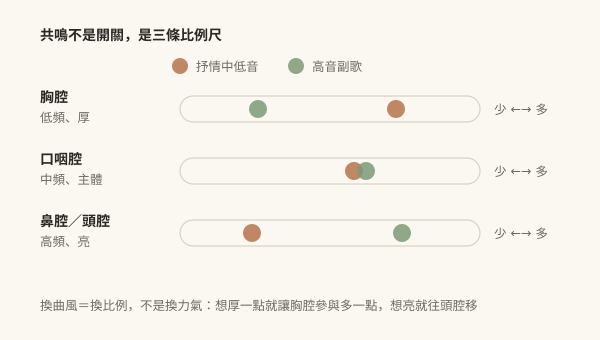
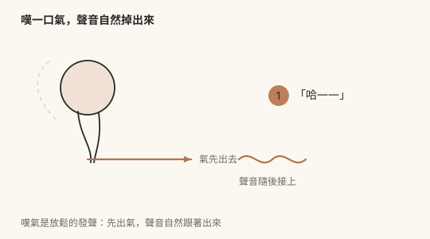
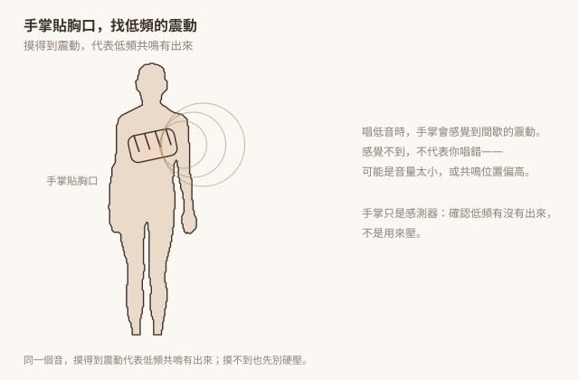

# [歌唱教學] 初階 第 9 章：流行歌的基底：溫暖的胸腔共鳴初探 (如何唱出厚實、具治癒感的中低音)

## 先講結論

流行歌的主歌大多落在中低音，這裡需要的不是大聲，是厚度與靠近感。

很多人唱低音時把下巴往脖子裡擠，以為這樣聲音會低。結果通道被壓扁，聲音變悶、變硬，音高還沒有真的下去。

這一章要讓你在不壓喉嚨的情況下找到胸口的振動，並把它帶進歌詞裡。

## 常見誤解

很多人以為「低音就是把聲音壓下去」。音高變低，是聲帶變厚變短、振動變慢，不是把喉嚨壓扁。你壓得越用力，聲帶越沒彈性，低音反而下不去，還會痛。

也有人以為「胸腔共鳴就是把聲音打到胸口」。共鳴腔不會被「打」，它是被動的。你放鬆、把通道打開，低頻成分比較不會被吃掉，手掌才摸得到那股震動。

## 原理：為什麼會這樣

聲帶振動產生一整排頻率成分：基頻加上它的諧波。基頻越低，諧波排得越密，落進人耳敏感那一段的成分就越多，聽起來就厚。這是低音聽起來「有東西」的第一個原因，跟音量無關。

第二個原因是共振峰的位置。你改變口腔與咽腔的形狀，會把某些頻段的能量拉高、某些壓低，這件事在音量變化時也量得出來（Vurma, 2022）。中低音要厚，靠的是通道形狀讓低頻成分活下來，不是靠推。

要再強調一次：胸腔不是真正的共鳴腔。你手掌感覺到的震動，主要是聲帶振動沿著氣管與胸壁組織傳導過來的觸覺，不是空腔在放大。這個觸覺很好用，它是儀表板，但不要把它當成一個獨立的音箱。

厚度和音量也是兩件事。你可以用聊天的音量唱出很厚的聲音，差別在振動的位置與氣流的穩定，不在大小聲。

還有一個跟麥克風有關的現象：靠近麥克風唱低音時，麥克風會多收一點低頻，這是近接效應，會讓聲音聽起來更近、更厚。那是錄音端的幫助，不能拿來代替共鳴；反過來說，如果你的低音只有靠麥克風才厚，拿開麥克風就會露出來。

姿勢仍然是前提。頭在肩膀正上方、下巴不往內擠，氣管才是直的。你把脖子折起來，聲道被壓扁，低頻成分再怎麼想維持也維持不住。

## 打個比方

**大鼓與小鼓。** 鼓面大、繃得鬆，聲音就低；鼓面小、繃得緊，聲音就高。同一副鼓，你不需要更用力打才會低，你需要的是不同的鼓面。聲帶變厚變短就是換鼓面。

**密一點的階梯。** 基頻低，諧波就像間距更小的階梯，同樣一段高度裡可以塞進更多階。人耳敏感的那一段被填得越滿，聲音就越厚。

**貼著耳朵說話。** 同一個人、同一句話，靠近你耳邊講就是比較厚、比較近。麥克風的近接效應就是這個效果；但真實世界的厚度，還是得從你自己的聲道來。

比喻失真的地方是：鼓皮不會自己調整，聲帶會。所以你不能「固定一個形狀唱到底」，要隨音高與母音微調。

## 現在就做

### 練習一：嘆息起音

1. 站直，一隻手平貼胸骨中央。
2. 吸氣，發一個比說話再低一點的「哈——」。
3. 不要用力，像嘆氣一樣讓氣自己出來。
4. 做五次，每次四秒。

感覺：手掌有輕微的震動，喉嚨不擠。做錯會怎樣：如果為了壓低而把下巴往下、脖子變粗，代表你已經低過能放鬆的位置。往上退半個音，再試。

### 練習二：牛叫「哞」

1. 閉唇、牙齒微張，下巴保持鬆。
2. 發低沉的「哞——」，像安靜的老牛。
3. 手放胸口，找震動最明顯的音高。
4. 做五次。

感覺：胸口發麻，聲音不費力。做錯會怎樣：如果「哞」變成喉嚨裡的擠壓聲，先把音量減半；如果找不到震動，手換到胸骨上方一點，再把音高降低一個半音試試。

### 練習三：廣播 DJ 朗讀

1. 挑一段你唱起來輕飄飄的主歌歌詞。
2. 手放胸口，用深夜廣播的語氣慢慢唸。
3. 每個字都要讓胸口有一點震動。
4. 唸兩遍。

感覺：像說話，但聲音有重量。做錯會怎樣：如果唸到一半震動消失，是聲音飄回喉嚨了。放慢、把句子縮短，先唸半句。

### 練習四：加上旋律

1. 保持剛才的胸口振動。
2. 照旋律唱，母音拉長，子音輕輕帶過。
3. 告訴自己：這是有高低起伏的說話，不是表演。
4. 唱兩遍。

感覺：低音不費力，句子有連貫。做錯會怎樣：一加旋律就變緊，先把旋律簡化成兩三個音，確認振動還在，再回到原旋律。

### 練習五：氣泡音點綴

1. 放鬆下巴，發一個很小聲、很低的「啊」。
2. 把氣流減到很少，讓聲音變成一顆一顆：「啊、啊、啊、啊」。
3. 維持三秒，做三次。

感覺：聲帶很鬆，像摩托車怠速。做錯會怎樣：如果喉嚨開始癢或想咳，是氣流太猛或音高太低。把氣再減小，或往上一點；不舒服就停。

氣泡音在教學上常被當成低張力的暖聲動作，它讓聲帶在很低的壓力下輕輕振動（Elias et al., 2016）；吸氣方向的氣泡音也有人用在嗓音治療與教學（Paolillo et al., 2021）。要用在歌裡時，只在句首的第一個字輕輕點一下，然後馬上滑進正常的聲音，不要整句都用。

## 練完之後

做對的徵兆：同樣的音量，主歌聽起來比較厚；手放胸口能感覺到穩定振動；唱完低音喉嚨不痠。

常見卡點是「越唱越低」。為了追求厚度，音高不知不覺往下掉，最後低到沒聲音。練習時開著伴奏或琴音對音高，不要只憑感覺。

另一個卡點是把氣泡音當特效猛用。它在句首偶爾出現很有效，整首都是會讓聲音變濁、氣流不穩。

下一章要往上走，處理高音需要的鼻腔與頭部共鳴。

## 延伸查證

- **Elias, V. S., Cielo, C. A., & Jotz, G. P. (2016).** Effect of Vocal Fry on Voice and on Velopharyngeal Sphincter. *International Archives of Otorhinolaryngology.* 氣泡音（vocal fry）對嗓音與共鳴的立即影響，是低張力振動的實測。PMID 27096021。
- **Paolillo, N. P., Carrozza, L., & Osio, M. (2021).** Inspiratory Vocal Fry: Anatomical and Physiological Aspects, Application in Speech Therapy, Voice Therapy and Singing Pedagogy. *Journal of Voice.* 氣泡音有呼氣與吸氣兩個方向，兩者在治療與歌唱教學上的用途不同。PMID 31708370。
- **Vurma, A. (2022).** Amplitude Effects of Vocal Tract Resonance Adjustments When Singing Louder. *Journal of Voice.* 聲道共鳴的調整是可量測的動作；厚度來自形狀與能量分布，不是力氣。PMID 32624371。
